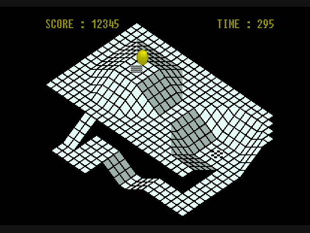
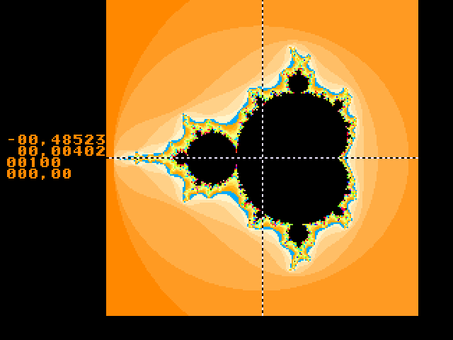
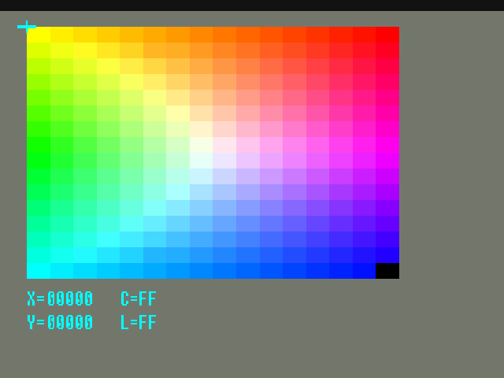

# vjag

An Atari Jaguar emulator written in [V](https://vlang.io).


The Jaguar is an odd machine: a Motorola 68000 that mostly gets out of the way, two custom RISC processors (one for graphics, one for sound), a display-list chip that rewrites its own list while it draws, and a blitter with more mode bits than documentation. vjag emulates all of it in about 14,000 lines of V, with no C emulation cores underneath. SDL3 only puts the picture in a window and the samples in the speakers.

<p>
  
  
</p>
<p>
  
  
</p>

Screenshots are from public-domain homebrew. No ROMs or boot ROM images come with this project; bring your own.

## Where it stands

It boots and plays a lot. A sweep over a private collection of 139 cartridge dumps and homebrew programs gives:

| Result after 15 seconds of emulated time | Images |
| --- | ---: |
| Animated picture | 118 |
| Static picture | 4 |
| Blank screen | 11 |
| 68000 ended up outside any program | 5 |
| Refused by the loader | 1 |

Most of the blank ones are tools that draw nothing by design, or dumps that are damaged. The crashes are real bugs.

"Animated" means pixels moved, not that the game is right. From looking at the pictures: 3D titles render their worlds, 2D titles scroll and animate, menus respond to the pad, and music plays. Known problems include one racing game that crashes its sound driver after about 13 seconds, a few demos that fall over on scaled sprites, and whatever nobody has played far enough to find.

Things that are honestly not done yet:

- **Boot ROM.** Everything starts by direct boot: the cartridge runs with the video timing the boot ROM would have left behind. Loading a real boot ROM is not wired up.
- **Blitter timing.** A blit finishes the instant it is started. Results are exact pixel for pixel in the tested modes, but software can never catch the blitter busy.
- **Cycle accuracy.** The 68000 counts cycles correctly; the RISC processors use rough per-instruction costs. The profile is called `functional_v1` so nobody mistakes it for more.
- **Save states, input recording, Jaguar CD.** Cartridge EEPROM saves work and persist between runs.
- **Wavetable ROM.** The eight waveforms in JERRY are generated, not dumped, so software that plays them sounds close but not identical.

## Run it

You need V 0.5.2, SDL3 and [just](https://github.com/casey/just). On macOS:

```sh
brew install vlang sdl3 just
just run path/to/game.j64
```

`just` on its own lists every recipe. The ones you will use:

```sh
just run game.j64        # optimized build, then play
just dev game.j64        # debug build with runtime checks
just test                # all unit tests
just install             # copy vjag and vjag_test to ~/.local/bin
just benchmark game.j64  # how fast it runs flat out
```

`just run` with no image opens an empty window; drop an image on it to start. Drop another one at any time to switch games. Saves land in your data directory, keyed by the content of the image, so renaming a file keeps its save.

### Controls

| Jaguar | Keyboard | Gamepad |
| --- | --- | --- |
| D-pad | Arrow keys | D-pad |
| C, B, A | Z, X, C | West, South, East |
| Pause | Enter | Start |
| Option | Tab | Back or North |
| Keypad 0-9 | 0-9 | |
| Keypad `*` and `#` | `-` and `=` | Left and right shoulder |

| Emulator | Key |
| --- | --- |
| Pause emulation | P |
| Reset | F5 |
| Fullscreen | F11 |
| Mute | M |
| Status overlay | F1 |
| Screenshot | F12 |
| Fast-forward (hold) | `` ` `` |
| Quit | Esc |

### Images it understands

Raw cartridges, Jaguar Server executables (`JAGR` types 2 and 3), DRI/Alcyon ABS, COFF, and headerless binaries. The loader looks at the bytes, never at the file extension. For headerless binaries it scores a short list of load addresses by how many absolute jumps land inside the image; when it guesses, it says so, and you can override it:

```sh
vjag demo.bin --format raw --load-address 0x4000 --entry 0x4000
vjag inspect demo.bin        # show what the loader would do, without running
```

## The headless tools

`vjag_test` is the same emulator without a window. It links without SDL, so it should build wherever V does; so far only macOS has been tried.

```sh
vjag_test run game.j64 --frames 600 --screenshot shot.png --wav sound.wav
vjag_test compat roms/ --frames 900 --report-json out/compat.json --screenshots out/shots
vjag_test bench game.j64 --frames 1200
vjag_test trace game.j64 --cpu dsp --tail 80
```

`trace` is the one that earns its keep. It single-steps the machine, keeps the last instructions of one processor in a ring, and stops when something interesting happens: the DSP wanders out of its RAM, the 68000 jumps into the vector table, a memory location changes. Then it prints the ring as a disassembly. Most of the bugs fixed so far were found this way.

```sh
vjag_test trace game.j64 --cpu m68k --stop-range 0x0:0x400   # who jumped into the vectors?
vjag_test trace game.j64 --cpu m68k --watch 0x4912           # who overwrote this?
vjag_test run game.j64 --frames 300 --dump                   # processors, video registers, display list
vjag_test run game.j64 --watch-io 0xf1a100:0xf1a120          # every write to the DSP control registers
vjag_test run game.j64 --frames 900 --press b@600 --press left@700+30 --screenshot shot.png   # scripted pad input
```

## How it is put together

```
hwtypes/   the bus interface and a few shared types; depends on nothing
m68k/      Motorola 68000
risc/      the GPU and DSP: one instruction format, two opcode maps
tom/       video timing, object processor, blitter, CRY colour
jerry/     timers, serial audio, controller matrix, wavetable
cart/      cartridge EEPROM
loader/    image detection and validated load plans
machine/   memory map, scheduler, interrupt wiring
debug/     disassemblers and read-only inspection
cli/       headless commands
host/sdl/  window, audio stream, input
cmd/       vjag (desktop) and vjag_test (headless)
```

Processors and devices only know the `Bus` interface from `hwtypes`. `machine` owns them all and is the bus. Nothing below `cli` touches a file, a clock or SDL, and the core does not allocate while it runs: a ten-second benchmark allocates about 12 KB in total.

All three processors share one timeline counted in ticks of the 26.59 MHz master clock. The scheduler runs each processor for at most 64 ticks, or up to the next device event, before the others catch up, so a mailbox written by the 68000 is seen by the DSP a few microseconds later, not a frame later.

On an M2 Max a simple homebrew program runs at about fourteen times real speed, and a commercial game that keeps both RISC processors busy at about four times.

## Tests

```sh
just fetch-tests   # once: downloads the 68000 corpus (MIT) into data/tests
just test
```

- **68000:** every case of [SingleStepTests/m68000](https://github.com/SingleStepTests/m68000) matches on registers, memory, cycle count and bus order. 317,500 of 317,500, no exclusions. Without the corpus the test says it was skipped.
- **Devices:** the object processor, blitter, RISC cores, EEPROM, controller matrix and timers have unit tests that check exact memory and register results.
- **Whole machine:** small hand-assembled programs boot through the real loader, run on the 68000, hand work to the GPU and publish a result word.
- **Loader:** synthetic fixtures for every format and every way a file can be truncated or lie about itself.

## Credits

Built from the Atari Jaguar Technical and Software Reference manuals and the original hardware errata. The CRY colour tables are hardware data, tabulated in MAME's Jaguar driver (BSD-3-Clause). The 68000 corpus is the work of the SingleStepTests project. Virtual Jaguar and BigPEmu showed what was possible.

## Licence

MIT. See [LICENSE](LICENSE).
