# Demos

Programs written with [`jagkit`](../jagkit/README.md). Each directory is a V program that writes the `.jag` file next to it, and has a test that boots that image in the emulator and uses it.

```sh
just run demos/maw.jag        # run an image that is already built
just demo maw                 # rebuild it from its V source first
v -prod test demos/maw/       # its test
just roboplay ghostgrid       # watch its test's robot play it, where it has one
```

`just roboplay` opens the app on the image with `--press-file demos/<name>/roboplay.press`, the robot's pad written down frame by frame; the demo's test plays that file on a fresh machine and checks the robot's result, so it stays in step with the game.

- `ghostgrid`: DEPOT, ARCHIVE, SPRINT and ANNEX one after the other from the title, each unseen with an S. `GHOSTGRID_ROBOPLAY=1 v -prod test demos/ghostgrid/roboplay_test.v` plans them again and rewrites the file.
- `hero`: the finale from the title, every note a perfect. `HERO_ROBOPLAY=1 v -prod test demos/hero/` rewrites the file; the test fails when it differs from what the robot presses now.

| Demo | What it is | Size | Controls |
|---|---|---|---|
| [`hello`](hello/main.v) | the smallest complete program: text, a ball, a beep | 4 KB | arrows move; Z, X, C beep |
| [`hello2`](hello2/main.v) | `hello` again, written with [jaggame](../docs/jaggame/guide.md) and no assembly, plus a spinning coin, a scaled and a flipped sprite, and counting numbers | 13 KB | arrows move; Z, X, C beep |
| [`ghostgrid`](ghostgrid/main.v) | **complete.** GHOSTGRID, a stealth trainer written with [jaggame](../docs/jaggame/guide.md) and no assembly: ten short missions of four kinds (sneak, collect data chips, beat the clock, rooms joined by doors), each a map and a row of a table. Guards with a state machine (patrol, suspicious, alert, search, return) throw a cone of amber light on the floor that walls cut and that is exactly what sees you; cameras sweep cones of their own and call the guards. You walk, run (guards hear it), crouch behind cover (guards cannot see you there, cameras can) and knock on a wall. A title over a GPU-drawn backdrop, a mission select with a rank and a best time for each mission, a briefing, a pause menu, scenes that fade through black, music that goes from calm to alert, sound effects, and a result screen with a rank and a medal; the records and the missions that are open are kept on the cartridge EEPROM. Art is made by [a small program](ghostgrid/art/make_art.v) and imported from PNG | 450 KB (`.jag`; `ghostgrid.j64` is the cartridge image for a board with an EEPROM) | menus: arrows, Z or Enter chooses, X back; in the mission arrows move; Z run, X crouch, C knock; Enter pauses; Z, X, C and Enter together go back to the title |
| [`plasma`](plasma/main.v) | a first GPU program: three waves, one picture a frame | 2 KB | none |
| [`wirewing`](wirewing) | a wireframe flying game | 8 KB | left and right bank, Down climbs, Up dives; Z, X, C start |
| [`maw`](maw) | a tunnel flyer | 438 KB | left and right turn the tunnel; Z, X, C start |
| [`hero`](hero) | a five-lane rhythm game | 506 KB | 1 to 5 play the lanes; Enter pauses, Tab goes back |

`hello` and `plasma` are the examples the [guide](../docs/jagkit.md) walks through. Keys are the emulator's defaults; on a pad the fire buttons are A, B and C.

All of them handle NTSC and PAL, and all run in this emulator and in Virtual Jaguar (`scripts/crosscheck/run.sh`). None has run on real hardware.

## GHOSTGRID

<p>
  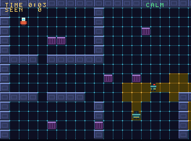
  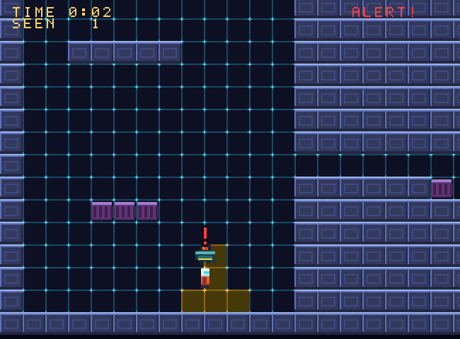
</p>

<p>
  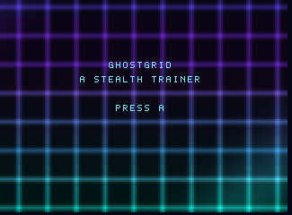
  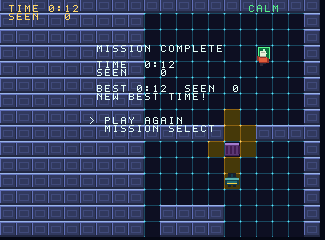
</p>

GHOSTGRID is an original stealth trainer, written on jaggame one slice at a time and finished in the sixth. The red and white figure is you; the broad teal ones with the red lens are guards, the lens is on the side they look to, and the amber floor is what they see; a camera on a pillar throws a cone of its own that sweeps. Ten missions: DEPOT, VAULT and FOUNDRY are sneak missions (reach the green pad unseen), ARCHIVE and STACKS ask for every data chip first, SPRINT, DASH and GAUNTLET run a countdown, ANNEX and CROSSING have two rooms. A mission earns S, A, B or C from its time, the times you were seen and the alerts you caused, and finishing one opens the next. [Chapter 3 of the guide](../docs/jaggame/guide.md#chapter-3-assets-rooms-and-collision) walks through the figure and the room, [chapter 4](../docs/jaggame/guide.md#chapter-4-state-machines-actors-and-guards) through the guards, [chapter 5](../docs/jaggame/guide.md#chapter-5-scenes-menus-sound-save-data-and-the-backdrop) through the scenes, the sound and the save, and [chapter 6](../docs/jaggame/guide.md#chapter-6-missions-as-data-cameras-ranks-and-the-record) through the missions, the cameras, the ranks and how the whole game is put together.

Its tests: a robot that searches for a way through each mission that no guard or camera sees plays all ten on NTSC and PAL from the title screen, through the menus, to the result, and the rank, the time and the saved record are checked; the interpreter plays whole missions of each kind alongside the machine and the two agree frame by frame; there is a test for each rule (caught, heard, knocked, hidden, a camera's call, chips, doors, the countdown, the ranks, the record, an old or damaged save) and the worst frame of every room is measured (under 60% of a frame, no frame missed). It runs in Virtual Jaguar with the same picture: the robot's run of the first two missions was replayed there and the record it wrote is the same in both chips.

<p>
  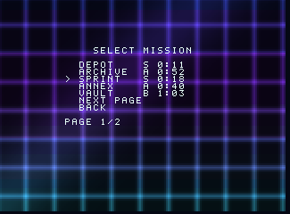
  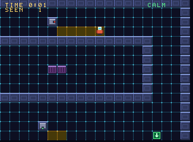
</p>

## MAW

<p>
  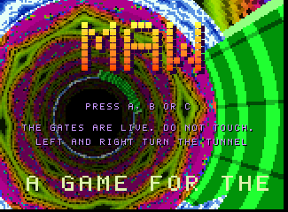
  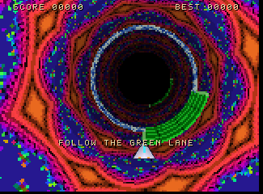
</p>

MAW is a tunnel flyer with a psytrance habit. Left and right turn the tunnel; follow the green lane through each gate, because the rest of the gate is live. The GPU draws the tunnel from a lookup table: a Julia set folded into a kaleidoscope for a wall, a palette that turns while you fly, fog, and a window on the table that wanders so the tunnel swerves. A gate is a few rings of the wall repainted with lightning every other frame. The DSP is a three-voice synthesizer and the 68000 runs the rules and the tune: 150 beats a minute, kick, rolling bass, acid line. Its test plays the game: it boots the image in the emulator, reads the game's variables through the assembler's symbol table and steers.

## WIREWING

<p>
  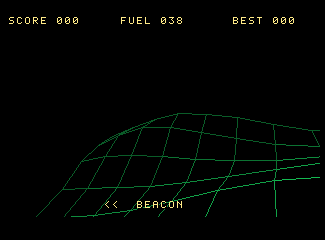
  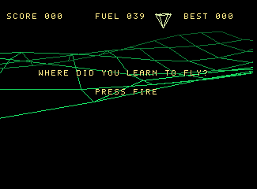
</p>

WIREWING is a wireframe flying game. Bank with left and right, pull back to climb, fly through the spinning beacons before the tank is dry. The GPU projects the corners of a rolling landscape around the eye, with perspective, bank and distance shading, and joins them with lines it draws itself, sixty pictures a second. Fly into a hill and the onboard computer has a remark ready. Its test flies it: an autopilot collects beacons, a dive ends in the ground, an empty tank ends the flight.

## Jaguar Hero

<p>
  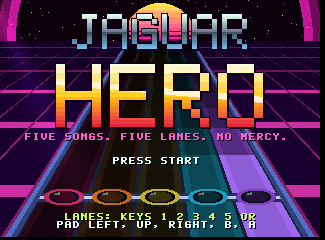
  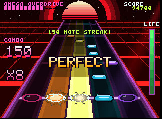
</p>

Jaguar Hero is a five-lane rhythm game. Five original songs, from a 113 BPM synthwave anthem to a 180 BPM finale, are written as patterns in `songs.v` and played by a ten-voice DSP synthesizer with drums, bass, distorted rhythm guitar, keys, twin leads and a stereo echo. Each chart is derived from the song's lead guitar, so what you press is what you hear: miss a note and the guitar drops out. Play the lanes with keys 1 to 5 (or Left, Up, Right, B, A on a pad), pause with Enter. Its test has a robot read the chart out of memory and play the finale perfectly inside the frame budget.

| Song | Style | BPM |
|---|---|---|
| MIDNIGHT ENGINE | synthwave anthem | 113 |
| COLOSSUS | heavy half-time | 129 |
| IRON GALLOP | galloping rock | 150 |
| NEON SERAPH | neo-classical shred | 150 |
| OMEGA OVERDRIVE | frantic finale | 180 |

## PAL

Anything counted in frames runs a sixth slower at 50 Hz. The tunes are corrected: MAW plays a step every five frames instead of six, and Jaguar Hero advances the song twice on every fifth frame. Movement is not: MAW's tunnel and WIREWING's plane are a sixth slower on a PAL machine.
