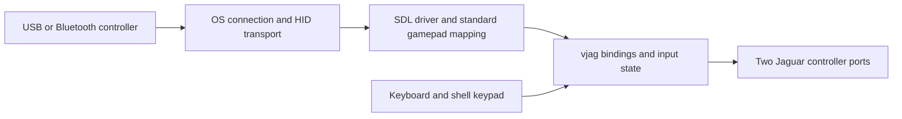

# Gamepad support research

Research date: 2026-11-17. This is a documentation and source review, not a
physical-controller test. The locally installed SDL is 3.4.18; SDL source links
below are pinned to that release.

The proposal below records the initial research. Its software implementation is
now present; see [controller setup](controllers.md) and the validation record
at the end of this document. Helge subsequently confirmed Xbox 360 wireless
controller operation on macOS; physical Sony-controller compatibility remains
unverified.

## What the host and SDL are responsible for

Bluetooth pairing belongs to the operating system. The emulator should not
implement Sony's pairing or raw Bluetooth protocol: once the OS exposes a HID
device, SDL translates it into its portable gamepad API. USB HID, classic
Bluetooth HID, and Bluetooth Low Energy's HID transport are separate host
transports; Windows documents in-box support for all three
([Microsoft](https://learn.microsoft.com/en-us/windows-hardware/drivers/hid/hid-transports)).
The application must therefore neither assume that every Bluetooth gamepad is
BLE nor inspect radio packets. It consumes the OS-provided HID device and lets
SDL select the suitable driver.

SDL's gamepad API deliberately sits above its raw joystick API. A raw joystick
has numbered controls; a gamepad mapping assigns those controls to semantic
locations such as south face button, d-pad, shoulders, and triggers. SDL loads
many mappings itself, allows application-supplied mappings, and asks programs to
support hotplugging ([SDL gamepad overview](https://wiki.libsdl.org/SDL3/CategoryGamepad)).
This is the right abstraction for Jaguar controls. It makes PlayStation labels
and Xbox-style labels converge before the emulator sees them.

SDL emits gamepad-added events for recognised controllers already connected when
`SDL_Init(SDL_INIT_GAMEPAD)` runs, as well as for later connections. The event
contains a joystick *instance ID*, not a durable device index
([SDL_GamepadDeviceEvent](https://wiki.libsdl.org/SDL3/SDL_GamepadDeviceEvent)).
The instance ID therefore belongs in the open-device and disconnect bookkeeping;
it must not be persisted as a controller preference.

For an otherwise unknown HID device, SDL can load a mapping database or a
user-created mapping. A later mapping overrides an earlier one for the same
GUID, is platform-specific, and causes an added event for a newly recognised
already-connected pad ([SDL_AddGamepadMappingsFromFile](https://wiki.libsdl.org/SDL3/SDL_AddGamepadMappingsFromFile)).
That supports generic controllers without guessing that arbitrary raw button 0
means Jaguar A.

## Current emulator baseline

The frontend already initialises `SDL_INIT_GAMEPAD`, opens the first two SDL
gamepads, maps standard d-pad, three face positions, Start/Back and shoulders,
and forwards button events to Jaguar ports 0 and 1 ([input.v](../host/sdl/input.v)).
This should work for a controller that the OS and SDL already recognise, over
USB or Bluetooth. It is not yet full controller support: analogue-stick and
trigger events are ignored; most of the Jaguar keypad is unavailable from a
pad; a third gamepad ignored while both ports are occupied is not reconsidered
when a port becomes free; and disconnecting one device produces a frontend-wide
focus-loss event. These are application integration gaps, not evidence of a
Sony HID protocol problem.

## PlayStation controllers

| Controller | Host connection facts | What SDL 3.4.18 does | Confidence and limit |
| --- | --- | --- | --- |
| DualShock 3 / Sixaxis (PS3) | Older Bluetooth behaviour is vendor-specific enough that pairing and driver availability must be checked on each host. SDL's PS3 driver does switch an already-connected Bluetooth device into report mode, but that is not host pairing. | SDL's PS3 HIDAPI driver supports Sony DS3 and ShanWan IDs. Its default is **on on macOS**, **off on Windows**, and **off on Linux**. Windows has a separate, opt-in `sixaxis.sys` path; on Linux SDL says kernel drivers manage the USB/Bluetooth transition better. [Source](https://github.com/libsdl-org/SDL/blob/release-3.4.18/src/joystick/hidapi/SDL_hidapi_ps3.c#L102-L126), [Bluetooth report mode](https://github.com/libsdl-org/SDL/blob/release-3.4.18/src/joystick/hidapi/SDL_hidapi_ps3.c#L181-L185), [Windows sixaxis path](https://github.com/libsdl-org/SDL/blob/release-3.4.18/src/joystick/hidapi/SDL_hidapi_ps3.c#L1123-L1129). | Do not promise plug-and-play Bluetooth DS3 on Windows or Linux. On macOS, SDL's own source says its driver works well, but this still needs a real-device test. The exact PS3 pairing procedure is host-stack-dependent and intentionally out of scope for vjag; a wired DS3 is the diagnostic fallback. |
| DualShock 4 (PS4) | Sony documents Bluetooth pairing with **Share + PS**, then selection in the host Bluetooth settings. It lists macOS Catalina or later for Bluetooth/USB use. [Sony](https://www.playstation.com/en-my/support/hardware/ps4-pair-dualshock-4-wireless-with-pc-or-mac/). | SDL has a PS4 HIDAPI driver enabled through the normal HIDAPI default and distinguishes Bluetooth from USB, including enhanced reports, serials, calibration and optional effects. [Driver](https://github.com/libsdl-org/SDL/blob/release-3.4.18/src/joystick/hidapi/SDL_hidapi_ps4.c#L201-L204), [Bluetooth handling](https://github.com/libsdl-org/SDL/blob/release-3.4.18/src/joystick/hidapi/SDL_hidapi_ps4.c#L321-L341). | Normal buttons are the only requirement for vjag. Touchpad, motion, light bar and rumble are optional capabilities and must not be prerequisites. Sony itself notes Bluetooth feature limits outside its supported platforms. |
| DualSense / DualSense Edge (PS5) | Sony documents USB and Bluetooth on Windows 10/11 and macOS Big Sur 11.3 or later; pairing mode is **Create + PS**. [Sony support](https://www.playstation.com/en-gb/support/hardware/pair-dualsense-controller-bluetooth/). | SDL has a PS5 HIDAPI driver enabled through the normal HIDAPI default. It detects USB versus Bluetooth reports and handles enhanced Bluetooth reports, including the protocol's output-report CRC. [Driver](https://github.com/libsdl-org/SDL/blob/release-3.4.18/src/joystick/hidapi/SDL_hidapi_ps5.c#L284-L287), [connection modes](https://github.com/libsdl-org/SDL/blob/release-3.4.18/src/joystick/hidapi/SDL_hidapi_ps5.c#L405-L435), [Bluetooth CRC](https://github.com/libsdl-org/SDL/blob/release-3.4.18/src/joystick/hidapi/SDL_hidapi_ps5.c#L1115-L1121). | vjag needs only the common gamepad controls. Adaptive triggers, advanced haptics, speaker/microphone, touchpad and gyro should remain out of scope initially; Sony documents that availability varies by platform and connection. |

The PS3 row is intentionally more conservative than PS4/PS5. Its Bluetooth
setup has a meaningful host-driver dependency, so vjag should report what SDL saw
and give connection guidance rather than attempting to reproduce a pairing
protocol inside the emulator.

## Protocol conclusion

PS4 and PS5 controllers are HID devices, but their richer functions use
Sony-specific reports that differ between USB and Bluetooth. SDL's release
source contains the mode detection, feature-report negotiation and Bluetooth
CRC handling. Reimplementing those reports in vjag would duplicate a maintained,
platform-sensitive driver and risk competing with OS drivers. For Jaguar input,
using SDL's standard button/axis events is sufficient and deliberately avoids
that risk. The same applies to PS3 after the OS/SDL driver has made it a
gamepad.

## Implications for a generic-controller feature

1. Treat `SDL_Gamepad` as the supported-device contract, not a list of Sony
   product IDs. This automatically covers PS3/PS4/PS5 wherever SDL exposes a
   standard mapping, plus Xbox, Switch-mode, arcade and many USB/Bluetooth pads.
2. Ship a small, versioned supplemental mapping file only for verified missing
   devices, loaded before device enumeration. Keep mappings keyed by SDL GUID
   and platform, as SDL specifies; do not hard-code host button numbers in the
   emulator.
3. Provide a user binding screen for the Jaguar's unusually large control set.
   A generic pad cannot expose every keypad key without a mode or chord, so a
   configurable keypad layer is a product decision, not a universal default.
4. Keep device identity and physical labels separate: SDL's South/East/West/
   North names describe *position*, and SDL provides button-label queries for
   displaying Cross/Circle/Square/Triangle versus A/B/X/Y
   ([SDL_GamepadButton](https://wiki.libsdl.org/SDL3/SDL_GamepadButton)).

## Evidence still required before calling support verified

Run the same smoke script against wired and Bluetooth DS3, DS4 and DualSense on
macOS; at least one Windows and Linux host should cover DS3's driver-specific
paths. For every device, record SDL name, vendor/product, mapping and transport,
then test: launch while connected, connect after launch, disconnect while a
button is held, reconnect, two pads, d-pad and left-stick direction, all Jaguar
gameplay buttons, Pause/Option, and keypad-layer entry. A generic pad without an
SDL mapping must be recorded as unsupported until its mapping or bind flow has
been tested.

## Proposed implementation

This section is a proposal, not implemented functionality. Start with macOS,
the platform the repository currently documents as tested, while keeping the
backend portable. Keep SDL's normal driver selection; do not globally enable
the PS3 HIDAPI hint on Windows/Linux or install drivers from the emulator.

### 1. Reliable input and useful defaults

Extend `host/sdl/input.v` and its C declarations, with a small testable binding
and state module alongside them. Continue sending logical `jerry.Button`
transitions to the frontend; no Sony-specific code belongs in `jerry` or
`machine`.

- Track each physical input separately, then OR all active bindings for each
  guest button. This includes aliases on one device, not just separate devices.
  Currently North and Back both map to Option, but releasing either clears
  Option even while the other remains down. Keyboard and gamepad bindings have
  the same problem. This follows directly from `decode_gamepad_button` and
  `App.handle_events`, which overwrite the guest bit on every event.
- Handle stick and trigger axes. Left stick should supplement the d-pad;
  independently threshold X/Y so diagonals work. Start with configurable
  activation/release thresholds of 30%/20% to prevent chatter near the dead
  zone; these are proposed defaults to tune on hardware. SDL stick values run
  from -32768 to 32767, while triggers run from 0 to 32767
  ([axis contract](https://wiki.libsdl.org/SDL3/SDL_GetGamepadAxis)).
- Keep button events, rather than sampling only once per video frame: preserve
  the frontend's existing one-frame visibility for a quick press and release.
  The aggregator should emit only changes to the combined guest state, with a
  queue for operations that release several buttons at once.
- Make attach idempotent, report open failures, handle remapping, and keep a
  registry of connected devices with two assigned ports. Reconsider waiting
  devices when a port becomes free. Existing startup-added events already work;
  enumeration is useful for reconciliation, not a missing-startup-event fix.
- Disconnect should remove only that device's contributions. Focus loss should
  clear all live host contributions and pending tap releases, while preserving
  replay ownership. Define a neutral-before-rearm policy on focus regain,
  reassignment and reconnect so held controls do not unexpectedly act. Ensure
  load/reset also resets or reconciles host state.
- Store instance IDs only for the current connection: reconnect assigns a new
  ID. Use GUID/platform for mapping profiles, optional serial as a device
  preference, and explicit player selection when identical pads cannot be
  distinguished. Serial is not guaranteed to exist
  ([instance IDs](https://wiki.libsdl.org/SDL3/SDL_JoystickID),
  [serial availability](https://wiki.libsdl.org/SDL3/SDL_GetGamepadSerial)).

Keep the existing face-button layout to avoid surprising current users:

| Jaguar | Standard position | PlayStation label |
| --- | --- | --- |
| Direction | D-pad or left stick | D-pad or left stick |
| C / B / A | West / South / East | Square / Cross / Circle |
| Option | North or Back | Triangle or Select/Share/Create |
| Pause | Start | Start/Options |
| Keypad `*` / `#` | Left/right shoulder | L1/R1 |

Display actual button labels using
[SDL_GetGamepadButtonLabel](https://wiki.libsdl.org/SDL3/SDL_GetGamepadButtonLabel),
with positional text as a fallback. Keep the system/PS button unassigned by
default. Guest Pause and the frontend's pause-emulation command stay distinct.

### 2. Remapping and the entire Jaguar keypad

Add a Controls screen with player assignment, live input indicators and
bindings for all 21 Jaguar buttons. Allow buttons, axis directions, triggers
and modifier combinations, including multiple physical bindings per guest
button. Include global defaults and optional per-game overrides keyed by image
identity, rather than a fragile filename match.

Proposed default keypad access: hold L2/left trigger to show the 3-by-4 keypad,
use the right stick or d-pad to select, and hold South to hold the selected
guest key. Latch the selected key when pressed so moving the selection cannot
change an already-held key. Release it on confirmation release, layer exit,
disconnect or focus loss. Consume navigation/confirmation inputs used by the
layer so selecting a number cannot also fire Jaguar B. The game continues
running while the keypad is visible. Make the layer shortcut rebindable to a
button or chord for pads without triggers; support direct keypad bindings for
frequent actions and simultaneous keypad combinations. This UI needs a real
gameplay trial before settling its default interaction.

Keep two kinds of mapping distinct:

1. Physical device to SDL standard controls: use SDL's built-in mappings first,
   then a user-supplied mapping file or guided raw-joystick mapping flow for an
   unknown pad. SDL supports buttons, hats and axes in its mapping strings
   ([mapping format](https://wiki.libsdl.org/SDL3/SDL_AddGamepadMapping)).
2. SDL standard controls to Jaguar buttons: vjag's configurable bindings and
   per-game profiles. Switching from USB to Bluetooth must not silently lose a
   user's gameplay layout merely because the device mapping differs.

Persist these in a separate `vjag/controllers.toml` plus an optional SDL mapping
file, or fully extend the existing settings model and serializer together.
`cmd/vjag/settings.v` currently rewrites only shell preferences, so merely
adding controller tables to its existing config file would lose them on save.
Validate profiles, preserve defaults for invalid fields, and save atomically.

### 3. Diagnostics and compatibility validation

Add a controller panel showing device name/type, assigned player, available
controls, current mapping, SDL version, connection state and battery information
where available. SDL exposes connection and power queries; unknown values must
remain unknown rather than appearing as Bluetooth or an empty battery
([connection](https://wiki.libsdl.org/SDL3/SDL_GetGamepadConnectionState),
[power](https://wiki.libsdl.org/SDL3/SDL_GetGamepadPowerInfo)). Distinguish
"not visible to the OS/SDL", "joystick found but needs mapping" and "mapped
gamepad found". That is particularly useful for PS3 and generic clones.

Automated verification should use SDL virtual joysticks to exercise the real
event/mapping path, plus pure state tests for bindings. SDL supports virtual
attachment and programmable buttons/axes; updates become visible when SDL
pumps events
([virtual joystick](https://wiki.libsdl.org/SDL3/SDL_AttachVirtualJoystick),
[virtual input updates](https://wiki.libsdl.org/SDL3/SDL_SetJoystickVirtualButton)).
Cover:

- Existing-at-startup and later connections; two players and a waiting third.
- Disconnect/reconnect while held; only the affected source releases.
- Keyboard plus pad, North plus Back, and d-pad plus stick overlapping holds.
- Dead-zone noise, diagonals, direction reversal and trigger thresholds.
- Remapping while held, focus loss, cartridge reset and fast taps.
- Every keypad key, layer transitions and binding persistence.
- Unknown joystick mapped at runtime, without opening it twice.
- Replay isolation and unchanged guest results for existing input recordings.

Then run the physical matrix above, including identical controllers and
USB/Bluetooth switching. Exercise menus and gameplay in I-War and Fight for
Life, a keypad-heavy title and a two-player title. Physical testing is required
to validate pairing, sleep/wake, packet delivery and driver behaviour; virtual
tests cannot establish those. Only claim Windows/Linux compatibility after
building and testing on those hosts.

The present baseline check `v test host/sdl/input_test.v` passes. Its five test
functions mainly cover keyboard events, file drops and one gamepad face-button
mapping; it does not establish physical-controller compatibility or cover the
state bugs identified above. No emulator implementation was changed during
this research.

### Suggested order and scope

Implement stage 1 with its automated tests first, then stage 2 for a complete
controller-only experience, and finish the diagnostics and hardware matrix.
Target DS4, DualSense and SDL-recognised generic pads first; label PS3 support
provisional until tested on the specific host. Rumble, adaptive triggers,
speaker/audio routing and motion controls can wait: the current Jaguar pad
interface has no corresponding outputs, and these features are not required
for gameplay input.

## Implementation and validation record

Implemented in the SDL frontend: overlapping-source aggregation, stick/trigger
input with hysteresis, device-local disconnect handling, waiting-device
assignment, reconnection/remapping neutral guards, and a configurable held
keypad layer. K opens a Controls screen with player selection, binding/chord
capture, dead-zone adjustment, global/per-game profiles, mapping imports and
device diagnostics. The Jaguar machine and JERRY controller matrix are unchanged.

The implementation uses an optional local SDL mapping file for unknown devices,
rather than a raw-joystick mapping wizard. Configuration navigation uses the
keyboard; gameplay and keypad access work through mapped gamepad controls.
PS3 support follows SDL's host-specific defaults. No Bluetooth pairing code,
driver installation, rumble or motion features were added.

Validation on macOS with SDL 3.4.18:

- Added 12 controller regression tests and two frontend input tests. These cover
  SDL virtual devices, overlapping controls, axes, two players and a waiting
  third, disconnect/reconnect, keypad holds, chord precedence/release, binding
  capture, profile persistence, runtime mapping replacement and replay isolation.
- Debug and optimized tests for `host/sdl/` and `cmd/vjag/` pass. Both desktop
  build configurations compile; formatting and whitespace checks pass.
- The full `v test .` run passes all 77 test files, including the long Ghostgrid
  gameplay scenarios (about 13 minutes). The affected files were also tested
  separately after the final review fixes. `v vet host/sdl/` and
  `v vet cmd/vjag/` pass; only existing fixed-array notices in `shell.v` remain.
- Opened the real Controls screen, switched players, navigated its rows and
  closed it back to the emulator. At that stage SDL reported zero physical
  controllers.
- Subsequently detected Microsoft's `045e:0719` Xbox 360 wireless receiver
  using SDL 3.4.18 rebuilt with libusb support. Helge confirmed the controller
  works. `just setup-sdl-usb` provides the checksum-pinned build; normal `just`
  commands select it without a runtime environment override. Sony controllers
  and Bluetooth transport have not received physical testing here.
- Compared pre-change and updated production builds using the existing I-War
  movement script and Fight for Life play script, 1,800 frames each, with SDL's
  dummy video/audio drivers and software renderer. The final window BMPs are
  byte-identical. These verify scripted frontend output, not real Bluetooth
  delivery or full-game playthroughs.

Local replay artifacts are in `out/controller-check/`. SHA-256 values match
before/after:

| Capture at frame 1,800 | SHA-256 |
| --- | --- |
| I-War | `a8df832f89890add577795e62f9451587062de56710e5a7564d825864dde5457` |
| Fight for Life | `785f3fe5b2b2681509c4e89ee61dcdd99507e9c0fb139c268b7f4da0d8d12fe6` |

Self-review caught and fixed synthetic button releases preceding removal,
impossible chords from rolling stick capture, and plain-button leakage when
leaving a chord. Regression tests cover these paths. Self-review verdict:
**Approve** for the software implementation, with the hardware validation
limit explicitly documented. Physical pairing,
sleep/wake, USB/Bluetooth switching and Windows/Linux behavior still need the
hardware matrix described above before claiming verified compatibility.
