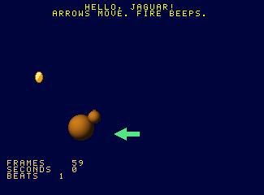

# Writing Jaguar games with jaggame

`jaggame` is a V module for writing Atari Jaguar programs without writing assembly. A program *describes* its variables and logic to a builder; the builder checks the description, compiles it to 68000 code and writes a `.jag` image. The same description also runs in an interpreter written in V, and the two must agree.

This guide grows with the module. Chapter 1 is the language: the programs there compute values that tests read back. Chapter 2 is the runtime (the frame loop, video, sprites, pad, text, timers), built around the demo [`hello2`](../../demos/hello2/main.v). Sprite sheets and PNG import, maps, collision, scenes and real sound come in later chapters. [`design.md`](design.md) is the plan and the contract; [`reference.md`](reference.md) lists every public name with its comment.

Every V block in this guide is quoted from tested code, and every text block is output that a test produces. A V block is named by a comment on the line above it, `<!-- guide:NAME -->`, and must be a run of lines from the region of that name: the lines between `// guide:NAME` and `// guide:end` in a test in [`jaggame/tests`](../../jaggame/tests), or in `demos/hello2/main.v` or its test. `jaggame/tests/guide_test.v` fails if a block is unnamed, names a region that does not exist, or has drifted from it.

## Contents

- [Chapter 1: the language](#chapter-1-the-language)
  - [A first program](#a-first-program)
  - [Running it twice](#running-it-twice)
  - [Types](#types)
  - [Expressions](#expressions)
  - [Variables, tables, arrays and records](#variables-tables-arrays-and-records)
  - [Statements](#statements)
  - [Functions](#functions)
  - [What the operations do](#what-the-operations-do)
  - [Mistakes are reported together](#mistakes-are-reported-together)
  - [Four complete programs](#four-complete-programs)
  - [How it is compiled](#how-it-is-compiled)
  - [How it is tested](#how-it-is-tested)
  - [V traps](#v-traps)
- [Chapter 2: the runtime](#chapter-2-the-runtime)
  - [A game and a frame](#a-game-and-a-frame)
  - [Declaring: pictures, animations, text and timers](#declaring-pictures-animations-text-and-timers)
  - [Starting up](#starting-up)
  - [Every frame](#every-frame)
  - [Sprites](#sprites)
  - [Animations](#animations)
  - [The pad](#the-pad)
  - [Text](#text)
  - [Time](#time)
  - [A beep](#a-beep)
  - [Mistakes in the description](#mistakes-in-the-description)
  - [Testing a game, twice](#testing-a-game-twice)
  - [What a frame costs](#what-a-frame-costs)
  - [V traps in the runtime](#v-traps-in-the-runtime)

## Chapter 1: the language

### A first program

<!-- guide:first -->
```v
mut p := jaggame.new_program()
score := p.u16('score')
lives := p.u8('lives', 3)

bonus := p.func('bonus', [jaggame.Param{'level', .u16}], .u16)
mut c := p.define(bonus)
c.ret(bonus.arg('level').mul(100).add(50))

main := p.func('main', [], .void)
c = p.define(main)
level := c.local_u8('level')

c.for_(level, 1, 4)
c.add_to(score, bonus.call(level))
c.end()
c.dec(lives)
```

Read it as a program, not as V: `score` is a 16-bit variable of the Jaguar program, `bonus` a function of the Jaguar program, and `c.for_(level, 1, 4)` a loop that the 68000 will run. The V code runs once, at build time, and records what was asked for. Two consequences:

- **V is the macro language.** A V function that adds statements to a `Code` is a macro; a V `for` loop repeats statements in the program; a V value computed at build time (a sine table, a constant) goes into the program as data. The sine walk below builds its table with V's `math.sin`.
- **Nothing is checked until the program is built.** Writing `score.add(lives)` builds a description. The type rules are applied by `p.check()`, `p.interpreter()` or `p.plain_image(...)`, which report every problem together.

`p.define(f)` returns the `Code` that collects the body of `f`. Blocks are opened by `if_`, `while_`, `for_` and `repeat` and closed by `end()`. A function may be declared with `p.func` long before it is defined, so functions can call each other in any order.

### Running it twice

<!-- guide:run -->
```v
mut it := p.interpreter()!
it.run('main')!
assert it.value('score')! == 750
assert it.value('lives')! == 2

img := p.plain_image(main)!
mut runner := emulated.new()
runner.run(img.bytes, img.done, 60)!
assert img.value(runner.ram(), 'score')! == 750
assert img.differences(it, runner.ram()) == []
```

- `p.interpreter()` checks the program and returns an `Interpreter`. `run` calls a function by name. `value`, `element` and `field` read variables. Values are *raw*: a `fix` comes back as its 32-bit pattern (`jaggame.fix_value` turns it into a float, `jaggame.fix_raw` goes the other way).
- `p.plain_image(main)` compiles the program into an image that calls `main` once, sets a `done` byte and waits. It sets up nothing else. `img.bytes` is the `.jag` file; `os.write_file_array(path, img.bytes)` saves it.
- `jaggame.emulated` boots an image in the emulator and runs frames until `done` is set. It is a separate module so that a game build does not link the emulator.
- `img.differences(it, ram)` compares every variable, parameter and local of the two runs and lists the ones that differ.

`p.listing(main)` prints a function back as builder calls, which is how the fuzzer shows a failing case:

```text
// fn main()
level := c.local('level', .u8)
c.for_(level, 1, 4)
	c.set(score, score.add(bonus.call(level)))
c.end()
c.set(lives, lives.sub(1))
```

### Types

| Type | Size | Values |
|---|---|---|
| `bool` | 1 byte | 0 or 1 |
| `u8`, `i8` | 1 | 0..255, -128..127 |
| `u16`, `i16` | 2 | 0..65535, -32768..32767; the natural size on the 68000 |
| `u32`, `i32` | 4 | 0..4294967295, -2147483648..2147483647 |
| `fix` | 4 | signed 16.16 fixed point: -32768.0 up to just under 32768.0, in steps of 1/65536 |

The rules:

- **Both sides of an operation have the same signedness.** The narrower side widens to the wider: `u16` with `u8` is a `u16`. `u16` with `i16` is refused; convert one side with `as_`.
- **A `fix` with an integer converts the integer** (both signed and unsigned ones): `speed.mul(lives)` is `speed * 3.0`.
- **An integer literal takes the type of the other side and must fit it.** `x.add(300)` is refused when `x` is a `u8`. A float literal is a `fix`, so `x.add(1.5)` is a `fix` even when `x` is an integer. Literals larger than an `int` need `i64(...)`: `x.and(i64(0xffff_0000))`.
- **Comparisons and `both`/`either` yield `bool`.** Arithmetic on a `bool` is refused; so is a number used as a condition.
- **`set` widens but does not narrow:** a `u8` can be stored in a `u32` or a `fix`, a `u32` in a `u8` only with `as_(.u8)`.

### Expressions

<!-- guide:expressions -->
```v
mut p := jaggame.new_program()
score := p.u16('score')
lives := p.u8('lives', 3)
speed := p.fix('speed', 1.5)
bag := p.array_u8('bag', 16)
sines := p.table_i16('sines', [0, 3212, 6393, 9512])

a := score.add(10) // u16
b := score.lt(lives) // bool: the u8 widens to u16
d := speed.mul(lives) // fix: lives becomes 3.0
e := bag.at(3).add(1) // u8: 255 + 1 wraps to 0
f := sines.at(score.and(3)).as_(.i32).mul(2) // i32
g := score + lives.as_(.u16) // operators work between two Exprs
```

A variable, an element and an operation are all `jaggame.Expr`, so a variable can be used wherever a value can. The methods take a `jaggame.Val`: an `Expr`, an `int`, an `i64`, a `u16` (which is what `jaggame.cry` returns), an `f64` or a `bool`.

| Methods | |
|---|---|
| `add sub mul div mod` | arithmetic; `mul` and `div` of `fix` keep 16.16 |
| `and or_ xor not shl shr` | bits of integers (`or` is a V keyword); `shl`/`shr` also shift a `fix` |
| `eq ne lt le gt ge` | comparisons |
| `both either invert` | `bool` logic; `both` and `either` do not evaluate their right side when the left decides |
| `neg abs` | signed types and `fix` |
| `min max` | |
| `as_(.type)` | conversion |
| `at(index)`, `field(name)` | an element, a field of a record element |
| `+ - * / %` | the same as `add sub mul div mod`, between two `Expr` values |

V lets a struct overload `<` and `==` only with a V `bool` result, so comparisons have no operators. A literal on its own has no type: `jaggame.lit(5).as_(.u8)` is a `u8` constant.

### Variables, tables, arrays and records

| Declaration | |
|---|---|
| `p.u8('name')`, `p.i16('name', -1)`, `p.fix('speed', 1.5)`, `p.bool('flag', true)` … | a global, 0 unless given a value; `p.global(name, type, value)` is the general form |
| `p.table_i16('sines', values)`, `p.table_fix(name, []f64)`, `p.table(name, type, []Val)` | read-only data |
| `p.array_u8('bag', 16)`, `p.array(name, type, length)` | read-write, all 0 |
| `p.record('Guard', fields)`, `p.array_of('guards', guard, 8)` | records, all fields 0 |
| `c.local_u16('i')`, `c.local(name, type)` | a local of the function being defined |

A record's fields are laid out in order, each aligned to its size, and the record's size is rounded up to a power of two so that indexing is a shift: `u8, u32, i16, bool` puts the fields at 0, 4, 8 and 10 in a 16-byte record. `guards.at(i).field('x')` is a field; `guards.at(i)` on its own is not a value.

An index is any integer expression. A literal index is checked at build time; an index computed at run time is not checked by the compiled code. The interpreter does check it and stops with an error, so a test in the interpreter finds an index out of range.

### Statements

<!-- guide:statements -->
```v
mut p := jaggame.new_program()
x := p.i16('x')
alert := p.bool('alert')
steps := p.u16('steps')
walk := p.func('walk', [jaggame.Param{'far', .i16}], .void)
mut c := p.define(walk)
i := c.local_u8('i')

c.if_(walk.arg('far').gt(100))
c.set(alert, true)
c.else_if(walk.arg('far').gt(50))
c.inc(steps)
c.else_()
c.ret_void()
c.end()

c.for_(i, 0, 8) // i is 0..7
c.if_(x.ge(walk.arg('far')))
c.break_()
c.end()
c.add_to(x, 10)
c.end()

c.while_(x.gt(0).both(alert))
c.sub_from(x, 3)
c.end()

c.repeat(3)
c.inc(steps)
c.end()
```

`v fmt` keeps the statements flat; the blocks are in the calls, not in the indentation. So the examples in this guide and the demos follow a convention to keep them readable: a blank line before each `if_`, `while_` and `for_` (except one that directly opens another block), and a short comment on an `end()` that closes a block of more than a few lines or one nested more than one deep (`c.end() // for each guard`).

| Statement | Meaning |
|---|---|
| `set(dst, value)` | store; `dst` is a variable, an element or a field |
| `inc(dst)`, `dec(dst)`, `add_to(dst, v)`, `sub_from(dst, v)` | `set(dst, dst.add(1))` and so on; for a `fix`, 1 is 1.0 |
| `if_(cond)`, `else_if(cond)`, `else_()`, `end()` | |
| `while_(cond)` … `end()` | |
| `for_(v, from, to)` … `end()` | `v` from `from` while `v < to`, adding 1; like C, `to` is evaluated before every step |
| `repeat(n)` … `end()` | `n` times; `n` is evaluated once, and a negative `n` runs no times |
| `break_()`, `continue_()` | leave the innermost loop, or go on with its next step (in a `for_`, the increment) |
| `call(f, args…)` | a call as a statement; a result is thrown away |
| `ret(value)`, `ret_void()` | |
| `asm(fn (mut m jagkit.M68k) { … })` | 68000 code in place of a statement, for the runtime; the interpreter cannot run it |

### Functions

<!-- guide:records -->
```v
clamp := p.func('clamp', [jaggame.Param{'v', .fix}, jaggame.Param{'lo', .fix},
	jaggame.Param{'hi', .fix}], .fix)
mut c := p.define(clamp)
c.ret(clamp.arg('v').max(clamp.arg('lo')).min(clamp.arg('hi')))
```

`clamp.arg('v')` is a parameter as an expression; `clamp.call(x, 0, 100)` is a call. Arguments convert to the parameters' types by the rules of `set`.

- **Parameters, locals and the result have fixed addresses**, not a stack frame: fast on a 68000, and the reason a function cannot call itself, directly or through others. The checker follows the call graph and refuses recursion.
- **Locals are set to 0 every time the function is called.**
- **A function that returns a value must not be able to reach its end**: the last statement must be a `ret`, or an `if_` with an `else_` whose every branch ends that way.
- **The arguments of a call are all evaluated before any is stored**, so `f.call(x, f.call(y, z))` works.

### What the operations do

The interpreter defines what every operation means, and the compiled code must do the same. These cases are worked out by hand and run both ways in `jaggame/tests/semantics_test.v`:

<!-- guide:semantics -->
```v
cases := [
	Case{'u8 wraps', .u8, u8_200.add(100), 44},
	Case{'u16 wraps below 0', .u16, u16_zero.sub(1), 65535},
	Case{'i16 wraps', .i16, i16_max.add(1), -32768},
	Case{'division rounds toward zero', .i8, i8_m7.div(2), -3},
	Case{'remainder has the sign of the dividend', .i8, i8_m7.mod(2), -1},
	Case{'-128 / -1 wraps', .i8, i8_min.div(-1), -128},
	Case{'smallest i32 / -1 wraps', .i32, i32_min.div(i32_m1), -2147483648},
	Case{'division by zero is 0', .u32, u32_five.div(0), 0},
	Case{'remainder by zero is 0', .i32, i32_m5.mod(0), 0},
	Case{'fix division by zero is 0', .fix, one.div(0), 0},
	Case{'unsigned division', .u32, u32_max.div(2), 0x7fff_ffff},
	Case{'shr fills unsigned with 0', .u8, u8_0x81.shr(1), 0x40},
	Case{'shr keeps the sign', .i8, i8_min.shr(1), -64},
	Case{'shl into the sign bit', .i8, i8_one.shl(7), -128},
	Case{'shl out of the type', .u8, u8_one.shl(8), 0},
	Case{'a shift count is masked to 5 bits', .u32, u32_five.shl(u32_33), 10},
	Case{'shr of -1', .i32, i32_m1.shr(31), -1},
	Case{'fix product', .fix, speed.mul(2.25), jaggame.fix_raw(3.375)},
	Case{'fix product rounds down', .fix, tiny.mul(half), 0},
	Case{'a negative one too', .fix, tiny.neg().mul(half), -1},
	Case{'fix quotient rounds toward zero', .fix, one.div(three), 21845},
	Case{'a negative one too', .fix, one.neg().div(three), -21845},
	Case{'fix remainder', .fix, f_m75.mod(2), jaggame.fix_raw(-1.5)},
	Case{'fix with an integer', .fix, speed.add(u8_two), jaggame.fix_raw(3.5)},
	Case{'fix to integer rounds down', .i16, half.neg().as_(.i16), -1},
	Case{'fix to u8', .u8, speed.add(1.25).as_(.u8), 2},
	Case{'narrowing cuts', .u8, i16_300.as_(.u8), 44},
	Case{'i8 to u16', .u16, i8_m1.as_(.u16), 65535},
	Case{'u8 to i8', .i8, u8_255.as_(.i8), -1},
	Case{'integer to fix wraps', .fix, u16_40000.as_(.fix), -1673527296},
	Case{'bool to fix', .fix, t.as_(.fix), jaggame.fix_one},
	Case{'to bool compares with 0', .bool, half.as_(.bool), 1},
	Case{'abs of the smallest', .i16, i16_min.abs(), -32768},
	Case{'neg of the smallest', .i8, i8_min.neg(), -128},
	Case{'unsigned max', .u16, u16_max.max(1), 0xffff},
	Case{'signed min', .i16, i16_m1.min(1), -1},
	Case{'unsigned compare', .bool, u32_top.gt(1), 1},
	Case{'signed compare', .bool, i32_m1.lt(1), 1},
	Case{'either skips its right side', .bool, t.either(bump.call()), 1},
	Case{'both skips its right side', .bool, t.invert().both(bump.call()), 0},
	Case{'both runs its right side', .bool, t.both(bump.call()), 1},
]
```

In words:

- **Arithmetic wraps** at the type's width, as the 68000 does.
- **Division rounds toward zero**, and the remainder has the sign of the dividend, as in C and V. **Dividing by zero gives 0**, and so does the remainder.
- **A shift count is 0..31.** A literal outside that is refused; a computed count is masked to five bits. `shr` is arithmetic for signed types and `fix`, logical for unsigned ones.
- **`fix * fix` rounds down** (toward minus infinity): it is the signed 64-bit product shifted right 16 bits, cut to 32. **`fix / fix` rounds toward zero.** `fix % fix` is the remainder of the raw values, which is the remainder in 16.16.
- **Conversions:** integers are cut or extended; an integer becomes a `fix` by shifting it 16 bits left, wrapping; a `fix` becomes an integer by rounding down (-0.5 becomes -1); anything becomes a `bool` by comparing with 0; a `bool` is 0 or 1 (1.0 as a `fix`).
- **Order of evaluation:** left side before right side, arguments left to right, and in `set` the destination's index before the value. It matters only when a function called in an expression changes a variable used in the same statement.

### Mistakes are reported together

<!-- guide:mistakes -->
```v
mut p := jaggame.new_program()
speed := p.fix('speed', 1.5)
x := p.i16('x')
hits := p.u8('hits')
update := p.func('update', [], .void)
mut c := p.define(update)
c.set(x, x.add(speed))

c.if_(hits)
c.set(hits, hits.add(x))
c.end()
c.set(x, 40000)
p.check() or { return err.msg() }
```

```text
jaggame program:
  function `update`: set(x, x.add(speed)): `x.add(speed)`: a fix cannot be stored in an i16; convert it with as_(.i16), which rounds down
  function `update`: if_(hits): a condition must be a bool, not u8; compare it, e.g. `hits.ne(0)`
  function `update`: set(hits, hits.add(x)): add mixes u8 and i16: one is signed and the other is not; convert one side with as_
  function `update`: set(x, 40000): 40000 does not fit i16 (-32768..32767)
```

Each problem names the function and the statement, written back as builder calls. Declarations are checked too (a name used twice, an initial value that does not fit, a table value out of range), as are blocks left open, `break_` outside a loop, calls with the wrong arguments, a function that is called but never defined, and recursion. `jaggame/check_test.v` tries every rule both ways.

### Four complete programs

Each is in `jaggame/tests/programs_test.v`, run by the interpreter and on the emulated 68000, compared variable by variable, and checked against the same computation written in plain V.

**An insertion sort.** `both` is what keeps `data.at(j.sub(1))` from being read when `j` is 0: the interpreter would stop on the index 65535.

<!-- guide:sort -->
```v
mut p := jaggame.new_program()
input := p.table_i16('input', values)
data := p.array_i16('data', 32)
sort := p.func('sort', [], .void)
mut c := p.define(sort)
i := c.local_u16('i')
j := c.local_u16('j')
key := c.local_i16('key')

c.for_(i, 0, 32)
c.set(data.at(i), input.at(i))
c.end()

c.for_(i, 1, 32)
c.set(key, data.at(i))
c.set(j, i)

// both() does not look at data.at(j - 1) once j is 0.
c.while_(j.gt(0).both(data.at(j.sub(1)).gt(key)))
c.set(data.at(j), data.at(j.sub(1)))
c.dec(j)
c.end()
c.set(data.at(j), key)
c.end() // for each element
```

**The primes below 2000**, by sieving:

<!-- guide:primes -->
```v
mut p := jaggame.new_program()
composite := p.array('composite', .bool, limit)
primes := p.array_u16('primes', 400)
count := p.u16('count')
sieve := p.func('sieve', [], .void)
mut c := p.define(sieve)
n := c.local_u16('n')
multiple := c.local_u32('multiple')

c.for_(n, 2, limit)
c.if_(composite.at(n).invert())
c.set(primes.at(count), n)
c.inc(count)
// n * n would wrap as a u16: square it as a u32.
c.set(multiple, n)
c.set(multiple, multiple.mul(n))

c.while_(multiple.lt(limit))
c.set(composite.at(multiple), true)
c.add_to(multiple, n)
c.end() // for each multiple of n
c.end() // if n is prime
c.end() // for each n
```

**A walk along a sine table.** The table is computed in V at build time. The angle is a `u16` whose high byte indexes the table, so adding to it wraps around the circle for free.

<!-- guide:sine -->
```v
mut p := jaggame.new_program()
sines := p.table_fix('sines', sine_table())
path := p.array_fix('path', 64)
angle := p.u16('angle') // 256 steps to a turn in the high byte
x := p.fix('x')
speed := p.fix('speed', 2.5)
walk := p.func('walk', [], .void)
mut c := p.define(walk)
step := c.local_u8('step')

c.for_(step, 0, 64)
c.add_to(angle, 1000) // wraps around at 65536
c.add_to(x, sines.at(angle.shr(8)).mul(speed))
c.set(path.at(step), x)
c.end()
```

**Records, and functions that call functions.** Eight guards walk back and forth for 150 steps; then `find` asks `distance` about each of them.

<!-- guide:records -->
```v
// step moves guard i right until x is 100, then left until it is 0.
step := p.func('step', [jaggame.Param{'i', .u8}], .void)
c = p.define(step)
g := guards.at(step.arg('i'))

c.if_(g.field('state').eq(0))
c.set(g.field('x'), clamp.call(g.field('x').add(1.5), 0, 100))

c.if_(g.field('x').eq(100))
c.set(g.field('state'), 1)
c.end()
c.else_()
c.set(g.field('x'), clamp.call(g.field('x').sub(0.75), 0, 100))

c.if_(g.field('x').eq(0))
c.set(g.field('state'), 0)
c.end()
c.end() // moving right or left
c.inc(g.field('timer'))
```

`g` is a V variable holding an expression, used six times: V is the macro language. `find` and `main` are in the test.

### How it is compiled

The checker turns the program into a typed form (every literal typed, every widening explicit, `for_`, `repeat`, `inc` and the like reduced to `set` and one kind of loop). The interpreter and the code generator both work from that form, which is why they agree on what a program means.

The code generator is meant to be obviously right, not fast:

- **Every expression leaves its value in `d0` as a whole long**, sign- or zero-extended from its type. Operations work on longs and cut the result back to the type, which is exactly how the interpreter wraps.
- **The left operand of an operation waits on the stack** while the right one is evaluated. There is no register allocation and no optimisation.
- **Nothing lives in a register from one statement to the next.** Globals, parameters and locals have fixed addresses in a data area after the code: longs, then words, then bytes, then arrays, tables and records.
- **Helper routines** do what the 68000 has no instruction for: `jaggame.mul32` (a 32 × 32 product from three `mulu`), `jaggame.divu32` and `jaggame.divs32` (shift-and-subtract division with the remainder), `jaggame.fix_mul` (bits 16..47 of the signed 64-bit product, from four `mulu`) and `jaggame.fix_div` (a 64 by 32 bit division). Each is emitted only when used. Narrow multiplications use `mulu` directly.
- **Registers:** compiled code uses `d0`..`d5` and `a0`; `a5`, `a6` and `d7` are never touched, for the runtime. `jaggame/registers_test.v` sets them in an `asm` statement, runs code that uses every helper, and checks them.

`p.emit(mut m)` compiles a program into a `jagkit.M68k` that may hold other code; `plain_image` is built on it. The labels are the names: function `bonus` starts at the label `bonus`, global `score` is at `score`, a parameter or local is `bonus.level`. To call a compiled function from assembly, store the arguments at the parameters' labels and `jsr` to it; the result comes back in `d0`, and `d0`..`d5`, `a0`..`a4` may have changed.

### How it is tested

| Test | What it proves |
|---|---|
| `jaggame/check_test.v` | every rule of the language accepts and refuses what it should, with a message that names the problem |
| `jaggame/fuzz_test.v` | 20,800 random well-typed cases agree between the interpreter and the 68000 |
| `jaggame/tests/semantics_test.v` | the table above, worked out by hand, on both sides |
| `jaggame/tests/programs_test.v` | the four programs, on both sides and against plain V |
| `jaggame/registers_test.v` | compiled code leaves `a5`, `a6` and `d7` alone |
| `jaggame/tests/guide_test.v` | this guide quotes only tested code |

The fuzzer builds 40 programs from a fixed seed. Each has globals holding the edge values of every type (0, ±1, the smallest and largest, and their neighbours), a few helper functions with parameters, and 520 cases: half are a function returning one random expression, half a function with locals, an array and records of its own and a random run of statements, loops, early returns and calls. Every variable is compared after the run, and a coverage check proves that every operation, conversion, load and store of every type was generated. In about five seconds it runs every case and some 3,000 divisions by zero.

When the two sides disagree, the test prints the first case, in the order the program runs them, whose variables differ, written back as builder calls with the values on both sides. The seed is fixed, so the failure reproduces; copy the case into a test of its own when you fix it.

### V traps

Found with V 0.5.2 while writing this slice, in addition to [the ones in the jagkit guide](../jagkit.md#v-traps):

| Trap | Workaround |
|---|---|
| With `-prod`, before every call statement V copies the pointers of each value-typed local and parameter in scope that holds pointers, walking it deeply, so that the garbage collector keeps them. A recursive walk over a tree held by value becomes quadratic | in hot code, hold trees and arrays of structs by reference (`&TExpr`, `&[]TStmt`), and keep large values such as the interpreter on the heap. This made the interpreter 6.5 times faster |
| `<` and `==` can only be overloaded with a V `bool` result | comparisons are methods only |
| `or` is a keyword | the method is `or_`, like `if_` and `for_` |
| `for s in list` where `list` is a `&[]T` gives `&T` elements, and `&list[i]` is refused outside `unsafe` | loop with `for s in list` and pass `s` on as it is |
| `-0x8000_0000` is positive: the literal is an `int` before it is negated | write `-i64(0x8000_0000)` |
| An `int` is 32 bits, so `0xffff_ffff` does not fit an `int` parameter | `Val` accepts `i64` too; `p.u32` and `table_u32` take `i64` |

## Chapter 2: the runtime

Chapter 1 described a language that compiles to 68000 code. This chapter adds what a game needs around it: a loop that runs once a frame, video on both television standards, sprites, a pad, text, timers and a beep. [`demos/hello2`](../../demos/hello2/main.v) is [`hello`](../../demos/hello/main.v) written with it, with no assembly, and a little more.

```sh
v run demos/hello2           # writes demos/hello2.jag
just run demos/hello2.jag    # play it
v -prod test demos/hello2/   # boot it in the emulator, on both standards, and check it
```



Two lines of text, a ball you move with the arrow keys that stops at the edges of the screen, and a beep when you press Z, X or C. Then: a spinning coin (an animation), a small ball that rides on the big one at half size (a scaled sprite on a higher layer, which the top of the screen cuts off), an arrow that turns to face the way you go (a flipped sprite), and three numbers that count: frames, seconds and half seconds.

- [A game and a frame](#a-game-and-a-frame)
- [Declaring: pictures, animations, text and timers](#declaring-pictures-animations-text-and-timers)
- [Starting up](#starting-up)
- [Every frame](#every-frame)
- [Sprites](#sprites)
- [Animations](#animations)
- [The pad](#the-pad)
- [Text](#text)
- [Time](#time)
- [A beep](#a-beep)
- [Mistakes in the description](#mistakes-in-the-description)
- [Testing a game, twice](#testing-a-game-twice)
- [What a frame costs](#what-a-frame-costs)
- [V traps in the runtime](#v-traps-in-the-runtime)

### A game and a frame

A game is a `jaggame.Game`: a `Program` (chapter 1) with a fixed runtime around it. `jaggame.new_game(Config{...})` returns one; the program is `game.p`, so `game.p.u16('beats')` declares a variable as before. The author declares things, writes the code of two functions with `define_init` and `define_update`, and calls `build()`, which checks everything, compiles it with the runtime and returns an `Image`: `img.bytes` is the `.jag` file and `img.symbols` the table of labels.

`Config` has three numbers: the size of the **sprite pool** (`sprites`), the number of **layers** the sprites are sorted into (`layers`) and the **background** colour (`background`, a CRY value from `jaggame.cry(r, g, b)`).

Once started, the machine does nothing but wait for the vertical interrupt, which comes once a frame, 60 times a second on NTSC and 50 on PAL. Each time:

1. the object processor is pointed at the display list that was finished last time;
2. the pad is read into `pad` and `pad_pressed`;
3. `rt_frame` runs: it counts the frame, moves the timers, calls the game's update, moves the animations and fades the beep;
4. the rows of text that changed are drawn, the layers' colours are copied into the colour table and the beep's note and volume into the synthesizer;
5. a new display list is built from the visible sprites;
6. if another interrupt is already waiting, `missed_frames` goes up by one.

Steps 3 to 5 are the same code on both standards; the television standard is read from bit 4 of `joybuts` at start-up and everything that differs (the display window, where the centre of the picture is, the number of frames in a second) is looked up from it.

**All game code runs inside the interrupt.** Start-up calls `rt_init` before interrupts are enabled; after that, compiled code runs only from the interrupt handler, and a handler cannot be interrupted by the next one: the 68000 raises its interrupt mask on entry, and an interrupt that arrives while the handler runs waits until it returns. So the fixed addresses that chapter 1 gives parameters and locals are never in use by two calls at once, and the limit that a function cannot call itself, even through others, is the only one that remains. This is how the runtime is built, not something the author has to look after.

**The picture is one frame behind the work.** At the end of frame N the handler points the object processor at the list that it built at the end of frame N-1, and builds the next. The work may then take longer than the gap between two pictures without the object processor ever reading a list that is half built (it uses a list up as it draws it, so the runtime keeps two and builds one while the other is shown). The price is that a button pressed in frame N shows in the picture of frame N+2: one frame later than `hello`.

A frame of work that takes longer than a frame does not nest or crash: the next interrupt waits, the picture repeats, and `missed_frames` counts it. It counts the handlers that found another interrupt waiting when they finished; one handler that takes ten frames adds one.

The runtime's variables are ordinary variables of the program, so game code reads them and a test reads them by name:

| Variable | Type | |
|---|---|---|
| `frame` | `u32` | frames since start-up, counted by `rt_frame` |
| `missed_frames` | `u16` | see above; a normal game keeps it at 0 |
| `fps` | `u8` | 60 on NTSC, 50 on PAL |
| `pad`, `pad_pressed` | `u32` | the buttons held, and the ones that went down this frame |
| `sprites` | array of records | the sprite pool |

Names that start with `rt_` and labels that start with `rt.` belong to the runtime, as `jaggame.` ones belong to the compiler.

### Declaring: pictures, animations, text and timers

<!-- guide:declare -->
```v
game.art_cry('ball', ball_size, ball_size, 1, ball())
game.art_pal('coin', 16, 16, 4, coin())
game.palette(coin_palette())
game.art_cry('arrow', 32, 16, 1, arrow())
game.sequence('spin', [jaggame.Step{0, 0.1}, jaggame.Step{1, 0.1},
	jaggame.Step{2, 0.1}, jaggame.Step{3, 0.1}])

title := game.text_layer('title', jaggame.TextConfig{
	columns: 40
	rows:    2
	y:       8
})
hud := game.text_layer('hud', jaggame.TextConfig{
	columns: 24
	rows:    3
	x:       8
	y:       200
	colour:  jaggame.cry(255, 220, 90)
})
beat := game.timer('beat')
watch := game.timer('watch')
beats := game.p.u16('beats')
```

- **`art_cry(name, width, height, frames, pixels)`** is a picture of 16-bit CRY pixels (`jaggame.cry(r, g, b)` makes one). `frames` pictures of the same size follow one another in `pixels`, each line after line. A line must fill whole 64-bit phrases, so the width is a multiple of 4. The pixel value 0 is transparent.
- **`art_pal(...)`** is the same with 8-bit pixels that are numbers in the game's **palette**, set once with `palette(colours)`; the width is a multiple of 8. The palette has room for 256 colours minus two for each text layer (the text keeps the top of the colour table). The pixel 0 is transparent here too.
- **`sequence(name, steps)`** is an animation: each `Step{frame, seconds}` shows a frame for a time. See [Animations](#animations).
- **`text_layer(name, config)`** is a grid of 8×8 character cells over the sprites; `TextConfig` has `columns` (a multiple of 8), `rows`, the position `x` and `y` in screen pixels and the `colour`. See [Text](#text).
- **`timer(name)`** is a countdown or a stopwatch; see [Time](#time).

A picture is a build-time array, as in `hello`: `ball()` in `demos/hello2/main.v` draws a shaded sphere with V's `math`. Pictures from PNG files come in a later slice.

### Starting up

<!-- guide:init -->
```v
ball_sprite := game.sprite(0)
coin_sprite := game.sprite(1)
moon := game.sprite(2)
pointer := game.sprite(3)

mut c := game.define_init()
ball_sprite.put(mut c, 'ball', 144, 104, 1)
coin_sprite.put(mut c, 'coin', 40, 90, 0)
coin_sprite.play(mut c, 'spin', true)
moon.put(mut c, 'ball', 168, 98, 2)
c.set(moon.scale, 0.5)
pointer.put(mut c, 'arrow', 140, 160, 3)

title.print(mut c, 13, 0, 'HELLO, JAGUAR!')
title.print(mut c, 8, 1, 'ARROWS MOVE. FIRE BEEPS.')
hud.print(mut c, 0, 0, 'FRAMES')
hud.print(mut c, 0, 1, 'SECONDS')
hud.print(mut c, 0, 2, 'BEATS')
beat.start(mut c, game.seconds(0.5))
watch.stopwatch(mut c)
```

`define_init` returns the block that collects the statements of the function that runs once, before the first frame. `game.sprite(i)` is a handle on element `i` of the pool; `put` sets its picture, position and layer, frame 0, full size and makes it visible. Everything else is a plain `set` of a field: `c.set(moon.scale, 0.5)`. A sprite handle is made outside the function because it is only a description of where the fields are.

The runtime has already set every sprite's scale to 1.0 and `fps` to 60 or 50 when this runs. The text printed here is printed once and stays.

### Every frame

<!-- guide:update -->
```v
c = game.define_update()

c.if_(game.held(.left))
c.set(ball_sprite.x, ball_sprite.x.sub(speed))
c.set(pointer.flip, true)
c.end()

c.if_(game.held(.right))
c.set(ball_sprite.x, ball_sprite.x.add(speed))
c.set(pointer.flip, false)
c.end()

c.if_(game.held(.up))
c.set(ball_sprite.y, ball_sprite.y.sub(speed))
c.end()

c.if_(game.held(.down))
c.set(ball_sprite.y, ball_sprite.y.add(speed))
c.end()

// The ball stops at the edges of the screen.
c.set(ball_sprite.x, ball_sprite.x.max(0).min(jaggame.logical_width - ball_size))
c.set(ball_sprite.y, ball_sprite.y.max(0).min(jaggame.logical_height - ball_size))

// The small ball rides on the big one, and runs off the screen with it.
c.set(moon.x, ball_sprite.x.add(24))
c.set(moon.y, ball_sprite.y.sub(6))

c.if_(game.pressed(.fire))
game.beep(mut c, beep_note, beep_volume)
c.end()

c.if_(beat.fired)
c.inc(beats)
beat.start(mut c, game.seconds(0.5))
c.end()

hud.number(mut c, 7, 0, game.frame, 5)
hud.number(mut c, 8, 1, game.whole_seconds(watch.elapsed), 3)
hud.number(mut c, 6, 2, beats, 3)
```

`define_update` is the function that runs once a frame. Everything is chapter 1 plus a few names: `game.held(.left)` is a `bool` expression that is true while the button is down, `game.pressed(.fire)` is true for the one frame in which it went down, `ball_sprite.x` is an `Expr` that can be read and set. The blank line before each `if_` is a convention of the guide and the demos: `v fmt` does not indent the statements between `if_` and `end`, so a blank line before the opener and a short comment on an `end()` that closes something long or deep keep the structure readable.

The ball stops at the edges with `max` and `min`. The small ball is placed relative to the big one, a little above its top right corner, so when the big ball is at the top of the screen the small one is partly off the screen, which the runtime copes with (see [Sprites](#sprites)).

### Sprites

A sprite is one element of the array `sprites`, which has `Config.sprites` of them. Its fields:

| Field | Type | |
|---|---|---|
| `x`, `y` | `i16` | the top left corner in **logical pixels**: the screen is 320×240, (0, 0) is its top left corner |
| `art` | `u8` | which picture: the number of the art, in the order declared |
| `frame` | `u8` | which frame of the picture; a frame the picture does not have shows frame 0 |
| `layer` | `u8` | 0 is drawn first; a higher layer is drawn over a lower one; a layer above the last is drawn with the last |
| `visible` | `bool` | only visible sprites are drawn |
| `flip` | `bool` | mirrored left to right |
| `scale` | `fix` | 1.0 is full size; from 1/32 to just under 8 (the object processor's 3.5 fixed point) |

The runtime builds the display list again every frame, layer by layer, and within a layer in the order of the pool: of two sprites on one layer the one later in the pool is on top. Positions are logical pixels on both standards: the runtime works out the display window of each standard from the profile it chose at start-up, centres the 320×240 screen in it, and adds that offset when it builds the objects. (NTSC has 241 lines and 352 pixels in the window, PAL 287 and 345.)

**Sprites that are not wholly on the screen.** The runtime decides for each sprite:

- A sprite wholly outside the screen, to either side or above or below, is not drawn at all.
- A sprite that runs off the **top** or the **bottom** is cut: the runtime shows fewer lines of it (leaving out the lines above the screen, or those below it), because the object processor cannot start an object above the first line of the display. This is exact for a sprite at full size. A scaled sprite is cut in whole lines of its picture, so its first visible line may be up to a source line lower than strictly right.
- A sprite that runs off the **left** or the **right** is left to the object processor, which clips at the edge of its line buffer, so no pixel wraps around. The part past the edge falls in the border of the display window, outside the logical screen, which a television may show and an emulator shows a few pixels of.

`jaggame/rt_sprites_test.v` tries each of these on both standards.

Flip is cheap: it is the object processor's reflect flag, and the sprite is drawn from its right edge to the left. A scaled sprite is a scaled object (the picture is magnified by the same factor across and down); the object processor's rule for the vertical remainder can make it a line taller or shorter than width × scale.

`game.sprite(i)` checks that `i` is in the pool (a build error otherwise); `game.sprite_at(index)` takes any expression, for a loop. `hide(c)` clears `visible`.

### Animations

`game.sequence('spin', [Step{0, 0.1}, Step{1, 0.1}, ...])` names a list of frames, each with the time it stays, in **seconds**. The runtime turns the time into frames for each standard (60 or 50 a second, rounded to whole frames, at least 1) and chooses the right table when it starts, so the coin spins at the same speed on NTSC and PAL. `sprite.play(c, 'spin', true)` starts it on a sprite: it shows the first step now, and every frame the runtime moves the animation on; with `true` it starts over after the last step, with `false` the sprite stays on the last frame and `sprite.playing` becomes false. `sprite.stop(c)` ends it where it is. An animation does not know which picture it is for: it sets the sprite's `frame`.

An unknown animation name is a build error that lists the known ones.

### The pad

`pad` holds one bit for each button, in the order of `jaggame.Button`: the four directions, the keypad (`star seven four one zero eight five two hash nine six three`), `a`, `b`, `c`, `option` and `pause`. `jaggame.button_mask(.left)` is a button's bit; `.fire` is the three fire buttons together. The runtime reads the controller matrix once a frame, before `rt_frame`; the keypad, Option and Pause come from the same read as the directions and A, B, C, so they cost nothing more. In the emulator the arrow keys are the directions and Z, X and C are A, B and C.

`pad_pressed` has the bits that were not set in the frame before. Both are ordinary variables: a test that runs the game in the interpreter sets them by feeding a pad (see [Testing a game, twice](#testing-a-game-twice)).

### Text

A text layer is an array of cells, one byte each, that the program owns (`hud_cells` for a layer called `hud`) together with an array of marks that say which rows changed (`hud_dirty`). Printing is ordinary code that fills cells and marks a row; the machine then draws the marked rows into the layer's picture once a frame and clears the marks, so printing something that does not change costs nothing after the first time.

| Call | |
|---|---|
| `layer.print(c, col, row, 'TEXT')` | a string constant at a cell |
| `layer.number(c, col, row, value, width)` | an unsigned number, right-aligned in `width` cells (1 to 10); a number with more digits shows its low digits |
| `layer.clear(c)` | blanks the whole layer |
| `layer.colour` | a `u16` variable, `hud_colour`: the colour of the letters; set it like any variable |

The font has capitals, digits and punctuation only (ASCII 32 to 95). A string with anything else, one that does not fit the layer, a layer that does not fit the screen: all are build errors. A column or row that is an expression is not checked on the machine. The value of `number` is any unsigned expression: a signed one needs `as_(.u32)`. Cells are glyph numbers (0 is a blank, `!` is 1, `0` is 16), so a test can compare what the machine drew with what the interpreter made.

Layers are drawn over all sprites in the order they were declared. Each has its own colour, which the runtime copies into the colour table every frame, so changing `hud_colour` recolours the whole layer; a layer uses the colour table entry `255 - 2 × its number`.

### Time

`game.seconds(1.5)` is a number of frames, the right one for the standard the game runs on: 90 on NTSC, 75 on PAL. It is an expression (a `u16`) computed from `fps` when it is evaluated, rounded to the nearest frame. `game.whole_seconds(frames)` goes the other way, rounded down, for showing elapsed time.

A **timer** (`game.timer('beat')`) is four variables that the runtime moves before the game's update: `beat_left` (frames to go, counting down), `beat_elapsed` (frames since it started, up to 65535), `beat_running` and `beat_fired`. In code they are the handle's fields: `beat.left`, `beat.elapsed`, `beat.running`, `beat.fired`.

| Call | |
|---|---|
| `timer.start(c, frames)` | counts down; when it reaches 0 the timer stops and `fired` is true for exactly one frame. Starting a running timer starts it over. `start(c, game.seconds(0.5))` |
| `timer.stopwatch(c)` | counts `elapsed` up until it is stopped; it never fires |
| `timer.stop(c)` | stops it; `left` and `elapsed` keep their values |

In hello2 the beat timer restarts itself each time it fires, which gives a regular beat, and the stopwatch feeds the seconds on the screen.

### A beep

`game.beep(c, note, volume)` plays a short note on the sawtooth voice of the sound chip and lets it fade in about twenty frames: `note` is a MIDI note number (69 is the A at 440 Hz), `volume` a few thousand. It is **provisional**: it exists so that a game can make a sound now. Sound proper, with effects and music, is a later slice and will replace it. The synthesizer program is only started and put in the image when a game calls `beep`.

### Mistakes in the description

The builder collects every mistake in the description of the game and reports them together, with the type errors of chapter 1:

<!-- guide:game_mistakes -->
```v
mut game := jaggame.new_game(jaggame.Config{ sprites: 4 })
game.art_cry('ball', 30, 30, 1, []u16{len: 900})
hud := game.text_layer('hud', jaggame.TextConfig{ columns: 12, rows: 2 })

mut c := game.define_init()
ball := game.sprite(6)
ball.put(mut c, 'bal', 10, 10, 0)
ball.play(mut c, 'spin', true)
hud.print(mut c, 5, 0, 'Score')
game.build() or { return err.msg() }
```

```text
jaggame program:
  game: art `ball`: a line of 30 pixels at 16 bits does not fill whole 64-bit phrases; the width must be a multiple of 4
  game: text layer `hud`: the columns (12) must be a multiple of 8, from 8 to 128, so that a line fills whole phrases
  game: sprite 6 is not in the pool of 4
  game: there is no art `bal`; the pictures are: ball
  game: there is no animation `spin`; no animation has been declared
  game: text layer `hud`: the font has no `c` (in "Score")
```

A picture whose lines do not fill phrases, a text layer too wide for the screen, a sprite that is not in the pool, a picture or an animation that was never declared (with the known ones listed), a character the font lacks, a palette picture without a palette, text outside its layer, and an image so large that it would run over the display lists: all are build errors that name the thing. The layout of memory is checked with `jagkit.check_regions` as in `hello`.

### Testing a game, twice

A test boots the image in the emulator on either television standard, drives the pad, reads variables by name and looks at the picture. `jaggame.emulated.boot(image, pal)` returns a `Player`; `p.frames(n)` runs frames and lets the interrupt finish (a frame of the emulator ends in the middle of the interrupt in any game that does real work), `p.hold(.right, 10)` holds a key, `p.picture()` is the screen, `p.list_objects(base)` decodes a display list, `p.loudest()` the sound, and `p.busy_cycles(n)` how many 68000 cycles a frame uses.

<!-- guide:boot -->
```v
img := build()!
mut p := emulated.boot(img.bytes, true)! // true: a PAL machine
p.frames(30)
assert img.value(p.m.ram, 'fps')! == 50
x := img.field(p.m.ram, 'sprites', 0, 'x')!

p.hold(.right, 10) // hold the right key for ten frames
p.frames(3)
assert img.field(p.m.ram, 'sprites', 0, 'x')! == x + 10 * speed
```

The same game runs in the interpreter. `game.interpreter(.ntsc)` starts it as if on that standard (`rt_init` and the game's `init` have run); `game.step(mut it, pad)` runs one frame with a pad built from `jaggame.button_mask`. The interpreter does not draw anything; it runs what is variables and logic: counting, timers, animations, the sprites' positions, the cells of the text.

<!-- guide:interpreter -->
```v
mut game := describe()
mut it := game.interpreter(.ntsc)!
for _ in 0 .. 50 {
	game.step(mut it, jaggame.button_mask(.right))!
}
assert it.field('sprites', 0, 'x')! == 144 + 50 * speed
assert it.value('frame')! == 50
```

**The test that ties the two together** drives the machine with a script of buttons and the interpreter with the same one, frame for frame, and asks `img.differences` for every variable, parameter and local of the two runs that differ (the marks that say a text cell or row is drawn are the one thing only the machine clears):

<!-- guide:compare -->
```v
for n, mask in script {
	hold_pad(mut b.p, mask)
	b.p.frames(1)
	g.step(mut it, mask)!
	assert b.value('frame') == n + 1
}
mut differences := b.img.differences(it, b.p.m.ram)
// The machine marks a text cell and row done when it has drawn them.
differences = differences.filter(!it.contains('_dirty') && !it.contains('_stale'))
assert differences.len == 0, differences.join('\n')
```

`demos/hello2/hello2_test.v` runs this on NTSC and PAL, over 400 frames in which the ball goes in every direction and fire is pressed once. It then checks the same things in the picture: that the ball is where its variable says, that it follows the pad, that the layers come in order, that the small ball is cut at the top (the display list says twenty of its lines are left), that the numbers are right at 60 frames and that 2.5 seconds are five beats on both standards.

`jaggame/rt_*_test.v` test the pieces on their own: layer order, clipping on both standards, scale, flip, 8-bit pictures, frames, the list that alternates, animation timing, timers, the pad (every button), text, the beep, a normal load that misses no frames and an update that is too slow and does.

### What a frame costs

Measured on the emulated 68000 (`Player.busy_cycles`), where a frame is about 221,000 cycles on NTSC and 265,000 on PAL:

| | Cycles a frame |
|---|---|
| hello2, NTSC and PAL | 66,000 |
| an empty game with a pool of 64 sprites and 4 layers | 11,600 |
| one more visible sprite | 1,300 (1,400 when scaled) |
| 16 / 32 / 64 visible sprites | 33,000 / 54,000 / 96,000 |

Finding the sprites to draw costs about 45 cycles for each place in the pool for each layer, whether it is visible or not: a pool no larger than the game needs, and few layers, keep that low. Text is the expensive part, because it is compiled code that is not tuned: a number that changes every frame costs about 17,000 cycles (its digits, and drawing its row of 24 cells again), and a text layer that does not change costs nothing. hello2 has three numbers, which is 51,000 of its 66,000. A game that prints much should print what changed, not everything. On the 68000 alone, about 150 visible sprites fit in a frame; whether the object processor can draw that many on each line is a different limit that this slice has not measured (the pool is at most 255).

### V traps in the runtime

Found with V 0.5.2 while writing the runtime, in addition to the ones above:

| Trap | Workaround |
|---|---|
| An `if` expression inside parentheses in an `assert` (`assert a == b / (if pal { 25 } else { 30 })`), or `assert x == []` on an array, makes the C compiler fail on an undeclared temporary | compute the value into a variable first, and compare `x.len == 0` |
| `runs.all(it == step)` in an `assert` with a message fails the same way | loop and assert each |
| `select` is a keyword here too: a variable of that name does not compile | `row_select` |
| A struct with a reference field (an `Expr` holds one) cannot be left out of a struct literal, even if it is never used | give it an invalid expression |
| `v test` prints nothing for a passing test | `v -stats test` shows `println` output |
