# Writing Jaguar games with jaggame

`jaggame` is a V module for writing Atari Jaguar programs without writing assembly. A program *describes* its variables and logic to a builder; the builder checks the description, compiles it to 68000 code and writes a `.jag` image. The same description also runs in an interpreter written in V, and the two must agree.

This guide grows with the module. Chapter 1 is the language: the programs there compute values that tests read back. Chapter 2 is the runtime (the frame loop, video, sprites, pad, text, timers), built around the demo [`hello2`](../../demos/hello2/main.v). Chapter 3 is assets, rooms, the camera and collision, built around [`demos/ghostgrid`](../../demos/ghostgrid/main.v). Chapter 4 is state machines, actors, line of sight, cones and hearing, built around the guards of the same demo. Chapter 5 is scenes, menus, sound and music, save data and the GPU backdrop, which turn the mission into a game with a title, a menu and a result. Chapter 6 finishes the game: ten missions of four kinds as rows of a table, cameras, ranks, the record, and how the whole of GHOSTGRID is put together. [`design.md`](design.md) is the plan and the contract; [`reference.md`](reference.md) lists every public name with its comment.

Every V block in this guide is quoted from tested code, and every text block is output that a test produces. A V block is named by a comment on the line above it, `<!-- guide:NAME -->`, and must be a run of lines from the region of that name: the lines between `// guide:NAME` and `// guide:end` in a test in [`jaggame/tests`](../../jaggame/tests), or in `demos/hello2/main.v` or its test, or in the files of `demos/ghostgrid` (`main.v`, `mission.v`, `guards.v`, `cameras.v`, `world.v`, `missions.v`, `maps.v`, `scenes.v`, `sound.v`) or its tests (`guards_test.v`, `cameras_test.v`, `records_test.v`, `robots_1_test.v`, `flow_test.v`). The chapters were written one slice at a time: a number or a measurement in chapters 3 to 5 is as it was in that slice, and chapter 6 and [`design.md`](design.md) have the final ones. `jaggame/tests/guide_test.v` fails if a block is unnamed, names a region that does not exist, or has drifted from it.

## Contents

- [Chapter 1: the language](#chapter-1-the-language)
  - [A first program](#a-first-program)
  - [Running it twice](#running-it-twice)
  - [Types](#types)
  - [Expressions](#expressions)
  - [Variables, tables, arrays and records](#variables-tables-arrays-and-records)
  - [Statements](#statements)
  - [Functions](#functions)
  - [What the operations do](#what-the-operations-do)
  - [Mistakes are reported together](#mistakes-are-reported-together)
  - [Four complete programs](#four-complete-programs)
  - [How it is compiled](#how-it-is-compiled)
  - [How it is tested](#how-it-is-tested)
  - [V traps](#v-traps)
- [Chapter 2: the runtime](#chapter-2-the-runtime)
  - [A game and a frame](#a-game-and-a-frame)
  - [Declaring: pictures, animations, text and timers](#declaring-pictures-animations-text-and-timers)
  - [Starting up](#starting-up)
  - [Every frame](#every-frame)
  - [Sprites](#sprites)
  - [Animations](#animations)
  - [The pad](#the-pad)
  - [Text](#text)
  - [Time](#time)
  - [A beep](#a-beep)
  - [Mistakes in the description](#mistakes-in-the-description)
  - [Testing a game, twice](#testing-a-game-twice)
  - [What a frame costs](#what-a-frame-costs)
  - [V traps in the runtime](#v-traps-in-the-runtime)
- [Chapter 3: assets, rooms and collision](#chapter-3-assets-rooms-and-collision)
  - [Pictures from PNG files](#pictures-from-png-files)
  - [Tiles and rooms from text](#tiles-and-rooms-from-text)
  - [Loading a room](#loading-a-room)
  - [The tile layer and the camera](#the-tile-layer-and-the-camera)
  - [Collision](#collision)
  - [The game's frame](#the-games-frame)
  - [Numbers are cheaper](#numbers-are-cheaper)
  - [Testing GHOSTGRID](#testing-ghostgrid)
  - [What it costs](#what-it-costs)
  - [V traps in this slice](#v-traps-in-this-slice)
- [Chapter 4: state machines, actors and guards](#chapter-4-state-machines-actors-and-guards)
  - [State machines](#state-machines)
  - [Actors](#actors)
  - [Line of sight](#line-of-sight)
  - [Showing a cone](#showing-a-cone)
  - [Hearing](#hearing)
  - [The mission](#the-mission)
  - [The guards](#the-guards)
  - [The figure: cover, running and knocking](#the-figure-cover-running-and-knocking)
  - [Testing the mission](#testing-the-mission)
  - [What it costs](#what-it-costs-1)
  - [Making it fit](#making-it-fit)
  - [V traps in this slice](#v-traps-in-this-slice-1)
- [Chapter 5: scenes, menus, sound, save data and the backdrop](#chapter-5-scenes-menus-sound-save-data-and-the-backdrop)
  - [Scenes](#scenes)
  - [Menus](#menus)
  - [Sound effects](#sound-effects)
  - [Music](#music)
  - [Save data](#save-data)
  - [The backdrop](#the-backdrop)
  - [GHOSTGRID as a game](#ghostgrid-as-a-game)
  - [Testing the game](#testing-the-game)
  - [What it costs](#what-it-costs-2)
  - [V traps in this slice](#v-traps-in-this-slice-2)
- [Chapter 6: missions as data, cameras, ranks and the record](#chapter-6-missions-as-data-cameras-ranks-and-the-record)
  - [How the whole game is put together](#how-the-whole-game-is-put-together)
  - [A mission is a row of a table](#a-mission-is-a-row-of-a-table)
  - [Adding a mission](#adding-a-mission)
  - [Rooms and doors](#rooms-and-doors)
  - [Chips and the exit](#chips-and-the-exit)
  - [The clock and the countdown](#the-clock-and-the-countdown)
  - [Cameras](#cameras)
  - [Ranks and the result](#ranks-and-the-result)
  - [The record](#the-record)
  - [The mission select, the briefing and the fade](#the-mission-select-the-briefing-and-the-fade)
  - [Testing the missions](#testing-the-missions)
  - [What it costs](#what-it-costs-3)
  - [Playing it in Virtual Jaguar](#playing-it-in-virtual-jaguar)
  - [V traps in this slice](#v-traps-in-this-slice-3)

## Chapter 1: the language

### A first program

<!-- guide:first -->
```v
mut p := jaggame.new_program()
score := p.u16('score')
lives := p.u8('lives', 3)

bonus := p.func('bonus', [jaggame.Param{'level', .u16}], .u16)
mut c := p.define(bonus)
c.ret(bonus.arg('level').mul(100).add(50))

main := p.func('main', [], .void)
c = p.define(main)
level := c.local_u8('level')

c.for_(level, 1, 4)
c.add_to(score, bonus.call(level))
c.end()
c.dec(lives)
```

Read it as a program, not as V: `score` is a 16-bit variable of the Jaguar program, `bonus` a function of the Jaguar program, and `c.for_(level, 1, 4)` a loop that the 68000 will run. The V code runs once, at build time, and records what was asked for. Two consequences:

- **V is the macro language.** A V function that adds statements to a `Code` is a macro; a V `for` loop repeats statements in the program; a V value computed at build time (a sine table, a constant) goes into the program as data. The sine walk below builds its table with V's `math.sin`.
- **Nothing is checked until the program is built.** Writing `score.add(lives)` builds a description. The type rules are applied by `p.check()`, `p.interpreter()` or `p.plain_image(...)`, which report every problem together.

`p.define(f)` returns the `Code` that collects the body of `f`. Blocks are opened by `if_`, `while_`, `for_` and `repeat` and closed by `end()`. A function may be declared with `p.func` long before it is defined, so functions can call each other in any order.

### Running it twice

<!-- guide:run -->
```v
mut it := p.interpreter()!
it.run('main')!
assert it.value('score')! == 750
assert it.value('lives')! == 2

img := p.plain_image(main)!
mut runner := emulated.new()
runner.run(img.bytes, img.done, 60)!
assert img.value(runner.ram(), 'score')! == 750
assert img.differences(it, runner.ram()) == []
```

- `p.interpreter()` checks the program and returns an `Interpreter`. `run` calls a function by name. `value`, `element` and `field` read variables. Values are *raw*: a `fix` comes back as its 32-bit pattern (`jaggame.fix_value` turns it into a float, `jaggame.fix_raw` goes the other way).
- `p.plain_image(main)` compiles the program into an image that calls `main` once, sets a `done` byte and waits. It sets up nothing else. `img.bytes` is the `.jag` file; `os.write_file_array(path, img.bytes)` saves it.
- `jaggame.emulated` boots an image in the emulator and runs frames until `done` is set. It is a separate module so that a game build does not link the emulator.
- `img.differences(it, ram)` compares every variable, parameter and local of the two runs and lists the ones that differ.

`p.listing(main)` prints a function back as builder calls, which is how the fuzzer shows a failing case:

```text
// fn main()
level := c.local('level', .u8)
c.for_(level, 1, 4)
	c.set(score, score.add(bonus.call(level)))
c.end()
c.set(lives, lives.sub(1))
```

### Types

| Type | Size | Values |
|---|---|---|
| `bool` | 1 byte | 0 or 1 |
| `u8`, `i8` | 1 | 0..255, -128..127 |
| `u16`, `i16` | 2 | 0..65535, -32768..32767; the natural size on the 68000 |
| `u32`, `i32` | 4 | 0..4294967295, -2147483648..2147483647 |
| `fix` | 4 | signed 16.16 fixed point: -32768.0 up to just under 32768.0, in steps of 1/65536 |

The rules:

- **Both sides of an operation have the same signedness.** The narrower side widens to the wider: `u16` with `u8` is a `u16`. `u16` with `i16` is refused; convert one side with `as_`.
- **A `fix` with an integer converts the integer** (both signed and unsigned ones): `speed.mul(lives)` is `speed * 3.0`.
- **An integer literal takes the type of the other side and must fit it.** `x.add(300)` is refused when `x` is a `u8`. A float literal is a `fix`, so `x.add(1.5)` is a `fix` even when `x` is an integer. Literals larger than an `int` need `i64(...)`: `x.and(i64(0xffff_0000))`.
- **Comparisons and `both`/`either` yield `bool`.** Arithmetic on a `bool` is refused; so is a number used as a condition.
- **`set` widens but does not narrow:** a `u8` can be stored in a `u32` or a `fix`, a `u32` in a `u8` only with `as_(.u8)`.

### Expressions

<!-- guide:expressions -->
```v
mut p := jaggame.new_program()
score := p.u16('score')
lives := p.u8('lives', 3)
speed := p.fix('speed', 1.5)
bag := p.array_u8('bag', 16)
sines := p.table_i16('sines', [0, 3212, 6393, 9512])

a := score.add(10) // u16
b := score.lt(lives) // bool: the u8 widens to u16
d := speed.mul(lives) // fix: lives becomes 3.0
e := bag.at(3).add(1) // u8: 255 + 1 wraps to 0
f := sines.at(score.and(3)).as_(.i32).mul(2) // i32
g := score + lives.as_(.u16) // operators work between two Exprs
```

A variable, an element and an operation are all `jaggame.Expr`, so a variable can be used wherever a value can. The methods take a `jaggame.Val`: an `Expr`, an `int`, an `i64`, a `u16` (which is what `jaggame.cry` returns), an `f64` or a `bool`.

| Methods | |
|---|---|
| `add sub mul div mod` | arithmetic; `mul` and `div` of `fix` keep 16.16 |
| `and or_ xor not shl shr` | bits of integers (`or` is a V keyword); `shl`/`shr` also shift a `fix` |
| `eq ne lt le gt ge` | comparisons |
| `both either invert` | `bool` logic; `both` and `either` do not evaluate their right side when the left decides |
| `neg abs` | signed types and `fix` |
| `min max` | |
| `as_(.type)` | conversion |
| `at(index)`, `field(name)` | an element, a field of a record element |
| `+ - * / %` | the same as `add sub mul div mod`, between two `Expr` values |

V lets a struct overload `<` and `==` only with a V `bool` result, so comparisons have no operators. A literal on its own has no type: `jaggame.lit(5).as_(.u8)` is a `u8` constant.

### Variables, tables, arrays and records

| Declaration | |
|---|---|
| `p.u8('name')`, `p.i16('name', -1)`, `p.fix('speed', 1.5)`, `p.bool('flag', true)` … | a global, 0 unless given a value; `p.global(name, type, value)` is the general form |
| `p.table_i16('sines', values)`, `p.table_fix(name, []f64)`, `p.table(name, type, []Val)` | read-only data |
| `p.array_u8('bag', 16)`, `p.array(name, type, length)` | read-write, all 0 |
| `p.record('Guard', fields)`, `p.array_of('guards', guard, 8)` | records, all fields 0 |
| `c.local_u16('i')`, `c.local(name, type)` | a local of the function being defined |

A record's fields are laid out in order, each aligned to its size, and the record's size is rounded up to a power of two so that indexing is a shift: `u8, u32, i16, bool` puts the fields at 0, 4, 8 and 10 in a 16-byte record. `guards.at(i).field('x')` is a field; `guards.at(i)` on its own is not a value.

An index is any integer expression. A literal index is checked at build time; an index computed at run time is not checked by the compiled code. The interpreter does check it and stops with an error, so a test in the interpreter finds an index out of range.

### Statements

<!-- guide:statements -->
```v
mut p := jaggame.new_program()
x := p.i16('x')
alert := p.bool('alert')
steps := p.u16('steps')
walk := p.func('walk', [jaggame.Param{'far', .i16}], .void)
mut c := p.define(walk)
i := c.local_u8('i')

c.if_(walk.arg('far').gt(100))
c.set(alert, true)
c.else_if(walk.arg('far').gt(50))
c.inc(steps)
c.else_()
c.ret_void()
c.end()

c.for_(i, 0, 8) // i is 0..7
c.if_(x.ge(walk.arg('far')))
c.break_()
c.end()
c.add_to(x, 10)
c.end()

c.while_(x.gt(0).both(alert))
c.sub_from(x, 3)
c.end()

c.repeat(3)
c.inc(steps)
c.end()
```

`v fmt` keeps the statements flat; the blocks are in the calls, not in the indentation. So the examples in this guide and the demos follow a convention to keep them readable: a blank line before each `if_`, `while_` and `for_` (except one that directly opens another block), and a short comment on an `end()` that closes a block of more than a few lines or one nested more than one deep (`c.end() // for each guard`).

| Statement | Meaning |
|---|---|
| `set(dst, value)` | store; `dst` is a variable, an element or a field |
| `inc(dst)`, `dec(dst)`, `add_to(dst, v)`, `sub_from(dst, v)` | `set(dst, dst.add(1))` and so on; for a `fix`, 1 is 1.0 |
| `if_(cond)`, `else_if(cond)`, `else_()`, `end()` | |
| `while_(cond)` … `end()` | |
| `for_(v, from, to)` … `end()` | `v` from `from` while `v < to`, adding 1; like C, `to` is evaluated before every step |
| `repeat(n)` … `end()` | `n` times; `n` is evaluated once, and a negative `n` runs no times |
| `break_()`, `continue_()` | leave the innermost loop, or go on with its next step (in a `for_`, the increment) |
| `call(f, args…)` | a call as a statement; a result is thrown away |
| `ret(value)`, `ret_void()` | |
| `asm(fn (mut m jagkit.M68k) { … })` | 68000 code in place of a statement, for the runtime; the interpreter cannot run it |

### Functions

<!-- guide:records -->
```v
clamp := p.func('clamp', [jaggame.Param{'v', .fix}, jaggame.Param{'lo', .fix},
	jaggame.Param{'hi', .fix}], .fix)
mut c := p.define(clamp)
c.ret(clamp.arg('v').max(clamp.arg('lo')).min(clamp.arg('hi')))
```

`clamp.arg('v')` is a parameter as an expression; `clamp.call(x, 0, 100)` is a call. Arguments convert to the parameters' types by the rules of `set`.

- **Parameters, locals and the result have fixed addresses**, not a stack frame: fast on a 68000, and the reason a function cannot call itself, directly or through others. The checker follows the call graph and refuses recursion.
- **Locals are set to 0 every time the function is called.**
- **A function that returns a value must not be able to reach its end**: the last statement must be a `ret`, or an `if_` with an `else_` whose every branch ends that way.
- **The arguments of a call are all evaluated before any is stored**, so `f.call(x, f.call(y, z))` works.

### What the operations do

The interpreter defines what every operation means, and the compiled code must do the same. These cases are worked out by hand and run both ways in `jaggame/tests/semantics_test.v`:

<!-- guide:semantics -->
```v
cases := [
	Case{'u8 wraps', .u8, u8_200.add(100), 44},
	Case{'u16 wraps below 0', .u16, u16_zero.sub(1), 65535},
	Case{'i16 wraps', .i16, i16_max.add(1), -32768},
	Case{'division rounds toward zero', .i8, i8_m7.div(2), -3},
	Case{'remainder has the sign of the dividend', .i8, i8_m7.mod(2), -1},
	Case{'-128 / -1 wraps', .i8, i8_min.div(-1), -128},
	Case{'smallest i32 / -1 wraps', .i32, i32_min.div(i32_m1), -2147483648},
	Case{'division by zero is 0', .u32, u32_five.div(0), 0},
	Case{'remainder by zero is 0', .i32, i32_m5.mod(0), 0},
	Case{'fix division by zero is 0', .fix, one.div(0), 0},
	Case{'unsigned division', .u32, u32_max.div(2), 0x7fff_ffff},
	Case{'shr fills unsigned with 0', .u8, u8_0x81.shr(1), 0x40},
	Case{'shr keeps the sign', .i8, i8_min.shr(1), -64},
	Case{'shl into the sign bit', .i8, i8_one.shl(7), -128},
	Case{'shl out of the type', .u8, u8_one.shl(8), 0},
	Case{'a shift count is masked to 5 bits', .u32, u32_five.shl(u32_33), 10},
	Case{'shr of -1', .i32, i32_m1.shr(31), -1},
	Case{'fix product', .fix, speed.mul(2.25), jaggame.fix_raw(3.375)},
	Case{'fix product rounds down', .fix, tiny.mul(half), 0},
	Case{'a negative one too', .fix, tiny.neg().mul(half), -1},
	Case{'fix quotient rounds toward zero', .fix, one.div(three), 21845},
	Case{'a negative one too', .fix, one.neg().div(three), -21845},
	Case{'fix remainder', .fix, f_m75.mod(2), jaggame.fix_raw(-1.5)},
	Case{'fix with an integer', .fix, speed.add(u8_two), jaggame.fix_raw(3.5)},
	Case{'fix to integer rounds down', .i16, half.neg().as_(.i16), -1},
	Case{'fix to u8', .u8, speed.add(1.25).as_(.u8), 2},
	Case{'narrowing cuts', .u8, i16_300.as_(.u8), 44},
	Case{'i8 to u16', .u16, i8_m1.as_(.u16), 65535},
	Case{'u8 to i8', .i8, u8_255.as_(.i8), -1},
	Case{'integer to fix wraps', .fix, u16_40000.as_(.fix), -1673527296},
	Case{'bool to fix', .fix, t.as_(.fix), jaggame.fix_one},
	Case{'to bool compares with 0', .bool, half.as_(.bool), 1},
	Case{'abs of the smallest', .i16, i16_min.abs(), -32768},
	Case{'neg of the smallest', .i8, i8_min.neg(), -128},
	Case{'unsigned max', .u16, u16_max.max(1), 0xffff},
	Case{'signed min', .i16, i16_m1.min(1), -1},
	Case{'unsigned compare', .bool, u32_top.gt(1), 1},
	Case{'signed compare', .bool, i32_m1.lt(1), 1},
	Case{'either skips its right side', .bool, t.either(bump.call()), 1},
	Case{'both skips its right side', .bool, t.invert().both(bump.call()), 0},
	Case{'both runs its right side', .bool, t.both(bump.call()), 1},
]
```

In words:

- **Arithmetic wraps** at the type's width, as the 68000 does.
- **Division rounds toward zero**, and the remainder has the sign of the dividend, as in C and V. **Dividing by zero gives 0**, and so does the remainder.
- **A shift count is 0..31.** A literal outside that is refused; a computed count is masked to five bits. `shr` is arithmetic for signed types and `fix`, logical for unsigned ones.
- **`fix * fix` rounds down** (toward minus infinity): it is the signed 64-bit product shifted right 16 bits, cut to 32. **`fix / fix` rounds toward zero.** `fix % fix` is the remainder of the raw values, which is the remainder in 16.16.
- **Conversions:** integers are cut or extended; an integer becomes a `fix` by shifting it 16 bits left, wrapping; a `fix` becomes an integer by rounding down (-0.5 becomes -1); anything becomes a `bool` by comparing with 0; a `bool` is 0 or 1 (1.0 as a `fix`).
- **Order of evaluation:** left side before right side, arguments left to right, and in `set` the destination's index before the value. It matters only when a function called in an expression changes a variable used in the same statement.

### Mistakes are reported together

<!-- guide:mistakes -->
```v
mut p := jaggame.new_program()
speed := p.fix('speed', 1.5)
x := p.i16('x')
hits := p.u8('hits')
update := p.func('update', [], .void)
mut c := p.define(update)
c.set(x, x.add(speed))

c.if_(hits)
c.set(hits, hits.add(x))
c.end()
c.set(x, 40000)
p.check() or { return err.msg() }
```

```text
jaggame program:
  function `update`: set(x, x.add(speed)): `x.add(speed)`: a fix cannot be stored in an i16; convert it with as_(.i16), which rounds down
  function `update`: if_(hits): a condition must be a bool, not u8; compare it, e.g. `hits.ne(0)`
  function `update`: set(hits, hits.add(x)): add mixes u8 and i16: one is signed and the other is not; convert one side with as_
  function `update`: set(x, 40000): 40000 does not fit i16 (-32768..32767)
```

Each problem names the function and the statement, written back as builder calls. Declarations are checked too (a name used twice, an initial value that does not fit, a table value out of range), as are blocks left open, `break_` outside a loop, calls with the wrong arguments, a function that is called but never defined, and recursion. `jaggame/check_test.v` tries every rule both ways.

### Four complete programs

Each is in `jaggame/tests/programs_test.v`, run by the interpreter and on the emulated 68000, compared variable by variable, and checked against the same computation written in plain V.

**An insertion sort.** `both` is what keeps `data.at(j.sub(1))` from being read when `j` is 0: the interpreter would stop on the index 65535.

<!-- guide:sort -->
```v
mut p := jaggame.new_program()
input := p.table_i16('input', values)
data := p.array_i16('data', 32)
sort := p.func('sort', [], .void)
mut c := p.define(sort)
i := c.local_u16('i')
j := c.local_u16('j')
key := c.local_i16('key')

c.for_(i, 0, 32)
c.set(data.at(i), input.at(i))
c.end()

c.for_(i, 1, 32)
c.set(key, data.at(i))
c.set(j, i)

// both() does not look at data.at(j - 1) once j is 0.
c.while_(j.gt(0).both(data.at(j.sub(1)).gt(key)))
c.set(data.at(j), data.at(j.sub(1)))
c.dec(j)
c.end()
c.set(data.at(j), key)
c.end() // for each element
```

**The primes below 2000**, by sieving:

<!-- guide:primes -->
```v
mut p := jaggame.new_program()
composite := p.array('composite', .bool, limit)
primes := p.array_u16('primes', 400)
count := p.u16('count')
sieve := p.func('sieve', [], .void)
mut c := p.define(sieve)
n := c.local_u16('n')
multiple := c.local_u32('multiple')

c.for_(n, 2, limit)
c.if_(composite.at(n).invert())
c.set(primes.at(count), n)
c.inc(count)
// n * n would wrap as a u16: square it as a u32.
c.set(multiple, n)
c.set(multiple, multiple.mul(n))

c.while_(multiple.lt(limit))
c.set(composite.at(multiple), true)
c.add_to(multiple, n)
c.end() // for each multiple of n
c.end() // if n is prime
c.end() // for each n
```

**A walk along a sine table.** The table is computed in V at build time. The angle is a `u16` whose high byte indexes the table, so adding to it wraps around the circle for free.

<!-- guide:sine -->
```v
mut p := jaggame.new_program()
sines := p.table_fix('sines', sine_table())
path := p.array_fix('path', 64)
angle := p.u16('angle') // 256 steps to a turn in the high byte
x := p.fix('x')
speed := p.fix('speed', 2.5)
walk := p.func('walk', [], .void)
mut c := p.define(walk)
step := c.local_u8('step')

c.for_(step, 0, 64)
c.add_to(angle, 1000) // wraps around at 65536
c.add_to(x, sines.at(angle.shr(8)).mul(speed))
c.set(path.at(step), x)
c.end()
```

**Records, and functions that call functions.** Eight guards walk back and forth for 150 steps; then `find` asks `distance` about each of them.

<!-- guide:records -->
```v
// step moves guard i right until x is 100, then left until it is 0.
step := p.func('step', [jaggame.Param{'i', .u8}], .void)
c = p.define(step)
g := guards.at(step.arg('i'))

c.if_(g.field('state').eq(0))
c.set(g.field('x'), clamp.call(g.field('x').add(1.5), 0, 100))

c.if_(g.field('x').eq(100))
c.set(g.field('state'), 1)
c.end()
c.else_()
c.set(g.field('x'), clamp.call(g.field('x').sub(0.75), 0, 100))

c.if_(g.field('x').eq(0))
c.set(g.field('state'), 0)
c.end()
c.end() // moving right or left
c.inc(g.field('timer'))
```

`g` is a V variable holding an expression, used six times: V is the macro language. `find` and `main` are in the test.

### How it is compiled

The checker turns the program into a typed form (every literal typed, every widening explicit, `for_`, `repeat`, `inc` and the like reduced to `set` and one kind of loop). The interpreter and the code generator both work from that form, which is why they agree on what a program means.

The code generator is meant to be obviously right, not fast:

- **Every expression leaves its value in `d0` as a whole long**, sign- or zero-extended from its type. Operations work on longs and cut the result back to the type, which is exactly how the interpreter wraps.
- **The left operand of an operation waits on the stack** while the right one is evaluated. There is no register allocation and no optimisation.
- **Nothing lives in a register from one statement to the next.** Globals, parameters and locals have fixed addresses in a data area after the code: longs, then words, then bytes, then arrays, tables and records.
- **Helper routines** do what the 68000 has no instruction for: `jaggame.mul32` (a 32 × 32 product from three `mulu`), `jaggame.divu32` and `jaggame.divs32` (shift-and-subtract division with the remainder), `jaggame.fix_mul` (bits 16..47 of the signed 64-bit product, from four `mulu`) and `jaggame.fix_div` (a 64 by 32 bit division). Each is emitted only when used. Narrow multiplications use `mulu` directly.
- **Registers:** compiled code uses `d0`..`d5` and `a0`; `a5`, `a6` and `d7` are never touched, for the runtime. `jaggame/registers_test.v` sets them in an `asm` statement, runs code that uses every helper, and checks them.

`p.emit(mut m)` compiles a program into a `jagkit.M68k` that may hold other code; `plain_image` is built on it. The labels are the names: function `bonus` starts at the label `bonus`, global `score` is at `score`, a parameter or local is `bonus.level`. To call a compiled function from assembly, store the arguments at the parameters' labels and `jsr` to it; the result comes back in `d0`, and `d0`..`d5`, `a0`..`a4` may have changed.

### How it is tested

| Test | What it proves |
|---|---|
| `jaggame/check_test.v` | every rule of the language accepts and refuses what it should, with a message that names the problem |
| `jaggame/fuzz_test.v` | 20,800 random well-typed cases agree between the interpreter and the 68000 |
| `jaggame/tests/semantics_test.v` | the table above, worked out by hand, on both sides |
| `jaggame/tests/programs_test.v` | the four programs, on both sides and against plain V |
| `jaggame/registers_test.v` | compiled code leaves `a5`, `a6` and `d7` alone |
| `jaggame/tests/guide_test.v` | this guide quotes only tested code |

The fuzzer builds 40 programs from a fixed seed. Each has globals holding the edge values of every type (0, ±1, the smallest and largest, and their neighbours), a few helper functions with parameters, and 520 cases: half are a function returning one random expression, half a function with locals, an array and records of its own and a random run of statements, loops, early returns and calls. Every variable is compared after the run, and a coverage check proves that every operation, conversion, load and store of every type was generated. In about five seconds it runs every case and some 3,000 divisions by zero.

When the two sides disagree, the test prints the first case, in the order the program runs them, whose variables differ, written back as builder calls with the values on both sides. The seed is fixed, so the failure reproduces; copy the case into a test of its own when you fix it.

### V traps

Found with V 0.5.2 while writing this slice, in addition to [the ones in the jagkit guide](../jagkit.md#v-traps):

| Trap | Workaround |
|---|---|
| With `-prod`, before every call statement V copies the pointers of each value-typed local and parameter in scope that holds pointers, walking it deeply, so that the garbage collector keeps them. A recursive walk over a tree held by value becomes quadratic | in hot code, hold trees and arrays of structs by reference (`&TExpr`, `&[]TStmt`), and keep large values such as the interpreter on the heap. This made the interpreter 6.5 times faster |
| `<` and `==` can only be overloaded with a V `bool` result | comparisons are methods only |
| `or` is a keyword | the method is `or_`, like `if_` and `for_` |
| `for s in list` where `list` is a `&[]T` gives `&T` elements, and `&list[i]` is refused outside `unsafe` | loop with `for s in list` and pass `s` on as it is |
| `-0x8000_0000` is positive: the literal is an `int` before it is negated | write `-i64(0x8000_0000)` |
| An `int` is 32 bits, so `0xffff_ffff` does not fit an `int` parameter | `Val` accepts `i64` too; `p.u32` and `table_u32` take `i64` |

## Chapter 2: the runtime

Chapter 1 described a language that compiles to 68000 code. This chapter adds what a game needs around it: a loop that runs once a frame, video on both television standards, sprites, a pad, text, timers and a beep. [`demos/hello2`](../../demos/hello2/main.v) is [`hello`](../../demos/hello/main.v) written with it, with no assembly, and a little more.

```sh
v run demos/hello2           # writes demos/hello2.jag
just run demos/hello2.jag    # play it
v -prod test demos/hello2/   # boot it in the emulator, on both standards, and check it
```


Two lines of text, a ball you move with the arrow keys that stops at the edges of the screen, and a beep when you press Z, X or C. Then: a spinning coin (an animation), a small ball that rides on the big one at half size (a scaled sprite on a higher layer, which the top of the screen cuts off), an arrow that turns to face the way you go (a flipped sprite), and three numbers that count: frames, seconds and half seconds.

- [A game and a frame](#a-game-and-a-frame)
- [Declaring: pictures, animations, text and timers](#declaring-pictures-animations-text-and-timers)
- [Starting up](#starting-up)
- [Every frame](#every-frame)
- [Sprites](#sprites)
- [Animations](#animations)
- [The pad](#the-pad)
- [Text](#text)
- [Time](#time)
- [A beep](#a-beep)
- [Mistakes in the description](#mistakes-in-the-description)
- [Testing a game, twice](#testing-a-game-twice)
- [What a frame costs](#what-a-frame-costs)
- [V traps in the runtime](#v-traps-in-the-runtime)

### A game and a frame

A game is a `jaggame.Game`: a `Program` (chapter 1) with a fixed runtime around it. `jaggame.new_game(Config{...})` returns one; the program is `game.p`, so `game.p.u16('beats')` declares a variable as before. The author declares things, writes the code of two functions with `define_init` and `define_update`, and calls `build()`, which checks everything, compiles it with the runtime and returns an `Image`: `img.bytes` is the `.jag` file and `img.symbols` the table of labels.

`Config` has three numbers: the size of the **sprite pool** (`sprites`), the number of **layers** the sprites are sorted into (`layers`) and the **background** colour (`background`, a CRY value from `jaggame.cry(r, g, b)`).

Once started, the machine does nothing but wait for the vertical interrupt, which comes once a frame, 60 times a second on NTSC and 50 on PAL. Each time:

1. the object processor is pointed at the display list that was finished last time;
2. the pad is read into `pad` and `pad_pressed`;
3. `rt_frame` runs: it counts the frame, moves the timers, calls the game's update, moves the animations, runs the scenes and ticks the sound;
4. the rows of text that changed are drawn, the layers' colours are copied into the colour table and the sound's voice mailbox into the synthesizer;
5. a new display list is built from the visible sprites;
6. if another interrupt is already waiting, `missed_frames` goes up by one.

Steps 3 to 5 are the same code on both standards; the television standard is read from bit 4 of `joybuts` at start-up and everything that differs (the display window, where the centre of the picture is, the number of frames in a second) is looked up from it.

**All game code runs inside the interrupt.** Start-up calls `rt_init` before interrupts are enabled; after that, compiled code runs only from the interrupt handler, and a handler cannot be interrupted by the next one: the 68000 raises its interrupt mask on entry, and an interrupt that arrives while the handler runs waits until it returns. So the fixed addresses that chapter 1 gives parameters and locals are never in use by two calls at once, and the limit that a function cannot call itself, even through others, is the only one that remains. This is how the runtime is built, not something the author has to look after.

**The picture is one frame behind the work.** At the end of frame N the handler points the object processor at the list that it built at the end of frame N-1, and builds the next. The work may then take longer than the gap between two pictures without the object processor ever reading a list that is half built (it uses a list up as it draws it, so the runtime keeps two and builds one while the other is shown). The price is that a button pressed in frame N shows in the picture of frame N+2: one frame later than `hello`.

A frame of work that takes longer than a frame does not nest or crash: the next interrupt waits, the picture repeats, and `missed_frames` counts it. It counts the handlers that found another interrupt waiting when they finished; one handler that takes ten frames adds one.

The runtime's variables are ordinary variables of the program, so game code reads them and a test reads them by name:

| Variable | Type | |
|---|---|---|
| `frame` | `u32` | frames since start-up, counted by `rt_frame` |
| `missed_frames` | `u16` | see above; a normal game keeps it at 0 |
| `fps` | `u8` | 60 on NTSC, 50 on PAL |
| `pad`, `pad_pressed` | `u32` | the buttons held, and the ones that went down this frame |
| `sprites` | array of records | the sprite pool |

Names that start with `rt_` and labels that start with `rt.` belong to the runtime, as `jaggame.` ones belong to the compiler.

### Declaring: pictures, animations, text and timers

<!-- guide:declare -->
```v
game.art_cry('ball', ball_size, ball_size, 1, ball())
game.art_pal('coin', 16, 16, 4, coin())
game.palette(coin_palette())
game.art_cry('arrow', 32, 16, 1, arrow())
game.sequence('spin', [jaggame.Step{0, 0.1}, jaggame.Step{1, 0.1},
	jaggame.Step{2, 0.1}, jaggame.Step{3, 0.1}])

title := game.text_layer('title', jaggame.TextConfig{
	columns: 40
	rows:    2
	y:       8
})
hud := game.text_layer('hud', jaggame.TextConfig{
	columns: 24
	rows:    3
	x:       8
	y:       200
	colour:  jaggame.cry(255, 220, 90)
})
beat := game.timer('beat')
watch := game.timer('watch')
beats := game.p.u16('beats')
```

- **`art_cry(name, width, height, frames, pixels)`** is a picture of 16-bit CRY pixels (`jaggame.cry(r, g, b)` makes one). `frames` pictures of the same size follow one another in `pixels`, each line after line. A line must fill whole 64-bit phrases, so the width is a multiple of 4. The pixel value 0 is transparent.
- **`art_pal(...)`** is the same with 8-bit pixels that are numbers in the game's **palette**, set once with `palette(colours)`; the width is a multiple of 8. The palette has room for 256 colours minus two for each text layer (the text keeps the top of the colour table). The pixel 0 is transparent here too.
- **`sequence(name, steps)`** is an animation: each `Step{frame, seconds}` shows a frame for a time. See [Animations](#animations).
- **`text_layer(name, config)`** is a grid of 8×8 character cells over the sprites; `TextConfig` has `columns` (a multiple of 8), `rows`, the position `x` and `y` in screen pixels and the `colour`. See [Text](#text).
- **`timer(name)`** is a countdown or a stopwatch; see [Time](#time).

A picture is a build-time array, as in `hello`: `ball()` in `demos/hello2/main.v` draws a shaded sphere with V's `math`. Pictures from PNG files come in a later slice.

### Starting up

<!-- guide:init -->
```v
ball_sprite := game.sprite(0)
coin_sprite := game.sprite(1)
moon := game.sprite(2)
pointer := game.sprite(3)

mut c := game.define_init()
ball_sprite.put(mut c, 'ball', 144, 104, 1)
coin_sprite.put(mut c, 'coin', 40, 90, 0)
coin_sprite.play(mut c, 'spin', true)
moon.put(mut c, 'ball', 168, 98, 2)
c.set(moon.scale, 0.5)
pointer.put(mut c, 'arrow', 140, 160, 3)

title.print(mut c, 13, 0, 'HELLO, JAGUAR!')
title.print(mut c, 8, 1, 'ARROWS MOVE. FIRE BEEPS.')
hud.print(mut c, 0, 0, 'FRAMES')
hud.print(mut c, 0, 1, 'SECONDS')
hud.print(mut c, 0, 2, 'BEATS')
beat.start(mut c, game.seconds(0.5))
watch.stopwatch(mut c)
```

`define_init` returns the block that collects the statements of the function that runs once, before the first frame. `game.sprite(i)` is a handle on element `i` of the pool; `put` sets its picture, position and layer, frame 0, full size and makes it visible. Everything else is a plain `set` of a field: `c.set(moon.scale, 0.5)`. A sprite handle is made outside the function because it is only a description of where the fields are.

The runtime has already set every sprite's scale to 1.0 and `fps` to 60 or 50 when this runs. The text printed here is printed once and stays.

### Every frame

<!-- guide:update -->
```v
c = game.define_update()

c.if_(game.held(.left))
c.set(ball_sprite.x, ball_sprite.x.sub(speed))
c.set(pointer.flip, true)
c.end()

c.if_(game.held(.right))
c.set(ball_sprite.x, ball_sprite.x.add(speed))
c.set(pointer.flip, false)
c.end()

c.if_(game.held(.up))
c.set(ball_sprite.y, ball_sprite.y.sub(speed))
c.end()

c.if_(game.held(.down))
c.set(ball_sprite.y, ball_sprite.y.add(speed))
c.end()

// The ball stops at the edges of the screen.
c.set(ball_sprite.x, ball_sprite.x.max(0).min(jaggame.logical_width - ball_size))
c.set(ball_sprite.y, ball_sprite.y.max(0).min(jaggame.logical_height - ball_size))

// The small ball rides on the big one, and runs off the screen with it.
c.set(moon.x, ball_sprite.x.add(24))
c.set(moon.y, ball_sprite.y.sub(6))

c.if_(game.pressed(.fire))
game.play(mut c, 'beep')
c.end()

c.if_(beat.fired)
c.inc(beats)
beat.start(mut c, game.seconds(0.5))
c.end()

hud.number(mut c, 7, 0, game.frame, 5)
hud.number(mut c, 8, 1, game.whole_seconds(watch.elapsed), 3)
hud.number(mut c, 6, 2, beats, 3)
```

`define_update` is the function that runs once a frame. Everything is chapter 1 plus a few names: `game.held(.left)` is a `bool` expression that is true while the button is down, `game.pressed(.fire)` is true for the one frame in which it went down, `ball_sprite.x` is an `Expr` that can be read and set. The blank line before each `if_` is a convention of the guide and the demos: `v fmt` does not indent the statements between `if_` and `end`, so a blank line before the opener and a short comment on an `end()` that closes something long or deep keep the structure readable.

The ball stops at the edges with `max` and `min`. The small ball is placed relative to the big one, a little above its top right corner, so when the big ball is at the top of the screen the small one is partly off the screen, which the runtime copes with (see [Sprites](#sprites)).

### Sprites

A sprite is one element of the array `sprites`, which has `Config.sprites` of them. Its fields:

| Field | Type | |
|---|---|---|
| `x`, `y` | `i16` | the top left corner in **logical pixels**: the screen is 320×240, (0, 0) is its top left corner |
| `art` | `u8` | which picture: the number of the art, in the order declared |
| `frame` | `u8` | which frame of the picture; a frame the picture does not have shows frame 0 |
| `layer` | `u8` | 0 is drawn first; a higher layer is drawn over a lower one; a layer above the last is drawn with the last |
| `visible` | `bool` | only visible sprites are drawn |
| `flip` | `bool` | mirrored left to right |
| `scale` | `fix` | 1.0 is full size; from 1/32 to just under 8 (the object processor's 3.5 fixed point) |

The runtime builds the display list again every frame, layer by layer, and within a layer in the order of the pool: of two sprites on one layer the one later in the pool is on top. Positions are logical pixels on both standards: the runtime works out the display window of each standard from the profile it chose at start-up, centres the 320×240 screen in it, and adds that offset when it builds the objects. (NTSC has 241 lines and 352 pixels in the window, PAL 287 and 345.)

**Sprites that are not wholly on the screen.** The runtime decides for each sprite:

- A sprite wholly outside the screen, to either side or above or below, is not drawn at all.
- A sprite that runs off the **top** or the **bottom** is cut: the runtime shows fewer lines of it (leaving out the lines above the screen, or those below it), because the object processor cannot start an object above the first line of the display. This is exact for a sprite at full size. A scaled sprite is cut in whole lines of its picture, so its first visible line may be up to a source line lower than strictly right.
- A sprite that runs off the **left** or the **right** is left to the object processor, which clips at the edge of its line buffer, so no pixel wraps around. The part past the edge falls in the border of the display window, outside the logical screen, which a television may show and an emulator shows a few pixels of.

`jaggame/rt_sprites_test.v` tries each of these on both standards.

Flip is cheap: it is the object processor's reflect flag, and the sprite is drawn from its right edge to the left. A scaled sprite is a scaled object (the picture is magnified by the same factor across and down); the object processor's rule for the vertical remainder can make it a line taller or shorter than width × scale.

`game.sprite(i)` checks that `i` is in the pool (a build error otherwise); `game.sprite_at(index)` takes any expression, for a loop. `hide(c)` clears `visible`.

### Animations

`game.sequence('spin', [Step{0, 0.1}, Step{1, 0.1}, ...])` names a list of frames, each with the time it stays, in **seconds**. The runtime turns the time into frames for each standard (60 or 50 a second, rounded to whole frames, at least 1) and chooses the right table when it starts, so the coin spins at the same speed on NTSC and PAL. `sprite.play(c, 'spin', true)` starts it on a sprite: it shows the first step now, and every frame the runtime moves the animation on; with `true` it starts over after the last step, with `false` the sprite stays on the last frame and `sprite.playing` becomes false. `sprite.stop(c)` ends it where it is. An animation does not know which picture it is for: it sets the sprite's `frame`.

An unknown animation name is a build error that lists the known ones.

### The pad

`pad` holds one bit for each button, in the order of `jaggame.Button`: the four directions, the keypad (`star seven four one zero eight five two hash nine six three`), `a`, `b`, `c`, `option` and `pause`. `jaggame.button_mask(.left)` is a button's bit; `.fire` is the three fire buttons together. The runtime reads the controller matrix once a frame, before `rt_frame`; the keypad, Option and Pause come from the same read as the directions and A, B, C, so they cost nothing more. In the emulator the arrow keys are the directions and Z, X and C are A, B and C.

`pad_pressed` has the bits that were not set in the frame before. Both are ordinary variables: a test that runs the game in the interpreter sets them by feeding a pad (see [Testing a game, twice](#testing-a-game-twice)).

### Text

A text layer is an array of cells, one byte each, that the program owns (`hud_cells` for a layer called `hud`) together with an array of marks that say which rows changed (`hud_dirty`). Printing is ordinary code that fills cells and marks a row; the machine then draws the marked rows into the layer's picture once a frame and clears the marks, so printing something that does not change costs nothing after the first time.

| Call | |
|---|---|
| `layer.print(c, col, row, 'TEXT')` | a string constant at a cell |
| `layer.number(c, col, row, value, width)` | an unsigned number, right-aligned in `width` cells (1 to 10); a number with more digits shows its low digits |
| `layer.clear(c)` | blanks the whole layer |
| `layer.colour` | a `u16` variable, `hud_colour`: the colour of the letters; set it like any variable |

The font has capitals, digits and punctuation only (ASCII 32 to 95). A string with anything else, one that does not fit the layer, a layer that does not fit the screen: all are build errors. A column or row that is an expression is not checked on the machine. The value of `number` is any unsigned expression: a signed one needs `as_(.u32)`. Cells are glyph numbers (0 is a blank, `!` is 1, `0` is 16), so a test can compare what the machine drew with what the interpreter made.

Layers are drawn over all sprites in the order they were declared. Each has its own colour, which the runtime copies into the colour table every frame, so changing `hud_colour` recolours the whole layer; a layer uses the colour table entry `255 - 2 × its number`.

### Time

`game.seconds(1.5)` is a number of frames, the right one for the standard the game runs on: 90 on NTSC, 75 on PAL. It is an expression (a `u16`) computed from `fps` when it is evaluated, rounded to the nearest frame. `game.whole_seconds(frames)` goes the other way, rounded down, for showing elapsed time.

A **timer** (`game.timer('beat')`) is four variables that the runtime moves before the game's update: `beat_left` (frames to go, counting down), `beat_elapsed` (frames since it started, up to 65535), `beat_running` and `beat_fired`. In code they are the handle's fields: `beat.left`, `beat.elapsed`, `beat.running`, `beat.fired`.

| Call | |
|---|---|
| `timer.start(c, frames)` | counts down; when it reaches 0 the timer stops and `fired` is true for exactly one frame. Starting a running timer starts it over. `start(c, game.seconds(0.5))` |
| `timer.stopwatch(c)` | counts `elapsed` up until it is stopped; it never fires |
| `timer.stop(c)` | stops it; `left` and `elapsed` keep their values |

In hello2 the beat timer restarts itself each time it fires, which gives a regular beat, and the stopwatch feeds the seconds on the screen.

### A beep

A sound is declared and played by name. A short A that fades out, from hello2 (chapter 5 has the rest of the sound API: priorities, music, tempo):

<!-- guide:beep -->
```v
// A short A that fades out: the A above concert pitch, 880 Hz.
game.sfx('beep', jaggame.Sfx{
	volume: 3000
	decay:  3
	steps:  [jaggame.SfxStep{880, 0.4}]
})
```

The update plays it with `game.play(mut c, 'beep')`. The synthesizer is only started and put in the image when a game declares a sound.

### Mistakes in the description

The builder collects every mistake in the description of the game and reports them together, with the type errors of chapter 1:

<!-- guide:game_mistakes -->
```v
mut game := jaggame.new_game(jaggame.Config{ sprites: 4 })
game.art_cry('ball', 30, 30, 1, []u16{len: 900})
hud := game.text_layer('hud', jaggame.TextConfig{ columns: 12, rows: 2 })

mut c := game.define_init()
ball := game.sprite(6)
ball.put(mut c, 'bal', 10, 10, 0)
ball.play(mut c, 'spin', true)
hud.print(mut c, 5, 0, 'Score')
game.build() or { return err.msg() }
```

```text
jaggame program:
  game: art `ball`: a line of 30 pixels at 16 bits does not fill whole 64-bit phrases; the width must be a multiple of 4
  game: text layer `hud`: the columns (12) must be a multiple of 8, from 8 to 128, so that a line fills whole phrases
  game: sprite 6 is not in the pool of 4
  game: there is no art `bal`; the pictures are: ball
  game: there is no animation `spin`; no animation has been declared
  game: text layer `hud`: the font has no `c` (in "Score")
```

A picture whose lines do not fill phrases, a text layer too wide for the screen, a sprite that is not in the pool, a picture or an animation that was never declared (with the known ones listed), a character the font lacks, a palette picture without a palette, text outside its layer, and an image so large that it would run over the display lists: all are build errors that name the thing. The layout of memory is checked with `jagkit.check_regions` as in `hello`.

### Testing a game, twice

A test boots the image in the emulator on either television standard, drives the pad, reads variables by name and looks at the picture. `jaggame.emulated.boot(image, pal)` returns a `Player`; `p.frames(n)` runs frames and lets the interrupt finish (a frame of the emulator ends in the middle of the interrupt in any game that does real work), `p.hold(.right, 10)` holds a key, `p.picture()` is the screen, `p.list_objects(base)` decodes a display list, `p.loudest()` the sound, and `p.busy_cycles(n)` how many 68000 cycles a frame uses.

<!-- guide:boot -->
```v
img := build()!
mut p := emulated.boot(img.bytes, true)! // true: a PAL machine
p.frames(30)
assert img.value(p.m.ram, 'fps')! == 50
x := img.field(p.m.ram, 'sprites', 0, 'x')!

p.hold(.right, 10) // hold the right key for ten frames
p.frames(3)
assert img.field(p.m.ram, 'sprites', 0, 'x')! == x + 10 * speed
```

The same game runs in the interpreter. `game.interpreter(.ntsc)` starts it as if on that standard (`rt_init` and the game's `init` have run); `game.step(mut it, pad)` runs one frame with a pad built from `jaggame.button_mask`. The interpreter does not draw anything; it runs what is variables and logic: counting, timers, animations, the sprites' positions, the cells of the text.

<!-- guide:interpreter -->
```v
mut game := describe()
mut it := game.interpreter(.ntsc)!
for _ in 0 .. 50 {
	game.step(mut it, jaggame.button_mask(.right))!
}
assert it.field('sprites', 0, 'x')! == 144 + 50 * speed
assert it.value('frame')! == 50
```

**The test that ties the two together** drives the machine with a script of buttons and the interpreter with the same one, frame for frame, and asks `img.differences` for every variable, parameter and local of the two runs that differ (the marks that say a text cell or row is drawn are the one thing only the machine clears):

<!-- guide:compare -->
```v
for n, mask in script {
	hold_pad(mut b.p, mask)
	b.p.frames(1)
	g.step(mut it, mask)!
	assert b.value('frame') == n + 1
}
mut differences := b.img.differences(it, b.p.m.ram)
// The machine marks a text cell and row done when it has drawn them.
differences = differences.filter(!it.contains('_dirty') && !it.contains('_stale'))
assert differences.len == 0, differences.join('\n')
```

`demos/hello2/hello2_test.v` runs this on NTSC and PAL, over 400 frames in which the ball goes in every direction and fire is pressed once. It then checks the same things in the picture: that the ball is where its variable says, that it follows the pad, that the layers come in order, that the small ball is cut at the top (the display list says twenty of its lines are left), that the numbers are right at 60 frames and that 2.5 seconds are five beats on both standards.

`jaggame/rt_*_test.v` test the pieces on their own: layer order, clipping on both standards, scale, flip, 8-bit pictures, frames, the list that alternates, animation timing, timers, the pad (every button), text, a normal load that misses no frames and an update that is too slow and does.

### What a frame costs

Measured on the emulated 68000 (`Player.busy_cycles`), where a frame is about 221,000 cycles on NTSC and 265,000 on PAL:

| | Cycles a frame |
|---|---|
| hello2, NTSC and PAL | 19,400 (66,000 before chapter 3's cheaper numbers) |
| an empty game with a pool of 64 sprites and 4 layers | 11,600 |
| one more visible sprite | 1,300 (1,400 when scaled) |
| 16 / 32 / 64 visible sprites | 33,000 / 54,000 / 96,000 |

Finding the sprites to draw costs about 45 cycles for each place in the pool for each layer, whether it is visible or not: a pool no larger than the game needs, and few layers, keep that low. Text used to be the expensive part: a number that changed every frame cost about 17,000 cycles, and hello2's three numbers 51,000 of its 66,000. Chapter 3 made it machine code that draws only what changed: a number that counts costs about 2,300, and a text layer that does not change costs nothing. On the 68000 alone, about 150 visible sprites fit in a frame; whether the object processor can draw that many on each line is a different limit that this slice has not measured (the pool is at most 255).

### V traps in the runtime

Found with V 0.5.2 while writing the runtime, in addition to the ones above:

| Trap | Workaround |
|---|---|
| An `if` expression inside parentheses in an `assert` (`assert a == b / (if pal { 25 } else { 30 })`), or `assert x == []` on an array, makes the C compiler fail on an undeclared temporary | compute the value into a variable first, and compare `x.len == 0` |
| `runs.all(it == step)` in an `assert` with a message fails the same way | loop and assert each |
| `select` is a keyword here too: a variable of that name does not compile | `row_select` |
| A struct with a reference field (an `Expr` holds one) cannot be left out of a struct literal, even if it is never used | give it an invalid expression |
| `v test` prints nothing for a passing test | `v -stats test` shows `println` output |

## Chapter 3: assets, rooms and collision

Chapter 2 drew sprites on a flat colour. This chapter adds what a game with a world needs: pictures from PNG files, rooms written as text, a tile layer that scrolls behind the sprites, a camera that follows the player, and walls that stop it. [`demos/ghostgrid`](../../demos/ghostgrid/main.v) is GHOSTGRID, a stealth trainer: a figure walks, runs and crouches through a depot bigger than the screen, slides along walls and takes the exit pad. This chapter looks at the figure and the room; chapter 4 adds the guards. The demo was a player and two training rooms with data chips when this chapter was written (slice 3) and grew into the mission of chapter 4; the parts this chapter quotes are the ones that are still in it. The pictures are made by [a small program](../../demos/ghostgrid/art/make_art.v) in the demo and kept as PNG files.

```sh
v run demos/ghostgrid/art           # draws the PNG files in art/ again
v run demos/ghostgrid               # writes demos/ghostgrid.jag
just run demos/ghostgrid.jag        # play it
v -prod test demos/ghostgrid/       # a robot plays it on NTSC and PAL (chapter 4)
```

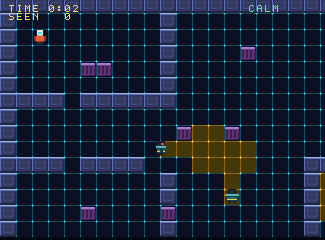

A room of GHOSTGRID is 28 by 20 tiles (448 by 320 pixels; the depot of slice 4 was 40 by 26 and chapter 6 explains why the rooms are smaller now), bigger than the screen both ways, so the camera follows the figure and stops at the room's edges. The floor, the walls, the purple cover blocks, the exit pad, the figure and the first guards are all in this picture; scrolled to the exit room in the north east it looks like this:

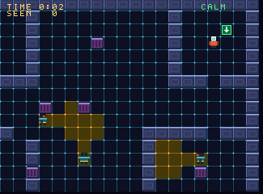

- [Pictures from PNG files](#pictures-from-png-files)
- [Tiles and rooms from text](#tiles-and-rooms-from-text)
- [Loading a room](#loading-a-room)
- [The tile layer and the camera](#the-tile-layer-and-the-camera)
- [Collision](#collision)
- [The game's frame](#the-games-frame)
- [Numbers are cheaper](#numbers-are-cheaper)
- [Testing GHOSTGRID](#testing-ghostgrid)
- [What it costs](#what-it-costs)
- [V traps in this slice](#v-traps-in-this-slice)

### Pictures from PNG files

A PNG is read when the game is described and cut into frames by a grid, across and then down: `png_cry` gives 16-bit CRY art, `png_pal` 8-bit art that indexes the game's palette. A pixel with an alpha below 128 is transparent and becomes the pixel value 0; an opaque black is not 0, it becomes the darkest colour above it.

The palette of 8-bit art is built by the pictures: every colour a `png_pal` picture uses, converted to CRY, takes the next free entry, in the order the colours are met (entry 0 is the transparent one). If you declare the palette yourself with `palette` before the first picture, a colour that is not in it is a build error that says which and where. Whichever you do, the palette is checked against the room the text layers leave (`256 - 2 * layers`), and the message names the files that added the colours.

`jaggame.new_canvas` is a picture to draw on and `save` as a PNG; the art program of the demo is built on it, and so are the tests that need a file to import.

<!-- guide:gg_declare -->
```v
game.tileset(os.join_path(art_dir(), 'tiles.png'))
game.png_pal('player', os.join_path(art_dir(), 'player.png'), 16, 16)
game.png_pal('guard', os.join_path(art_dir(), 'guard.png'), 16, 16)
game.png_pal('mark', os.join_path(art_dir(), 'mark.png'), 16, 16)
game.png_pal('cam', os.join_path(art_dir(), 'cam.png'), 16, 16)
game.png_cry('medal', os.join_path(art_dir(), 'medal.png'), 24, 24)
game.art_cry('panel', 28, 16, 1, []u16{len: 28 * 16, init: jaggame.cry(8, 12, 34)})

game.legend_tile(`.`, tile_floor, 0)
game.legend_tile(`#`, tile_wall, jaggame.flag_solid)
game.legend_tile(`c`, tile_cover, jaggame.flag_solid | jaggame.flag_cover)
game.legend_tile(`X`, tile_exit, jaggame.flag_exit)
game.legend_tile(`,`, tile_floor_lit, 0)
game.legend_tile(`;`, tile_exit_lit, jaggame.flag_exit)
game.legend_tile(`%`, tile_chip_lit, jaggame.flag_item)
game.legend_tile(`D`, tile_door_next, flag_door)
game.legend_tile(`d`, tile_door_next_lit, flag_door)
game.legend_tile(`U`, tile_door_prev, flag_door)
game.legend_tile(`u`, tile_door_prev_lit, flag_door)
game.legend_marker(`@`, marker_start, tile_floor, 0)
game.legend_marker(`[`, marker_from_prev, tile_floor, 0)
game.legend_marker(`]`, marker_from_next, tile_floor, 0)
game.legend_marker(`$`, 'chip', tile_chip, jaggame.flag_item)
for k in 0 .. max_cams {
	game.legend_marker(rune(`A` + k), 'cam${k}', tile_wall, jaggame.flag_solid)
}
for k in 1 .. 10 {
	game.legend_marker(rune(`0` + k), waypoint_marker(u8(`0` + k)), tile_floor, 0)
}
mut world := new_world(mut game)
```

`tileset` is a `png_pal` of 16 by 16 pixel tiles, numbered across and then down from 0; a game has one tile set, at most 255 tiles. The figure's sheet is four frames across (standing, one foot, the other foot, crouching) and a row for each direction, so the animations pick frames by number:

<!-- guide:gg_animations -->
```v
directions := ['down', 'up', 'left', 'right']
for d, name in directions {
	first := d * 4
	m.game.sequence('walk_${name}', [jaggame.Step{first + 1, 0.14},
		jaggame.Step{first, 0.14}, jaggame.Step{first + 2, 0.14},
		jaggame.Step{first, 0.14}])
	m.game.sequence('run_${name}', [jaggame.Step{first + 1, 0.07},
		jaggame.Step{first, 0.07}, jaggame.Step{first + 2, 0.07},
		jaggame.Step{first, 0.07}])
}
```

Every mistake in a file is a build error that names the file, and all of them come out together with the others:

<!-- guide:asset_mistakes -->
```v
	mut game := jaggame.new_game(jaggame.Config{ sprites: 2 })
	game.tileset(dir + '/tiles.png') // 40 pixels wide: not whole tiles of 16
	game.png_cry('logo', dir + '/logo.png', 16, 16) // there is no such file
	game.legend_tile(`#`, 1, jaggame.flag_solid)
	game.legend_tile(`#`, 2, 0) // a character is given once
	game.room('lab', '
#####
#..@#
##
')
	game.build() or { return err.msg().replace(dir + '/', '') }
```

```text
jaggame program:
  game: art `tileset`: tiles.png: the picture is 40x16 pixels, which a grid of 16x16 does not divide (8 columns and 0 lines are left over)
  game: art `logo`: logo.png: the file does not exist
  game: legend: the character `#` is given twice
  game: room `lab`: row 3 has 2 characters, row 1 has 5
  game: room `lab`: `.` at row 2, column 2 is not in the legend
  game: room `lab`: `@` at row 2, column 4 is not in the legend
```

A cell whose width does not fill whole phrases (a multiple of 4 pixels for CRY, 8 for 8-bit art), a file that is not a PNG, more than 255 frames and too many colours are reported the same way.

### Tiles and rooms from text

A room is a V string with one character for each tile. The legend says what a character is: `legend_tile(ch, tile, flags)` a tile number with its flags, `legend_marker(ch, name, tile, flags)` a named place that is drawn as a tile and that the game can ask for. The flags belong to the tile (two characters for one tile must give it the same), and there are eight: `flag_solid`, `flag_cover`, `flag_exit`, `flag_item` and four for the game (`flag_user1` to `flag_user4`).

Rooms are read when the game is built, so the legend may come after them, and every mistake (a character that is not in the legend, with its row and column; a row of another length; a room larger than 64 by 64 tiles; a tile the tile set does not have; a tile with two sets of flags) is reported together. A room is at most 64 by 64 tiles and the tile size is 16 by 16.

The demo's room, as it is in `main.v`: `#` is a wall, `c` a cover block, `@` where the player starts, `X` the exit pad, and the digits are markers, named places that chapter 4 uses for the guards' routes (each has a name of its own in the legend, `g0w0` and so on). `,` and `;` are in the legend but not in the text: they are the tiles a guard's cone turns the floor and the exit pad into.

<!-- guide:gg_map_depot -->
```v
const map_depot = '
############################
#.........#..........#.....#
#.@.......#..........#...X.#
#.........#....c.....#.....#
#....cc...#..........#.....#
#.........#..........#.....#
####.######..........###.###
#..........................#
#..1.......c..c.......2....#
#..........................#
####.####..........#####.###
#.........#........#.......#
#.........#...3....#...5...#
#....c....c........#...c...#
#.........#........#.......#
#.........####.#####.......#
#..........................#
#..4...................6...#
#..........................#
############################
'

```

The game asks for places by name, as expressions that are right for the room that is loaded: `marker_count(name)`, and `marker_x(name, k)` and `marker_y(name, k)`, in tiles, for place `k` in reading order (-1 when there is no such place). A name that was never declared is a build error that lists the ones that were. `game.markers_of(room, name)` gives the same positions at build time, for tests.

### Loading a room

`game.load_room(mut c, room)` (or `load_room_number` with an expression) starts loading a room. It sets the room's size (`game.room_width`, `game.room_height`, in pixels) and `game.room_number` at once, so markers can be read in the same statement list, but the tiles take a few frames: the room is drawn into a picture buffer in memory, 48 tiles a frame, copied from the room's data and drawn by machine code. While it loads, `game.loading` is true and the picture is blank (the tile layer and the sprites are not drawn; the text stays), and it starts one frame late: the picture that is already on its way to the screen is blank before the buffer is touched. The game's update goes on running; read `loading` and leave the room alone, as GHOSTGRID does (it also uses the frames to clear what the last mission left):

<!-- guide:gg_setup -->
```v
c.if_(game.loading)
game.camera_follow(mut c, m.pcx(), m.pcy())
c.for_(k, m.clear_at, m.clear_at.add(128).min(room_cells))
c.set(m.lit.at(k), 0)
c.end() // each tile of a slice
c.set(m.clear_at, m.clear_at.add(128))
m.scenes.wait(mut c) // the same step again next frame
c.ret_void()
c.end() // loading
c.call(m.setup, m.scenes.step)
```

That is the setup of the play scene (chapter 5): it runs a step a frame, and `wait` makes it stay on the same step while the room loads.

Loading is spread over frames so that a handler never lasts longer than the picture: a room of 600 tiles takes 15 frames, GHOSTGRID's 816-tile hall 18, and one of the largest (40 by 30 tiles, 1,200) would take about 27, half a second. The most any frame of loading costs is about 125,000 of the 221,000 cycles of an NTSC frame, so `missed_frames` stays 0.

`game.set_tile(mut c, column, row, tile)` changes a tile at run time and redraws it in the same frame (at most 12 a frame; up to 128 wait in a ring, so a big change shows over a few frames). `tile_at` and `flags_at` describe the room as it is, after the change.

### The tile layer and the camera

A room is drawn once into a buffer of one byte a pixel (the game's palette) at address 0x100000: a line after a line, the whole room wide, so a room of 34 by 24 tiles is 544 by 384 bytes. Every frame the display list gets one object, first so that it is behind the sprites, that shows a window of that picture. The object's data pointer picks the line and the 8-pixel phrase the camera is at; the 0 to 7 pixels that are left over move the object's position left of where it would be, and the line buffer clips what falls outside the display. The object is 41 phrases (328 pixels) wide, so there is always a phrase for the fine part.

`game.camera_x` and `game.camera_y` are ordinary `i16` variables: the world position at the left and top of the screen. Set them yourself, or call `camera_follow(mut c, x, y)`, which puts a world position in the middle of the screen as far as the room allows: it stops at the edges of the room, and in a room smaller than the screen it sets a negative camera, which centres the room. The tile layer and every sprite are drawn from the camera, so sprite positions are world positions; a sprite with `fixed` set stays where it is on the screen (a HUD sprite). The text layers are never moved.

**What was checked in both emulators.** The fine scroll is the part most likely to differ: shifting an object to the left of the display window clips on the line buffer in this emulator, and the same in Virtual Jaguar. The tests set the camera to 14 positions (every fine offset from 0 to 7, edges, corners) and compare the whole logical screen with what the room should show: every pixel agrees, on NTSC and PAL. `scripts/crosscheck` ran GHOSTGRID in Virtual Jaguar with the pad held to scroll across the first room and through the exit, and compared it with this emulator at the same frame with the same input: the frames at 120, 200 (scrolling), 287, 290, 296 (the room loading, blank), 300 and 330 (the second room, centred) are identical over the 72,525 pixels both show (the colours differ by at most 2 in a channel, the two emulators convert CRY a little differently), at one fixed offset of the two pictures. So the object's first-pixel field and a wider object were not needed. What differs is only how much of the display window each emulator shows: this one crops the middle 325 pixels, so the overhang of the layer, up to 7 pixels to the left and 8 to the right of the logical screen, is visible only in Virtual Jaguar, as the next column of the room (seen there at frame 120: 7 columns of tile pixels left of the logical screen and 1 right of it).

### Collision

`flags_at(x, y)`, `tile_at(x, y)` and `solid_at(x, y)` ask about a world position in pixels, as expressions; outside the room the tile is `tile_none` (255) and the flags are `flag_solid`. They are machine code that the interpreter has an exact copy of: about 400 cycles each.

`move_and_slide(mut c, x, y, box, dx, dy)` moves a mover whose position is the `fix` variables `x` and `y` by `dx`, `dy` against the solid tiles. The box is a `Hitbox{ox, oy, w, h}`, the part of the sprite that collides. It moves along x first, stopping flush against a wall, then along y with the new x, so pushing diagonally into a wall slides along it; afterwards `blocked_x()` and `blocked_y()` say which way a wall stopped it. **The limit is one tile: 16 pixels along an axis in one call**, so that only one new column of tiles can be entered and nothing can be tunnelled through; a larger step is cut to 16, and a faster mover calls again. The box must not start inside a wall, and the position's fraction is kept while the box is free and dropped when a wall stops it. A call costs about 4,300 cycles in the open.

`overlap(a, b)` is an expression for two rectangles, `Rect{x, y, w, h}`, sharing a pixel; `sprite.rect(hitbox)` is a sprite's.

### The game's frame

The demo's update, in the order it happens. A room has loaded (a start of the mission takes five more frames, one for the figure and one for each guard, chapter 4), and the pad turns into a movement, and the movement into a call:

<!-- guide:gg_update -->
```v
c.if_(m.phase.eq(0))
m.define_figure(mut c)
```

<!-- guide:gg_figure -->
```v
c.set(m.crouched, game.held(.b))
c.set(speed, walk_speed)

c.if_(game.held(.a))
c.set(speed, run_speed)
c.end() // running

c.if_(m.crouched)
c.set(speed, crouch_speed)
c.end() // crouching

c.if_(game.held(.up))
c.set(dy, speed.neg())
c.set(m.facing, 1)
c.end()

c.if_(game.held(.down))
c.set(dy, speed)
c.set(m.facing, 0)
c.end()

c.if_(game.held(.left))
c.set(dx, speed.neg())
c.set(m.facing, 2)
c.end()

c.if_(game.held(.right))
c.set(dx, speed)
c.set(m.facing, 3)
c.end()

game.move_and_slide(mut c, m.px, m.py, player_box, dx, dy)
c.set(m.pcell, m.pcy().shr(4).mul(room_cols).add(m.pcx().shr(4)).as_(.u16))
// a figure that pushes against a wall does not walk on the spot
moving := c.local_bool('moving')
c.set(moving,
	dx.ne(0).both(game.blocked_x().invert()).either(dy.ne(0).both(game.blocked_y().invert())))

```

The figure walks while it moves, stands when it does not and holds a pose when it crouches; what should be playing is worked out each frame and an animation is started only when that changes, because `play` starts it over:

<!-- guide:gg_animate -->
```v
// The figure walks while it moves, and stands when it does not; a
// crouching figure holds a pose. What should be playing is worked out
// each frame, and the animation is started only when that changes.
directions := ['down', 'up', 'left', 'right']
want := c.local_u8('want')
c.set(want, 0)

c.if_(m.crouched)
c.set(want, 9)
c.set(m.player.frame, m.facing.mul(4).add(3))
c.else_if(moving)
c.set(want, m.facing.add(1))

c.if_(speed.eq(run_speed))
c.set(want, want.add(4))
c.end() // running
c.end() // crouching, moving or standing

c.if_(want.ne(m.playing))
c.set(m.playing, want)
m.player.stop(mut c)

c.if_(want.eq(0))
c.set(m.player.frame, m.facing.mul(4))
c.end() // standing
for d, name in directions {
	for run in [false, true] {
		which := 1 + d + if run { 4 } else { 0 }

		c.if_(want.eq(which))
		m.player.play(mut c, '${if run { 'run' } else { 'walk' }}_${name}', true)
		c.end()
	}
}
c.end() // something else to play
```

Then the world: the sprite goes where the figure is, the camera follows, and the exit pad under the middle of the figure ends the mission:

<!-- guide:gg_world -->
```v
c.set(m.player.x, m.px.as_(.i16))
c.set(m.player.y, m.py.as_(.i16))

// What is under the middle of the figure: a chip, the exit, a door.
c.set(under, game.flags_at(m.pcx(), m.pcy()))
```

### Numbers are cheaper

Chapter 2 measured about 17,000 cycles a frame for a number that changes every frame. The slice replaced that: a `number` is machine code now (the language gained `native` and `native_ret`, an `asm` statement that the interpreter can run too, with a V copy of the same behaviour for the interpreter), one `divu` for a digit instead of the language's division, and only a cell that shows a different glyph is marked, and only a marked cell is drawn again.

| A number of 5 cells in a changing game | before | now |
|---|---|---|
| counts up by one every frame | 19,800 | 2,300 |
| every digit changes (a 16-bit value) | 19,700 | 3,100 |
| a 32-bit value, every digit changes | 20,400 | 3,900 |
| does not change | 19,700 | 1,600 |

`jaggame/rt_number_test.v` measures each and fails above a bound. The same text work took hello2 from 66,000 cycles a frame to 19,400. `print` also skips a character that is already there, so printing a HUD every frame costs a compare a character.

### Testing GHOSTGRID

Chapter 4 describes the robot that plays the mission. What belongs to this chapter: the tests that push at the walls. A random pad for 3,000 frames never puts the figure's box inside a wall (checked every frame, with the pad's run button and all), on NTSC; the guards' boxes are checked the same way for 4,000 frames. The picture of the whole logical screen is compared with the map as it is in memory (the tile layer, one pixel at a time, with the sprites and the text left out), after the room has loaded and while cones move tiles about. The camera test of slice 3 (the camera on the figure at every frame, stopping at the edges) is part of the robot's run. And the logic runs again in the interpreter, with a random pad, frame for frame:

<!-- guide:gg_compare -->
```v
sim.frame(mask)
its.frame(mask)
for name in ['px', 'py', 'phase', 'seen', 'alerts', 'level', 'secs', 'camera_x',
	'camera_y'] {
	assert b.value(name) == it.value(name), 'frame ${n}: ${name}: machine ${b.value(name)}, interpreter ${it.value(name)}'
}
for i in 0 .. 4 {
	assert gstate(b, i) == gstate(it, i), 'frame ${n}: guard ${i}: machine ${robot.state_names[gstate(b,
		i)]}, interpreter ${robot.state_names[gstate(it, i)]}'

	visited[gstate(b, i)] = true
	for field in ['x', 'y', 'face', 'wp', 'mleft', 'look', 'stuck', 'cone_n'] {
		assert b.field('guards', i, field) == it.field('guards', i, field), 'frame ${n}: guard ${i} ${field}: machine ${b.field('guards',
			i, field)}, interpreter ${it.field('guards', i, field)}'
	}
}
```

The movement, the camera and every variable of the program agree after each frame.

### What it costs

Measured on the emulated 68000 (`Player.busy_cycles`) in slice 3, with a player and no guards; a frame is about 221,000 cycles on NTSC and 265,000 on PAL. Chapter 4 has the cost of the mission.

| | Cycles |
|---|---|
| GHOSTGRID standing in the first room | 14,700 a frame |
| GHOSTGRID running | 18,900 a frame |
| the tile layer's object (in a test game with a few checks) | 1,800 a frame |
| `camera_follow` | 900 |
| `flags_at`, `tile_at` | 400 |
| `move_and_slide` in the open | 4,300 |
| loading, at most | 125,000 a frame, 48 tiles a frame |
| a changed tile | 1,500 (`set_tile` is machine code in slice 4: 200 of it is the call, the rest the drawing) |
| a number that counts | 2,300 |

A frame of the player alone left about 200,000 cycles for the work of guards.

### V traps in this slice

| Trap | Workaround |
|---|---|
| `map[string]Expr` cannot be read without an `or {}` block (the value holds a pointer) | keep the runtime's declarations in a heap struct (`&TileVars`) made when it is first needed |
| a struct with an `Expr` field cannot be left out of a literal | build it with `invalid('')` placeholders, as `new_game` does |
| a local named `map` or `i32` is refused | `grid`, `xy` |
| `_test.v` files compile alone: a helper in one is not in another | repeat the small helpers, or put what the tool needs in the module (`Canvas`) |
| zsh does not split `$H` into words, so `front core game 100 out.bmp scratch $H` passes one argument | write the holds out, or use an array |

## Chapter 4: state machines, actors and guards

Chapter 3 had a figure that walks. This chapter gives it something to fear: [`demos/ghostgrid`](../../demos/ghostgrid/main.v) is now a whole mission with no assembly. The figure starts in the north west of a depot of 28 by 20 tiles, bigger than the screen both ways, and has to reach the exit pad in the north east. Four guards patrol it. Each throws a cone of amber light on the floor, and whoever stands in that light is seen. The figure can walk, run (guards hear it), crouch behind a cover block (guards cannot see it there) and knock on a wall (a guard comes to look).

```sh
v -prod test demos/ghostgrid/       # a robot plays the mission, and the guards are tested
v run demos/ghostgrid               # writes demos/ghostgrid.jag
just run demos/ghostgrid.jag        # D-pad walk, A run, B crouch, C knock on the wall you face
```

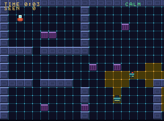

The figure is the small red and white one at the bottom. The guards are the broad teal ones with the red lens; the lens is on the side he looks to, and the amber floor is what he sees. A wall cuts the light off: the guard on the right is in a corridor, and his light stops where the corridor does. When a guard notices something a sign comes over his head, and the word at the top right says how bad it is:

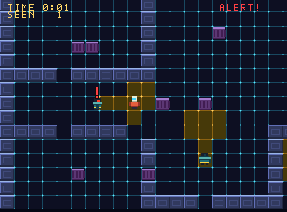

- [State machines](#state-machines)
- [Actors](#actors)
- [Line of sight](#line-of-sight)
- [Showing a cone](#showing-a-cone)
- [Hearing](#hearing)
- [The mission](#the-mission)
- [The guards](#the-guards)
- [The figure: cover, running and knocking](#the-figure-cover-running-and-knocking)
- [Testing the mission](#testing-the-mission)
- [What it costs](#what-it-costs-1)
- [Making it fit](#making-it-fit)
- [V traps in this slice](#v-traps-in-this-slice-1)

### State machines

A state machine is a set of named states, each with a body that runs once a frame while the machine is in it. It can belong to an array (one state for each element, so one machine runs a whole squad of guards) or to nothing (`machine_global`, one state at index 0). The language has no new kind of statement for it: a machine is written out as ordinary arrays and functions of the program, so the interpreter and the compiled code cannot disagree about it, and everything the language checks is checked.

<!-- guide:machine -->
```v
mut p := jaggame.new_program()
log := p.array_u8('log', 12)
n := p.u8('n')
mut door := p.machine_global('door')

mut c := door.state('closed')
c.set(log.at(n), 0)
c.inc(n)

c.if_(c.time_in_state().ge(2))
c.to('open') // the state changes now; the body of `open` runs from the next frame
c.end()

c = door.state('open')
c.set(log.at(n), 1)
c.inc(n)

c.if_(c.time_in_state().ge(1))
c.to('closed')
c.end()

c = door.on_enter('open') // runs at the transition, with time_in_state 0
c.set(log.at(n), 9)
c.inc(n)

tick := p.func('tick', [], .void)
c = p.define(tick)
door.run(mut c, 0) // one frame of the machine, for the record 0
```

`state(name)` declares a state and returns the block for its body, as `define` does for a function. Inside it `me()` is the index of the record that is being run, `time_in_state()` the number of frames it has been in the state (0 in the first frame) and `to(name)` leaves for another state. A transition sets the state and the time at once and runs the target's `on_enter` body, if it has one, straight away; the body of the new state runs from the next frame, and the statements after `to` in the old body still run (follow it with `ret_void()` to stop). `run(c, index)` runs one record for one frame. Run for ten frames, the door above has been through these states, where 0 is the body of `closed`, 1 of `open` and 9 the `on_enter` of `open`:

```text
0 0 0 9 1 1 0 0 0 9
```

What a machine `m` adds to the program is plain to see and to test: `m_state`, `m_time` and `m_fresh` (an array with one element for each record; `m_fresh` is 1 from a transition to the end of that frame's `run`, so the body of the first frame sees time 0), a function `m_<state>(self)` for each state, `m_<state>_enter(self)` for each `on_enter`, `m_to_<state>(self)` for each transition that is used, and `m_run(self)`, which calls the body of the current state and then counts the frame. The robot in this chapter reads `guard_ai_state` by name. `m.start(c, index, state)` puts a record in a state from outside (a guard that was just spawned), `m.state_of(index)`, `m.time_of(index)` and `m.in_state(index, name)` are expressions.

The design said `c.go(...)` and a jump table. `go` is a V keyword, so the transition is `to`. The dispatch is an if chain: with five states the table would not have been faster, and an if chain is language, which the interpreter runs, where a table needed a native routine. The state variable is in arrays of the machine and not a hidden field of the record, because a record's layout is fixed when it is declared, before the machine is.

The three mistakes a machine can make are build errors and are reported together with the others:

<!-- guide:machine_mistakes -->
```v
mut p := jaggame.new_program()
mut guard := p.machine_global('guard')
mut c := guard.state('patrol')
c.to('chase') // there is no such state
guard.state('patrol') // a state is declared once
p.machine_global('camera') // a machine needs states
p.check() or { return err.msg() }
```

```text
jaggame program:
  machine `guard`: the state `patrol` is defined twice
  machine `guard`: a transition to the state `chase`, which does not exist; the states are: patrol
  machine `camera` has no states
```

A state may be named before it is declared (`a` going to `b`, declared after): which states exist is checked when the program is built.

### Actors

An array of records and a sprite for each is what most games' creatures are, so there is a thin helper for it. An actor array has the fields every actor has (`x` and `y` as `fix`, `face` as an angle, `live`) and the ones the game adds; actor `i` owns sprite `first + i` of the pool.

<!-- guide:gg_actors -->
```v
guards := game.actors('guards', guard_fields(), max_guards, sprite_guard)
cams := game.actors('cams', cam_fields(), max_cams, sprite_cam)
```

<!-- guide:gg_fields -->
```v
return [jaggame.Field{'wp', .u8}, jaggame.Field{'first', .u8},
	jaggame.Field{'count', .u8}, jaggame.Field{'dir', .u8},
	jaggame.Field{'mleft', .u8}, jaggame.Field{'pause', .u8},
	jaggame.Field{'look', .u8}, jaggame.Field{'exposure', .u8},
	jaggame.Field{'lost', .u8}, jaggame.Field{'stuck', .u8},
	jaggame.Field{'moving', .bool}, jaggame.Field{'stale', .bool},
	jaggame.Field{'spot_x', .i16}, jaggame.Field{'spot_y', .i16},
	jaggame.Field{'cone_x', .i16}, jaggame.Field{'cone_y', .i16},
	jaggame.Field{'cone_f', .u8}, jaggame.Field{'cone_n', .u8}]
```

`spawn(x, y)` is a call that clears the first dead actor's record, makes it live at a position, shows its sprite and gives its number (65535 if all are alive); `remove(c, i)` kills one and hides its sprite; `each(c, i)` opens a loop over the live actors, closed by the one `end()` (a `for_` and an `if_` in one, so `break_` and `continue_` work); `show(c, i, ox, oy)` puts the sprite on the actor. Everything else is a field: `guards.x(i)`, `guards.field(i, 'wp')`. A machine goes with the array: `p.machine('guard_ai', guards.records)`, run inside `each`:

<!-- guide:gg_guards -->
```v
m.guards.each(mut c, i)
m.ai.run(mut c, i)

c.end() // each guard

c.set(m.worked, false)
c.for_(k, 0, max_guards)
c.set(g, game.frame.add(k).and(3).as_(.u16))

c.if_(m.guards.live(g).both(m.gf(g, 'stale')))
c.call(m.cone, g)
c.set(m.worked, true)
c.break_()
c.end() // a cone to work out
c.end() // each guard, from a different one every frame
```

### Line of sight

Angles are `u8`, 256 to the turn: 0 is right, 64 down (the screen's y goes down), 128 left, 192 up. A sine table (`game.sine(angle)`, `cosine`, scaled to -127..127) and an arctangent (`game.direction(dx, dy)`, which is a table of 64 steps and one division, within one 256th of a turn of the real one) come with the runtime.

`game.can_see(from_x, from_y, facing, to_x, to_y, range, half_angle)` is a `bool` expression with three tests, the cheapest first: the target is within `range` pixels (at most 255); it is within `half_angle` (0 to 64) of the facing, which is a dot product against the sine table and a compare of squares, no division; and no wall is on the line between. The positions are world pixels. A wall blocks sight; a cover block (`flag_cover`) blocks it only for a target that is crouching, which is what `can_see_crouched` asks and `can_see` does not. `game.line_clear(...)` is the third test on its own.

The line is the hot part, so it is machine code (a `native` routine, with a V twin for the interpreter, as the tile queries are). It looks at the tile under every 8th pixel along the longer axis of the line, not at the two ends: positions are kept as 16.16 numbers, the step as 128ths of a pixel from one `divu`, so the pixel is the high word and the tile that word shifted by 4; a position outside the room is a word that is not below the room's size. A wall that the line crosses for 10 pixels or more is never missed; one it merely grazes can be, which is what a cone through a diagonal crack between two blocks does. A line longer than 255 pixels along an axis is blocked. The tests run the machine code, the interpreter's twin and a plain V model that works out every place from the start with a multiplication, against each other on 3,640 random queries in 14 random rooms (a mix of walls and cover blocks, targets that stand and crouch, the cone's edge, the direction), and the model against a one-pixel walk, which no wall of 10 pixels or more crosses unseen. A look of 15 places costs about 5,400 cycles with the cone test in the language.

### Showing a cone

The guards have to be seen to be avoided, so the cone is lit on the floor, and **what is lit is what sees**: a guard sees the figure when the figure's tile is in the guard's list of lit tiles (and, if the figure crouches, when a cover block is not on the line).

The ways to draw it were two. A low-resolution overlay filled by the GPU would be an object of its own on top of the tile layer, and the Jaguar's object processor has no blending, so a cone would be a stipple of transparent pixels, and it would have to be kept in step with the walls by a second routine. Tiles that change colour need nothing new: the tile set has a second floor with an amber grid, `set_tile` draws a tile in place, and a cone is the floor tiles under it. That is what GHOSTGRID does, and what it costs is the part to measure.

A cone looks at every tile in range, and a wall walk for every tile on every frame would be a lot, so it is done once, when the game is built: `game.view_cells(room, tile_x, tile_y, facing, range, half_angle, crouched)` gives the tiles that a guard standing in the middle of a tile sees, by `can_see` from the middle of that tile to the middle of the other (walls are not in the list). The demo asks it for every tile a guard can stand on and every facing, and keeps the answers in tables:

<!-- guide:gg_views -->
```v
world.views(mut game)
```

A test asks the machine's `can_see` about every floor tile of six random rooms from random tiles and facings, standing and crouching (20,410 questions) and the lists agree with it on all. A cone on the screen is then a table look-up. A byte for each tile (`lit`) says which guards' cones are on it (a bit for each guard); moving a cone changes only the tiles that are in one list and not in the other, drawn with `set_cell` (new: `set_tile` for a cell number; both are machine code now):

<!-- guide:gg_cone -->
```v
c = p.define(m.light)
src := m.light.arg('src')
key := m.light.arg('key')
old_n := m.light.arg('old_n')
k := c.local_u16('k')
n := c.local_u8('n')
start := c.local_u32('start')
cell := c.local_u16('cell')
bit := c.local_u16('bit')
marked := c.local_u16('marked')
bits := c.local_u16('bits')
first := c.local_u16('first')
c.set(bit, jaggame.lit(1).as_(.u16).shl(src))
c.set(marked, bit.shl(8))
c.set(start, m.pool_base.at(game.room_number).add(m.view_at.at(key)))
c.set(n, m.view_len.at(key))
c.set(first, src.mul(cone_slots).as_(.u16))

// Mark the cells of the new cone, so that the cells that stay are not
// drawn twice.
c.for_(k, 0, n)
c.set(cell, m.pool_cell.at(start.add(k)))
c.set(bits, m.lit.at(cell))
c.set(m.lit.at(cell), bits.or_(marked))
c.end() // each new cell

// The cells that were lit and are not any more.
c.for_(k, 0, old_n)
c.set(cell, m.old_cell.at(first.add(k)))
c.set(bits, m.lit.at(cell))

c.if_(bits.and(marked).eq(0))
c.set(bits, bits.and(bit.not()))
c.set(m.lit.at(cell), bits)

c.if_(bits.and(0x7f).eq(0))
game.set_cell(mut c, cell, m.dim_of.at(game.tile_cell(cell))) // no cone is on it any more
c.end() // dark
c.end() // gone
c.end() // each old cell

// The cells that are lit now and were not; the list is kept for next time.
c.for_(k, 0, n)
c.set(cell, m.pool_cell.at(start.add(k)))
c.set(bits, m.lit.at(cell))

c.if_(bits.and(bit).eq(0))

c.if_(bits.and(0x7f).eq(0))
game.set_cell(mut c, cell, m.glow_of.at(game.tile_cell(cell))) // the first cone on it
c.end() // lit
c.set(bits, bits.or_(bit))
c.end() // new
c.set(m.lit.at(cell), bits.and(marked.not()))
c.set(m.old_cell.at(first.add(k)), cell)
c.end() // each new cell
c.ret(n)
```

A guard's cone is out of date when he has gone into another tile or turned, and one is worked out a frame, the guard picked by the frame number, so that four guards turning at once cost four frames and not one big one.

### Hearing

`game.noise(c, x, y, radius)` makes a noise at a world position; `game.hears(x, y)` is true for a listener within its radius (a circle, walls do not stop it) during the frame it was made and the next, so that whoever runs before the maker of the noise hears it too. A later noise replaces the one before. The figure makes two:

<!-- guide:gg_noise -->
```v
c.if_(moving.both(speed.eq(run_speed)).both(game.frame.and(7).eq(0)))
game.noise(mut c, m.pcx(), m.pcy(), run_hearing)
c.end() // running

// A knock on the wall the figure faces is heard further.
c.if_(game.pressed(.c))
c.set(probe_x, m.pcx())
c.set(probe_y, m.pcy())

c.if_(m.facing.eq(0))
c.add_to(probe_y, 12)
c.else_if(m.facing.eq(1))
c.sub_from(probe_y, 12)
c.else_if(m.facing.eq(2))
c.sub_from(probe_x, 12)
c.else_()
c.add_to(probe_x, 12)
c.end() // which way

c.if_(game.solid_at(probe_x, probe_y))
game.noise(mut c, m.pcx(), m.pcy(), knock_hearing)
game.play(mut c, 'knock')
c.set(m.flash, 40)
c.end() // a wall to knock on
c.end() // C pressed
```

A figure that runs is heard five tiles away, every eighth frame; one that walks or crouches is not. A knock is the **C** button with a solid tile within 12 pixels of the middle of the figure in the direction it faces, and is heard seven tiles away (the word KNOCK shows on the HUD for 40 frames). Guards on patrol or on their way back react; a guard that is already suspicious, searching or chasing has his mind on something else.

### The mission

The depot is text. `#` is a wall, `c` a cover block, `X` the exit, `@` the start, and the digits are the guards' waypoints:

<!-- guide:gg_map_depot -->
```v
const map_depot = '
############################
#.........#..........#.....#
#.@.......#..........#...X.#
#.........#....c.....#.....#
#....cc...#..........#.....#
#.........#..........#.....#
####.######..........###.###
#..........................#
#..1.......c..c.......2....#
#..........................#
####.####..........#####.###
#.........#........#.......#
#.........#...3....#...5...#
#....c....c........#...c...#
#.........#........#.......#
#.........####.#####.......#
#..........................#
#..4...................6...#
#..........................#
############################
'

```

Which digit belongs to which guard and in which order is the game's: guard 0 patrols between `1` and `2`, a corridor with a one-tile alcove in the middle, closed to either side by cover blocks; guard 1 between `3` and `4` in the west hall; guard 2 is a sentinel with the single waypoint `5` and stands in front of the exit room's door; guard 3 goes round a block in the north west. The markers have a name each (`g0w0`, `g0w1`, ...), because the markers of one name come back in reading order, not in the order of the route.

To finish the mission the figure must reach the exit pad unseen, or at least not caught. It is *caught* when a guard that is chasing it touches it (their boxes overlap), which ends the mission and offers a restart: **A** (or Pause) loads the room again and starts over. The alert does not time out by itself: a guard that has lost the figure for 50 frames goes to look at the last place it was seen, looks all round and walks back. Reaching the pad completes the mission and the screen shows the time taken and how many times a guard noticed the figure; the clock at the top left runs while you play and the word at the top right is CALM, CAUTION (somebody is suspicious or searching) or ALERT! (somebody is chasing).

The first frames of a mission are spread out: a room takes 15 to 27 frames to load, during which the update only keeps the camera on the figure and clears the lit tiles of the last mission 128 a frame, and the start itself (the figure, then each guard) is one step a frame, so that no frame is longer than the picture.

### The guards

A guard is an actor with a state machine of five states:

| State | What the guard does | Leaves for |
|---|---|---|
| `patrol` | walks the route, 45 frames at each waypoint, turning to look along the next leg | `suspicious` when the figure is in his cone or a noise is heard |
| `suspicious` | stands 20 frames looking at the spot, walks to it, looks all round (four turns of 20 frames) | `alert` when he has seen the figure for 24 frames in all; `return` when he has looked |
| `alert` | chases the figure at twice the patrol speed; touching it ends the mission | `search` after 50 frames without sight |
| `search` | goes to where he last saw the figure, looks all round | `alert` if he sees it; `return` |
| `return` | goes to the middle of the tile he is on, then back along the route | `suspicious` if he notices something; `patrol` at the waypoint |

<!-- guide:gg_states -->
```v
mut c := m.ai.state('patrol')
mut i := c.me()
c.set(m.gf(i, 'moving'), false)

c.if_(m.watch.call(i))
m.spot_figure(mut c, i)
c.inc(m.seen)
c.to('suspicious')
c.ret_void()
c.end() // saw something

c.if_(game.hears(m.gcx(i), m.gcy(i)))
m.spot_noise(mut c, i)
c.to('suspicious')
c.ret_void()
c.end() // heard something

c.if_(m.gf(i, 'pause').gt(0))
c.dec(m.gf(i, 'pause'))
c.ret_void()
c.end() // waiting at a waypoint

c.if_(m.follow.call(i, 1))
c.set(m.gf(i, 'wp'), m.gf(i, 'wp').add(1))

c.if_(m.gf(i, 'wp').ge(m.gf(i, 'count')))
c.set(m.gf(i, 'wp'), 0)
c.end() // round the route
c.set(m.gf(i, 'pause'), 45)
// Turn to look along the next leg.
way := c.local_u8('way')
c.set(way,
	m.flow.at(m.gf(i, 'first').add(m.gf(i, 'wp')).as_(.u16).mul(room_cells).add(m.gcy(i).shr(4).mul(room_cols).add(m.gcx(i).shr(4)).as_(.u16))))

c.if_(way.ne(255))
c.set(m.guards.face(i), way.shl(6))
c.set(m.gf(i, 'stale'), true)
c.end() // there is a next leg
c.end() // at the waypoint

c = m.ai.state('suspicious')
i = c.me()
c.set(m.gf(i, 'moving'), false)

c.if_(m.watch.call(i))
m.spot_figure(mut c, i)

c.if_(m.gf(i, 'exposure').ge(alert_after))
c.to('alert')
c.ret_void()
c.end() // sure now
c.end() // in view

c.if_(c.time_in_state().lt(20))

c.if_(c.time_in_state().eq(0))
c.set(m.guards.face(i), game.direction(m.gf(i, 'spot_x').as_(.i32).sub(m.gcx(i)), m.gf(i,
	'spot_y').as_(.i32).sub(m.gcy(i))).add(32).and(0xc0))
c.end() // turn to the spot
c.ret_void()
c.end() // standing still

c.if_(m.around.call(i, 1.0))
c.to('return')
c.end() // done looking

c = m.ai.state('alert')
i = c.me()
c.set(m.gf(i, 'moving'), false)

c.if_(m.watch.call(i))
c.set(m.gf(i, 'lost'), 0)
m.spot_figure(mut c, i)
c.else_()
c.set(m.gf(i, 'lost'), m.gf(i, 'lost').add(1).min(255))
c.end() // in view
c.call(m.chase, i, m.gf(i, 'spot_x').as_(.i32), m.gf(i, 'spot_y').as_(.i32), 2.0)

c.if_(m.guards.x(i).sub(m.px).abs().lt(13.0).both(m.guards.y(i).sub(m.py).abs().lt(13.0)))

c.if_(jaggame.overlap(m.guards.sprite(i).rect(catch_box), m.player.rect(catch_box)))
c.set(m.phase, 2) // caught
c.end() // touched the figure
c.end() // near it

c.if_(m.gf(i, 'lost').gt(lose_after))
c.to('search')
c.end() // lost it

c = m.ai.state('search')
i = c.me()
c.set(m.gf(i, 'moving'), false)

c.if_(m.watch.call(i))
m.spot_figure(mut c, i)
c.to('alert')
c.ret_void()
c.end() // there it is

c.if_(m.around.call(i, 1.5))
c.to('return')
c.end() // looked everywhere

c = m.ai.state('return')
i = c.me()
c.set(m.gf(i, 'moving'), false)

c.if_(m.watch.call(i))
m.spot_figure(mut c, i)
c.inc(m.seen)
c.to('suspicious')
c.ret_void()
c.end() // saw something

c.if_(game.hears(m.gcx(i), m.gcy(i)))
m.spot_noise(mut c, i)
c.to('suspicious')
c.ret_void()
c.end() // heard something

c.if_(m.gf(i, 'look').eq(0))
// First to the middle of the tile it is on, then it can use the field again.
c.if_(m.chase.call(i, m.gcx(i).shr(4).shl(4).add(8), m.gcy(i).shr(4).shl(4).add(8), 1.0).either(m.gf(i,
	'stuck').gt(30)))
c.set(m.guards.x(i), m.gcx(i).shr(4).shl(4).as_(.fix))
c.set(m.guards.y(i), m.gcy(i).shr(4).shl(4).sub(1).as_(.fix))
c.set(m.gf(i, 'look'), 1)
c.set(m.gf(i, 'mleft'), 0)
c.end() // on the middle
c.ret_void()
c.end() // not on it yet

c.if_(m.follow.call(i, 2))
c.set(m.gf(i, 'pause'), 20)
c.to('patrol')
c.end() // back on the route

// Every state starts with a clean sheet when it is entered.
for name in ['suspicious', 'alert', 'search', 'return'] {
	mut e := m.ai.on_enter(name)
	j := e.me()
	e.set(m.gf(j, 'look'), 0)
	e.set(m.gf(j, 'pause'), 0)
	e.set(m.gf(j, 'stuck'), 0)
	e.set(m.gf(j, 'lost'), 0)
	if name == 'return' {
		e.set(m.gf(j, 'mleft'), 0)
	}
	if name == 'alert' {
		game.play(mut e, 'spotted')
		e.inc(m.alerts)
	}
}
```

Guards walk the route along the centres of tiles, by a field of directions that was worked out when the game was built (a breadth-first search from each waypoint over the open tiles, one byte for each tile and waypoint), so a guard on his route cannot be stuck on a corner. Free movement, to a spot or after the figure, is `move_and_slide` towards a point, with the rule that a guard that has not moved for 30 frames gives up (`stuck`), so that a spot behind a wall costs him a few seconds and not his life. `return` goes back to a tile centre and joins the field again, wherever he was.

Sensing is `watch`:

<!-- guide:gg_watch -->
```v
mut c := p.define(m.watch)
mut i := m.watch.arg('i')
sees := c.local_bool('sees')
gtx := c.local_i32('gtx')
gty := c.local_i32('gty')
ptx := c.local_i32('ptx')
pty := c.local_i32('pty')
exposure := m.gf(i, 'exposure')
bit := jaggame.lit(1).as_(.u16).shl(i)

c.if_(m.lit.at(m.pcell).and(bit).ne(0))
c.set(sees, true)

c.if_(m.crouched)
c.set(gtx, m.gcx(i).shr(4).shl(4).add(8)) // the centres of the two tiles
c.set(gty, m.gcy(i).shr(4).shl(4).add(8))
c.set(ptx, m.pcx().shr(4).shl(4).add(8))
c.set(pty, m.pcy().shr(4).shl(4).add(8))
c.set(sees,
	game.can_see_crouched(gtx, gty, m.guards.face(i), ptx, pty, sight_range, sight_half))
c.end() // crouching
c.end() // in a lit tile

// How long it has been in view: it grows while seen, and fades.
c.if_(sees)

c.if_(exposure.lt(255))
c.inc(exposure)
c.end() // not at the top
c.else_if(game.frame.and(1).eq(0).both(exposure.gt(0)))
c.dec(exposure)
c.end() // seen or not
c.ret(sees)
```

A guard looks at the byte of the figure's tile in `lit`, one look-up; only when the figure crouches does he ask `can_see_crouched`, between the middles of the two tiles. How long the figure has been in view (`exposure`) grows a frame at a time while it is seen and fades by one every second frame; a calm guard is suspicious at the first glimpse and sure after 24.

### The figure: cover, running and knocking

<!-- guide:gg_figure -->
```v
c.set(m.crouched, game.held(.b))
c.set(speed, walk_speed)

c.if_(game.held(.a))
c.set(speed, run_speed)
c.end() // running

c.if_(m.crouched)
c.set(speed, crouch_speed)
c.end() // crouching

c.if_(game.held(.up))
c.set(dy, speed.neg())
c.set(m.facing, 1)
c.end()

c.if_(game.held(.down))
c.set(dy, speed)
c.set(m.facing, 0)
c.end()

c.if_(game.held(.left))
c.set(dx, speed.neg())
c.set(m.facing, 2)
c.end()

c.if_(game.held(.right))
c.set(dx, speed)
c.set(m.facing, 3)
c.end()

game.move_and_slide(mut c, m.px, m.py, player_box, dx, dy)
c.set(m.pcell, m.pcy().shr(4).mul(room_cols).add(m.pcx().shr(4)).as_(.u16))
// a figure that pushes against a wall does not walk on the spot
moving := c.local_bool('moving')
c.set(moving,
	dx.ne(0).both(game.blocked_x().invert()).either(dy.ne(0).both(game.blocked_y().invert())))

```

The rules, exactly as implemented:

- **Walking** is 1.5 pixels a frame, **running** (A) 3, **crouching** (B) 0.75. Crouching wins over running.
- **A standing or running figure** is seen by a guard whose cone is on its tile. A cover block does not hide it: it is seen over the block.
- **A crouching figure** is hidden from a guard whose line to it, between the middle of the guard's tile and the middle of its own, crosses a cover block (a wall hides it from anyone). It does not matter how far the block is from the figure. It is not hidden in the open: crouching in a lit tile with nothing between is being seen, slowly. The doorway of the exit room has a cover block in front of it for exactly this: a crouching figure in the door is in the sentinel's lit floor and he does not see it.
- **Running** makes a noise of five tiles every eighth frame; **a knock** makes one of seven.

### Testing the mission

The robot reads what it needs from the machine's memory by name: where each guard is (`guards` fields `x`, `y`, `face`), his state (`guard_ai_state`) and which tiles are lit (`lit`). It does not guess. Guards walk the same way whatever the figure does as long as they do not notice it, so the game is first run in the interpreter with the figure parked in a wall and the cones of every frame written down, from the game's own `lit` words. A breadth-first search over (tile, time) then finds the walk that never stands in a lit tile, in steps of four frames, with a margin of two frames each side, waiting where it has to, crouching where a cover block hides it, and moving crouched where that is the only way. (In slice 4 the depot needed a knock to draw a guard away, and the robot knocked; the missions of chapter 6 do not, so the robot only walks, and the knock is tested on its own in `guards_test.v`.) Chapter 6 shows the robot as it is now, on all ten missions with chips, doors and cameras. Its run is played on the machine, on NTSC and PAL, and its result is checked:

<!-- guide:gg_robot -->
```v
assert r.phase == 1, '${def.title} ${std}: the mission is done, not ${r.phase}'
assert r.seen == 0 && r.alerts == 0, '${def.title} ${std}: never seen'
assert r.secs == secs, '${def.title} ${std}: ${r.secs} seconds, expected ${secs}'
assert r.rank == rank, '${def.title} ${std}: rank ${rank_letters[r.rank]}, expected ${rank_letters[rank]} (score ${r.score} against ${def.ranks})'
assert b.value('missed_frames') == 0, '${def.title} ${std}: ${b.value('missed_frames')} frames missed'
if def.limit > 0 {
	assert r.secs < def.limit, '${def.title}: inside the limit'
}
if s.find(s.first[mission], `$`).len > 0 {
	assert b.value('chips_left') == 0, '${def.title}: every chip is taken'
}
assert b.value('room_at') == def.rooms.len - 1, '${def.title}: in the last room'
assert scene_of(Sim(b)) == robot.scene_result
// the result screen and the record
sim := Sim(b)
assert screen_text(sim, 0, 4, 16) == 'MISSION COMPLETE'
assert screen_text(sim, 6, 9, 1) == rank_letters[rank]
assert screen_text(sim, 7, 9, 4) == robot.clock_text(secs)
word := int(b.p.m.eeprom.words[1 + mission])
assert word == (rank << 12 | secs), '${def.title}: the record holds ${word}'
```

Every frame, a guard saw nothing, every guard but the sentinel stayed in patrol, the sentinel was drawn out and went back, the machine and the interpreter agreed on the figure and every guard, and at the end every variable of the program was the same on both.

The other tests set up one situation each, on NTSC and PAL:

| Test | What it proves |
|---|---|
| a figure that stands in a guard's path | he goes patrol, suspicious, alert, and catches it in under 400 frames; the guards stop; A starts a new mission |
| a running figure is heard where a walking one is not | behind the sentinel, outside his cone, 4 tiles away: running wakes him within 60 frames and he has not *seen* it; walking for 360 frames does nothing |
| a knock draws the nearest guard | the sentinel, seven tiles away, comes to the spot; the other three stay on patrol; he looks round, returns and is back at his post |
| a crouched figure behind cover is not seen | in the sentinel's lit doorway behind the crate: crouched, 200 frames unseen; standing, seen within 30 |
| guards never walk through a wall or stay stuck | 4,000 frames (2,500 on PAL): every frame every guard's box is clear of the walls, no patrolling guard stands still for 120 frames, and every guard with a route goes round it |
| a figure pushed about at random never enters a wall | 3,000 frames of a random pad |
| the picture | the logical screen is compared with the map as it is in memory, pixel for pixel, with the sprites and the text left out; the amber floor is in it |
| the interpreter | 1,800 frames of a random pad, with the figure put in front of the guards now and then, so that all five states are visited: after each frame the machine and the interpreter agree on the figure and every guard, and at the end on every variable |

<!-- guide:gg_compare -->
```v
sim.frame(mask)
its.frame(mask)
for name in ['px', 'py', 'phase', 'seen', 'alerts', 'level', 'secs', 'camera_x',
	'camera_y'] {
	assert b.value(name) == it.value(name), 'frame ${n}: ${name}: machine ${b.value(name)}, interpreter ${it.value(name)}'
}
for i in 0 .. 4 {
	assert gstate(b, i) == gstate(it, i), 'frame ${n}: guard ${i}: machine ${robot.state_names[gstate(b,
		i)]}, interpreter ${robot.state_names[gstate(it, i)]}'

	visited[gstate(b, i)] = true
	for field in ['x', 'y', 'face', 'wp', 'mleft', 'look', 'stuck', 'cone_n'] {
		assert b.field('guards', i, field) == it.field('guards', i, field), 'frame ${n}: guard ${i} ${field}: machine ${b.field('guards',
			i, field)}, interpreter ${it.field('guards', i, field)}'
	}
}
```

**Second emulator.** In slice 4 the image ran in Virtual Jaguar with a handful of pad holds; the robot's own run could not be replayed there. It can now: chapter 6 has the replay and its numbers.

### What it costs

Measured on the emulated 68000 (`Player.busy_cycles`) in slice 4, on its mission of four guards; a frame is 221,000 cycles on NTSC and 265,000 on PAL. Chapter 6 has the final numbers.

| | NTSC cycles a frame | PAL |
|---|---|---|
| the figure alone, guards gone | 20,300 | 20,400 |
| four guards standing at their waypoints (sensing, sprites, signs) | 34,700: 3,600 a guard | 34,800 |
| four guards on patrol, cones lit (typical) | 46,800 on average (21%), 90% under 71,700, at most 118,700 | 47,000 (18%) |
| one more cone moved | about 25,000 in the frame that does it | the same |
| worst case: four guards chasing, the figure running, cones moving | 80,400 on average (36%), 90% under 106,700, at most 175,600 | 80,500 (30%), at most 175,800 |

A guard costs about 3,600 cycles of sensing, sprites and signs, 3,000 of walking, and moving his cone about 25,000 in the one frame in 8 to 16 that has to. No frame is missed in any of it. A frame of the worst case leaves more than 40% for sound and for more guards.

### Making it fit

The first version of the mission was slow: four guards on patrol cost 96,000 cycles a frame on average and the frames that moved a cone ran past the end of the frame (a missed frame, 221,000 and more). In the order the task gave:

1. **Tables built with the game.** The cone of a guard is the walk of 14 or so places for each of a dozen tiles; the first version did the walks in the frame. `view_cells` does them when the game is built and a cone is a table look-up (image 66 KB, now 95 KB): the average went from 96,000 to 63,000 and the worst frame from 221,000 to 203,000.
2. **Machine code.** `set_tile` was a language function of fifteen operations, and a cone changes up to 30 tiles: it is now machine code, with `set_cell` beside it and a V twin for the interpreter (the existing tile tests pass unchanged, and a new one fills the queue past 64 and checks the count of what is lost). The worst frame went to 165,000. The tile walk of `can_see` was machine code from the start.
3. **Doing less, and in other frames.** Stored per frame what only changes sometimes: the figure's tile number once a frame instead of once for each guard, the clock's seconds counted and the HUD written when a number changes, the animation chosen once and started when it changes, a guard's cone marked stale where he moves and not asked every frame. The clearing of the lit tiles and the start are spread over frames, which also took the one 221,000-cycle frame at the start out.
4. **The code generator.** A loop that cleared a byte cost 415 cycles a turn. Three cheap changes, all in `codegen.v`: a comparison in an `if_` or a loop branches on the flags of its `cmp` and does not make a 0 or a 1 first; the right operand of an operation that is a constant or a variable is loaded straight into `d1` without going through the stack; a variable that is set to a constant, or to itself plus or minus a constant (`inc`, `add_to`, `dec`), is one instruction on the variable, and an element is set from a simple value without the stack. The loop is 250 cycles a turn; the guards 50,100 on average and 143,000 at most. The differential fuzzer still agrees on all 20,800 programs (the same ones as before, with the state machines added), and it catches planted bugs in the new code: with the condition code of `lt` made `gt` it fails at once, and with the `sub` of a constant made an `add` it fails. Both were tried and the code restored.
5. A shorter range: the cone went from 5 tiles to 4, about two thirds of the cells, and with it every cost of a cone: 46,800 on average and 118,700 at most (the table above).

The measured worst case was 97,000 on average before the code generator's changes and 80,000 after.

### V traps in this slice

| Trap | Workaround |
|---|---|
| `spawn` is a V keyword | the function is `spawn_f`, the call `spawn(x, y)` |
| a computed constant (`const cells = cols * rows`) cannot be passed where a `Val` is wanted: the C compiler cannot take its address | write the number, and let a test check it |
| a struct literal of the game's own `Expr`s has to name every field | `new_mission` makes all of them in one literal |
| `jaggame.Room{...}` with positional fields only works inside the module | name the fields, or keep a `const` |
| the formatter wraps a call inside a string interpolation and breaks a `// guide:` region's line match | keep the long messages in a variable |
| `front` took at most 16 holds (slice 4) | it takes them from a file now (`--holds-file`) |

## Chapter 5: scenes, menus, sound, save data and the backdrop

Chapter 4 ended with one mission that starts at once. This chapter makes it a game: a title, a mission select, the mission with a pause menu, a result; sound effects and two tracks of music; the best time kept on the cartridge's EEPROM; and a backdrop that the GPU draws behind the menus. Every piece is ordinary program code, so the interpreter runs it too and the tests compare the two.

### Scenes

A scene is a state of a global state machine called `scene` (chapter 4), with a few additions. `game.scenes()` returns the handle; `scene(name)` returns the block for the scene's update, which runs every frame while the scene is the current one; `on_enter(name)` and `on_leave(name)` run when it begins and ends; `setup(name, steps)` is work spread over frames; `go(mut c, name)` is the transition; `start(name)` says where the game begins, after its `init`. The title shows the shape of it:

<!-- guide:gg_title -->
```v
mut c := scenes.on_enter('title')
m.menu_screen(mut c)
c.set(m.msg.colour, jaggame.cry(150, 235, 255))
m.msg.print(mut c, 7, 3, 'GHOSTGRID')
m.msg.print(mut c, 3, 5, 'A STEALTH TRAINER')
game.music_play(mut c, 'calm')

c = scenes.scene('title')
c.if_(game.music_is('calm').both(game.music_rows().and(8).ne(0)))
m.msg.print(mut c, 8, 9, 'PRESS A')
c.else_()
m.msg.print(mut c, 8, 9, '       ')
c.end() // blink, on the beat of the music

c.if_(game.pressed(.a).either(game.pressed(.pause)))
game.play(mut c, 'menu_select')
c.set(m.page, 0)
scenes.go_fade(mut c, 'picker')
c.end() // go on
```

- **`go` is immediate.** The scene that is left runs its `on_leave`, the new one its `on_enter`; the new scene's update (or its setup) begins next frame. The statements after `go` still run, so follow it with `ret_void()` where they should not.
- **A setup is a step a frame.** `setup(name, steps)` runs its block once a frame for `steps` frames after the scene begins, `scenes.step` saying which; the scene's update starts when the last is done (`scenes.settled()`). A step that has to wait calls `scenes.wait(mut c)`, and the same step runs again next frame. The mission's setup waits while the room loads and then puts the figure and each guard on their start in a frame of its own:

<!-- guide:gg_setup -->
```v
c.if_(game.loading)
game.camera_follow(mut c, m.pcx(), m.pcy())
c.for_(k, m.clear_at, m.clear_at.add(128).min(room_cells))
c.set(m.lit.at(k), 0)
c.end() // each tile of a slice
c.set(m.clear_at, m.clear_at.add(128))
m.scenes.wait(mut c) // the same step again next frame
c.ret_void()
c.end() // loading
c.call(m.setup, m.scenes.step)
```

- **The play scene** is those and an update:

<!-- guide:gg_play -->
```v
mut c := scenes.on_enter('play')

c.if_(game.backdrop_shown())
game.backdrop_hide(mut c)
c.end() // the backdrop is behind a menu
game.load_room_number(mut c, m.room_of())
c.set(m.clear_at, 0)
game.music_play(mut c, 'calm')

c = scenes.on_leave('play')
c.set(m.paused, false)
m.panel.hide(mut c)
m.limit.stop(mut c)

c = scenes.setup('play', max_guards + 2)
m.define_play_setup(mut c)

c = scenes.scene('play')
m.define_play_update(mut c)
```

- **Mistakes are build errors:** a scene declared twice, `go` to a scene that does not exist, an `on_leave` or a setup of a scene that does not exist, no scenes, no `start`, a `start` that names no scene. All are reported together, with the scenes that do exist.
- **A fade between scenes** (added in slice 6): `go_fade(mut c, name)` is `go` through black. The picture dims in eight frames (the scene's update does not run), the scenes change while it is black, the new scene's setup runs, and the picture comes back in eight before the update begins. `game.fade` is the brightness, 0 to 16: the machine scales the intensity of every entry of the colour table to it, and the text colours too, so tiles, 8-bit sprites and text fade and the 16-bit backdrop and sprites do not. A game may set `game.fade` itself (GHOSTGRID dims to half for the pause menu). `rt_scenes_test.v` checks that the brightness, the colour table and the scene change agree on both sides.
- **Not done:** scenes that stack (a pause is a mode of the play scene, below).

### Menus

`game.menu(name, layer, col, row, items)` is a list of text items on a text layer with a cursor in column `col` that the pad moves: up and down, once at the press and again and again while the button is held (0.3 seconds, then every 0.1: in seconds, so the same on NTSC and PAL), A or Pause to choose, B to go back. The menu's variables are valid for the frame in which `update` ran: `chosen` (the item, 255 for none), `backed`, `moved`, `cursor`:

<!-- guide:gg_menus -->
```v
save:   game.save(2, ['m0', 'm1', 'm2', 'm3', 'm4', 'm5', 'm6', 'm7', 'm8', 'm9', 'open'])
picker: game.menu('picker', msg, 1, 3, ['                    ', '                    ',
	'                    ', '                    ', '                    ', 'NEXT PAGE',
	'BACK'])
pause:  game.menu('pause', msg, 5, 4, ['RESUME', 'RESTART', 'QUIT'])
win:    game.menu('win', msg, 3, 9, ['PLAY AGAIN', 'NEXT MISSION', 'MISSION SELECT'])
lose:   game.menu('lose', msg, 3, 9, ['PLAY AGAIN', 'MISSION SELECT'])
```

`open(mut c)` writes the items and puts the cursor on the first; `update(mut c)` runs every frame. The mission select (the list of missions is `mission_titles` plus a way back, so more missions are a name and a room):

<!-- guide:gg_picker -->
```v
mut c := scenes.on_enter('picker')
m.menu_screen(mut c)
c.set(m.best_up, false)
m.save.load(mut c)

// The screen is written in two frames, behind the black of the fade.
c = scenes.setup('picker', 2)
c.if_(scenes.step.eq(0))
c.set(m.msg.colour, jaggame.cry(255, 255, 255))
m.msg.print(mut c, 5, 1, 'SELECT MISSION')
m.msg.print(mut c, 1, 11, 'PAGE')
m.msg.print(mut c, 7, 11, '/2')
m.picker.open(mut c)
c.end() // the frame and the menu
c.if_(scenes.step.eq(1))
m.draw_page(mut c)
c.end() // the missions

c = scenes.scene('picker')
m.picker.update(mut c)

c.if_(m.picker.moved)
game.play(mut c, 'menu_move')
c.end() // the cursor moved

// The record is read a word a frame; when it is in, the page is drawn again.
c.if_(m.save.busy().invert().both(m.best_up.invert()))
c.set(m.best_up, true)
m.load_record(mut c)
m.draw_page(mut c)
c.end() // the record arrived

c.if_(m.picker.chosen.lt(picker_rows))
c.set(m.mission, m.page.mul(picker_rows).add(m.picker.chosen))

c.if_(m.mission.lt(m.unlocked))
game.play(mut c, 'menu_select')
scenes.go_fade(mut c, 'brief')
c.else_()
game.play(mut c, 'denied')
c.end() // open, or locked
c.else_if(m.picker.chosen.eq(picker_rows))
game.play(mut c, 'menu_select')
c.set(m.page, m.page.xor(1))
m.draw_page(mut c)
c.else_if(m.picker.chosen.eq(picker_rows + 1).either(m.picker.backed))
game.play(mut c, 'menu_select')
scenes.go_fade(mut c, 'title')
c.end() // what was chosen
```

The pause menu is a mode of the mission, not a scene: a scene change would load the room again. While `paused` is set the update runs the menu and nothing else, so the guards and the clock stand still:

<!-- guide:gg_pause -->
```v
c.if_(m.paused)
m.pause.update(mut c)

c.if_(m.pause.moved)
game.play(mut c, 'menu_move')
c.end() // the cursor moved

c.if_(m.pause.chosen.eq(0).either(m.pause.backed))
game.play(mut c, 'menu_select')
m.resume(mut c)
c.else_if(m.pause.chosen.eq(1))
game.play(mut c, 'menu_select')
m.start_mission(mut c, 'play')
c.else_if(m.pause.chosen.eq(2))
game.play(mut c, 'menu_select')
m.scenes.go_fade(mut c, 'picker')
c.end() // what was chosen
c.ret_void()
c.end() // paused

c.if_(game.pressed(.option).either(game.pressed(.pause)).both(m.phase.eq(0)))
c.set(m.paused, true)
c.set(m.limit.running, false)
c.set(m.clock.running, false)
m.show_panel(mut c)
c.set(game.fade, 8)
m.msg.print(mut c, 9, 2, 'PAUSED')
m.pause.open(mut c)
c.ret_void()
c.end() // pause pressed
```

### Sound effects

The sound chip is a small synthesizer that runs on the DSP: six voices, two square waves and a triangle for the melody and the bass, a noise voice for drums, and a square wave and a noise voice for effects. The DSP only makes the waves; the program writes each voice's pitch and volume into the array `rt_voice` and the machine copies it to the DSP once a frame. What decides those numbers (the effects, the sequencer, the decay of the volumes) is code of the program, `rt_sound_tick` at the end of every frame, so the interpreter has it and the tests compare its `rt_voice` with the machine's.

`game.sfx(name, Sfx{...})` declares an effect: steps of a pitch in Hz and a length in seconds (a pitch of 0 is silence), a volume, `decay` (the volume loses 1/2^decay of itself each frame), `slide` (the same for the pitch: a thud that drops), `noise` (the noise voice instead of the square wave) and a `priority`. `game.play(mut c, name)` starts it. An effect takes its voice if that is free or plays something of lower or equal priority, and is dropped otherwise:

<!-- guide:gg_sfx -->
```v
// Footsteps are soft bursts of low noise; a run is louder. A knock is two
// thuds. The tone voice has the stings: the more important a sound, the
// higher its priority, and a sound cuts off one of lower or equal priority.
game.sfx('step', jaggame.Sfx{
	noise:    true
	priority: 2
	volume:   700
	decay:    2
	steps:    [jaggame.SfxStep{150, 0.06}]
})
game.sfx('run', jaggame.Sfx{
	noise:    true
	priority: 3
	volume:   1300
	decay:    2
	steps:    [jaggame.SfxStep{220, 0.07}]
})
```

(The rest of the file declares the knock, the sting when a guard sees you, the sounds of being caught and of completing a mission, and the two menu sounds.) Footsteps are a call of `play` every so often while the figure walks or runs; a crouching figure is silent:

<!-- guide:gg_steps -->
```v
c.if_(moving.both(m.crouched.invert()))
c.inc(m.stride)

c.if_(m.stride.ge(14).either(m.stride.ge(8).both(speed.eq(run_speed)).both(game.frame.and(7).eq(4))))
c.set(m.stride, 0)

c.if_(speed.eq(run_speed))
game.play(mut c, 'run')
c.else_()
game.play(mut c, 'step')
c.end() // run or walk
c.end() // time for a step
c.else_()
c.set(m.stride, 0)
c.end() // moving
```

Mistakes are build errors: an effect declared twice, one with no steps or a volume outside 1..4000, a `play` of a name that was not declared first.

### Music

A track is data made when the game is built: patterns of 16 rows for four channels (lead, harmony, bass, drums), written as text. A note is a name (`A4`, `C#5`, `Bb3`; C4 is 60, A4 is 69), `.` holds what plays, `-` stops it; the drums are `k` (kick), `s` (snare), `h` (hat) and `.`. An order lists the patterns in the sequence they are played (a pattern may come again; the track starts over at the end), and the speed is in rows a second:

<!-- guide:gg_tracks -->
```v
// The calm track: slow, in D minor, a lot of air. The alert track: twice
// as fast, pulsing on the root and its neighbour a semitone above, with
// the drums driving. Each pattern is sixteen rows; `.` holds a note and
// `-` stops it.
game.track('calm', jaggame.Track{
	rows_per_second: 5.5
	patterns:        [
		jaggame.Pattern{
			lead:    'D4 . . . . . F4 . . . A3 . . . . .'
			harmony: 'A3 . . . . . . . G3 . . . . . . .'
			bass:    'D2 . . . . . . . . . A1 . . . . .'
			drums:   'k . . . . . . . . . . . h . . .'
		},
```

(The listing is cut here: the file has four patterns for the calm track and two for the alert one.) `game.music_play(mut c, name)` starts a track unless it is the one that plays, so it can be called every frame; `music_stop` stops the music; `music_is(name)` and `music_rows()` are expressions. **The tempo is in wall-clock time:** the sequencer adds `rows_per_second / fps` to a counter each frame and plays a row for each 1.0, so the calm track plays 55 rows in ten seconds on NTSC (600 frames) and on PAL (500 frames) alike; the design's double-tick trick of `demos/hero/pal.v` is not needed with a fractional counter. GHOSTGRID follows the alarm: alert while a guard is chasing, calm when no guard is suspicious, and while one is only suspicious, whichever plays:

<!-- guide:gg_music -->
```v
c.if_(m.level.eq(2))
game.music_play(mut c, 'alert')
c.else_if(m.level.eq(0))
game.music_play(mut c, 'calm')
c.end() // the level
```

The sound costs 2,800 cycles a frame on average above an empty game's (4,483 against 1,700 with the alert track playing) and 5,400 at most, in a frame that plays a row. The volumes' decay is machine code with a V twin (`emit_envelopes` and `run_envelopes`), since the loop in the language cost 4,000 cycles a frame.

### Save data

**What storage is real.** A Jaguar cartridge can carry a serial EEPROM, a 93C46 type part: 64 words of 16 bits, 128 bytes. It is on the cartridge board, wired to three addresses of JERRY's range: a read of `$F15000` is the chip select, a word write to `$F14800` sends a bit (in bit 0), a read of `$F14800` is the clock strobe that moves the next bit out, and bit 0 of `$F14000` is the data out. A `.jag` image is loaded into RAM by a tool and runs on whatever cartridge board it was loaded through, so **it has an EEPROM only if that board has one**. A game that must keep its record therefore also comes as a cartridge image, `Image.cartridge()` (GHOSTGRID writes `demos/ghostgrid.j64` next to its `.jag`): the boot area of a cartridge, a few instructions that copy the program into RAM and jump into it, and the program. It starts in this emulator and does not carry the signature a retail console checks; it has not been run on hardware. The emulator has the chip for every image, saves its contents under the image's hash in the user's data directory (`vjag/saves`) and gives it back at the next start.

**What this does.** `game.save(version, fields)` declares a record of up to 16 fields of 16 bits, held in variables (`save.field(name)`, named `save_<field>` in the program). `save.store(mut c)` writes it and `save.load(mut c)` reads it; `save.busy()` is true while that goes on, because one word of the EEPROM is moved a frame, so that the wait for a real chip's write (up to 10 milliseconds a word) never keeps a frame from being ready. The record is a header word (a mark and the version), the fields and a checksum; `load` accepts it only if all three are right. **A chip that is missing, blank, written by another version or damaged gives "none":** `loaded` stays false, the fields keep their values and the game goes on. A `store` that does not read back as written sets `failed`. GHOSTGRID keeps the best time and the fewest times seen, and the result scene works them out:

<!-- guide:gg_result -->
```v
mut c := scenes.on_enter('result')
changed := c.local_bool('changed')
packed := c.local_u16('packed')
old_rank := c.local_u16('old_rank')
old_time := c.local_u16('old_time')
time := c.local_u16('time')
c.set(m.new_best, false)
c.set(m.has_next, false)
game.music_stop(mut c)

c.if_(m.phase.eq(1))
game.play(mut c, 'complete')
// the score: seconds, and 5 for each time seen, 15 for each alert
c.set(m.score, m.secs.add(m.seen.mul(5)).add(m.alerts.mul(15)))
c.set(m.rank,
	m.score.le(m.ms_rank_b.at(m.mission)).as_(.u8).add(m.score.le(m.ms_rank_a.at(m.mission)).as_(.u8)).add(m.score.le(m.ms_rank_s.at(m.mission)).as_(.u8)).add(1))
c.set(packed, m.bests.at(m.mission))
c.set(old_rank, packed.shr(12))
c.set(old_time, packed.and(0xfff))
c.set(time, m.secs.min(4095))

c.if_(old_rank.eq(0).either(time.lt(old_time)))
c.set(m.new_best, true)
c.set(old_time, time)
c.end() // a faster time
c.set(changed, m.new_best.either(m.rank.as_(.u16).gt(old_rank)))
c.set(m.bests.at(m.mission), old_rank.max(m.rank.as_(.u16)).shl(12).or_(old_time))

// The next mission opens.
c.if_(m.unlocked.lt(m.mission.as_(.u16).add(2)).both(m.mission.add(1).lt(mission_count)))
c.set(m.unlocked, m.mission.as_(.u16).add(2))
c.set(changed, true)
c.end() // something new is open
c.set(m.has_next, m.mission.add(1).lt(mission_count))

c.if_(changed)
m.store_record(mut c)
c.end() // something to keep
c.else_if(m.phase.eq(2))
game.play(mut c, 'caught')
c.else_()
game.play(mut c, 'timeup')
c.end() // done, caught or out of time

c = scenes.setup('result', 4)
step := scenes.step
c.if_(step.eq(0))
m.msg.clear(mut c)
c.set(m.msg.colour, jaggame.cry(255, 255, 255))
m.show_panel(mut c)

c.if_(m.phase.eq(1))
m.msg.print(mut c, 4, 0, 'MISSION COMPLETE')
c.else_if(m.phase.eq(2))
m.msg.print(mut c, 4, 0, 'YOU WERE CAUGHT')
c.else_()
m.msg.print(mut c, 4, 0, 'TIME IS UP')
c.end() // done, caught or out of time
c.end() // the title

c.if_(step.eq(1))
m.msg.print(mut c, 3, 2, 'TIME')
m.clock_at(mut c, 9, 2, m.secs)
m.msg.print(mut c, 3, 3, 'SEEN')
m.msg.number(mut c, 9, 3, m.seen, 3)
m.msg.print(mut c, 3, 4, 'ALERTS')
m.msg.number(mut c, 10, 4, m.alerts, 2)
c.end() // what happened

c.if_(step.eq(2).both(m.phase.eq(1)))
m.msg.print(mut c, 3, 5, 'SCORE')
m.msg.number(mut c, 9, 5, m.score, 3)
m.msg.print(mut c, 3, 6, 'RANK')
m.letter(mut c, 9, 6, m.rank.as_(.u16))
m.msg.print(mut c, 3, 7, 'BEST')
m.clock_at(mut c, 9, 7, m.bests.at(m.mission).and(0xfff))

c.if_(m.new_best)
m.msg.print(mut c, 5, 1, 'NEW BEST TIME!')
c.end() // a record
c.end() // the rank

c.if_(step.eq(3))

c.if_(m.phase.eq(1))
m.medal.put(mut c, 'medal', 212, 74, 3)
c.set(m.medal.scale, 2.0)
c.set(m.medal.fixed, true)
c.set(m.medal.frame, m.rank.sub(1))
c.end() // a medal
c.if_(m.has_next)
m.win.open(mut c)
c.else_()
m.lose.open(mut c)
c.end() // which menu
c.end() // the menu

c = scenes.scene('result')
c.if_(m.has_next)
m.win.update(mut c)

c.if_(m.win.moved)
game.play(mut c, 'menu_move')
c.end() // the cursor moved

c.if_(m.win.chosen.eq(0))
game.play(mut c, 'menu_select')
m.start_mission(mut c, 'play')
c.else_if(m.win.chosen.eq(1))
game.play(mut c, 'menu_select')
c.inc(m.mission)
m.start_mission(mut c, 'play')
c.else_if(m.win.chosen.eq(2).either(m.win.backed))
game.play(mut c, 'menu_select')
m.scenes.go_fade(mut c, 'picker')
c.end() // what was chosen
c.else_()
m.lose.update(mut c)

c.if_(m.lose.moved)
game.play(mut c, 'menu_move')
c.end() // the cursor moved

c.if_(m.lose.chosen.eq(0))
game.play(mut c, 'menu_select')
m.start_mission(mut c, 'play')
c.else_if(m.lose.chosen.eq(1).either(m.lose.backed))
game.play(mut c, 'menu_select')
m.scenes.go_fade(mut c, 'picker')
c.end() // what was chosen
c.end() // which menu
```

The emulator's EEPROM was changed for this: a driver clocks data out by reading `$F14800` (as Virtual Jaguar's core, which the standard driver was checked against, does); the emulator had only clocked by writing. Both work now, a byte write of the data line no longer reads the word it merges with, and a board without the chip can be modelled (`eeprom.present = false`: nothing is stored and the data line stays high).

### The backdrop

`game.backdrop(Backdrop{colours: [...]})` gives the game a picture that the GPU draws, as the first object of the display list: under the sprites and the text. It is a neon grid that drifts, a bright bar that sweeps across it diagonally and a gradient (the colours given, blended top to bottom, scrolling). A pixel is `grid[across + x] + grid[down + y] + band[slant + x + y] + hues[hue + y]`: three table look-ups for the brightness and one for the colour, 160 by 120 pixels of 16-bit CRY that the object processor shows at double size. Each frame the 68000 moves four numbers (language code) and tells the GPU to draw; `backdrop_show(mut c)` and `backdrop_hide(mut c)` switch it, and while it is hidden the GPU is left alone and the object is not in the list. It lives in 38,400 bytes at `0x90000` (declared with `check_regions`, as the tile buffer at `0x100000`, which the GPU program does not touch), and it costs the 68000 about 900 cycles a frame while shown. It is meant for a title or a menu: a room's tile layer is opaque and would cover it, so the title and the menus hide the room and the mission hides the backdrop:

<!-- guide:gg_screen -->
```v
for s in 0 .. 14 {
	game.sprite(s).hide(mut c)
}
game.hide_room(mut c)
game.backdrop_show(mut c)
m.hud.clear(mut c)
m.status.clear(mut c)
m.msg.clear(mut c)
```

The test reads the GPU's picture and compares it, pixel for pixel, with a V model of the formula, accepting this frame's numbers or the last frame's for each pixel (the GPU starts drawing from the top while the emulator's frame ends), as `demos/plasma`'s test does.

### GHOSTGRID as a game

The scenes are `title` (the backdrop, the calm track, a prompt that blinks on the beat of the music), `picker` (the missions, five a page, and the best rank and time of each), `brief` (chapter 6), `play` (the mission; the pause menu is a mode of it) and `result` (a panel over the room as it was: time, times seen, alerts, score, rank and a medal, the best, `NEW BEST TIME!` if it is one, and a menu). The result is written a few lines a frame, in a setup of four steps; written in one frame it cost about 100,000 cycles. Slice 6 tidied it onto a panel of its own, since the text had been crowded over the room. The title and the result:

<p>
  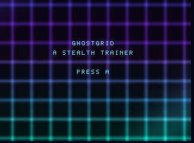
  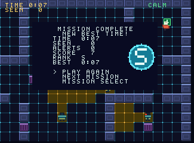
</p>

### Testing the game

`demos/ghostgrid/flow_test.v` and `records_test.v` play the whole game (chapter 6 lists them): the flow title, select, BACK, title, briefing, mission (the backdrop goes off, the calm track plays), pause, resume, restart, quit to the select, on NTSC and PAL; the record in the EEPROM (the same words in the interpreter's model of the chip); a fresh machine given the chip's contents shows the best time on its mission select, a record with one bit flipped is none, and so is a record of the old version; the music follows the alarm without restarting and keeps ten seconds at 5.5 rows a second on both standards; the GPU draws on the title and stands still in the mission. `jaggame/rt_scenes_test.v`, `rt_menu_test.v`, `rt_sound_test.v` (what reaches the DSP, a calm and an alert recording that differ in energy and in pitch), `rt_save_test.v` (including the cartridge image booted and saved through) and `rt_backdrop_test.v` test the pieces on their own.

The interpreter agrees with the machine across the scenes: `agree_test.v` runs it alongside from the title through whole missions, and compares every variable of the two at the end, the EEPROM included (the interpreter's chip is the array `rt_eeprom`).

### What it costs

The numbers in this section are slice 5's, on its one mission; chapter 6 has the final ones for all ten.

The slice began with a worst mission frame of 175,700 of the 221,000 cycles of an NTSC frame (79%), and a target of 60%. Most of that was not the cones: one cone is worked out a frame, as before. It was the end-of-mission screen written in one frame (about 100,000 cycles), and a cone that turned (up to 60 tiles redrawn at 1,700 cycles). The measurement now settles the interrupt after each frame, which counts the part of a frame that runs on past the emulator's frame boundary, and leaves out the frame in which a mission ends (where a scene change has its work):

| | before (slice 4) | after, NTSC | after, PAL |
|---|---|---|---|
| calm, four patrolling guards: mean | 46,900 | 49,800 | 50,000 |
| calm: most | 118,700 | 101,700 | 101,800 |
| worst case (four chasing, running, cones moving): mean | 80,400 (36%) | 87,100 (39%) | 87,200 (33%) |
| worst case: most | 175,700 (79%) | **131,700 (59.6%)** | 129,700 (48.9%) |
| the frame that ends a mission | | 148,200 | 148,200 |
| missed frames | 0 | 0 | 0 |

The worst case now has the alert music playing. What brought it down: the result screen written over four frames; a tile redraw ring that draws at most 12 changes a frame (5 when fewer wait, so that a frame that moves a cone does not also draw all it queued; a ring of 128 waits for the rest, and `load_room` empties it); the cones' cells held as one table of cell numbers instead of columns and rows multiplied together at every access; and the volumes' decay in machine code. The picture can trail the map by a few frames after a big change, which the tests allow for.

### V traps in this slice

| Trap | Workaround |
|---|---|
| `select` and `chan` are V keywords | `picker`, `lane` |
| `for x in 0 .. some_const {` parses the constant as a struct literal | `int(some_const)` |
| `v -prod -o x file_test.v` runs the tests and shows what they print; `v test` hides it | use it to read a cost table |
| `vjag_test run` takes `--press=button@frame+frames`, with the options before the path | |
| a frame of the emulator ends in the middle of the interrupt: a test that pokes a variable then races the tail of the last frame | `Player.settle` (or `settle_cycles`, which counts the tail) before the poke |

## Chapter 6: missions as data, cameras, ranks and the record

Chapter 5 ended with one mission inside a game. This chapter finishes GHOSTGRID: ten missions of four kinds that are rows of a table and not code, cameras that sweep, a rank for each mission, and a record that keeps the best of each and says which missions are open. It also walks through how the whole game is put together, because by now it is about 4,000 lines in nine files and the pieces have to be found.

```sh
v run demos/ghostgrid                    # writes demos/ghostgrid.jag and .j64
just run demos/ghostgrid.jag             # play it
v -prod test jaggame/ demos/hello2/ demos/ghostgrid/      # everything, about four minutes
```

- [How the whole game is put together](#how-the-whole-game-is-put-together)
- [A mission is a row of a table](#a-mission-is-a-row-of-a-table)
- [Adding a mission](#adding-a-mission)
- [Rooms and doors](#rooms-and-doors)
- [Chips and the exit](#chips-and-the-exit)
- [The clock and the countdown](#the-clock-and-the-countdown)
- [Cameras](#cameras)
- [Ranks and the result](#ranks-and-the-result)
- [The record](#the-record)
- [The mission select, the briefing and the fade](#the-mission-select-the-briefing-and-the-fade)
- [Testing the missions](#testing-the-missions)
- [What it costs](#what-it-costs-3)
- [Playing it in Virtual Jaguar](#playing-it-in-virtual-jaguar)
- [V traps in this slice](#v-traps-in-this-slice-3)

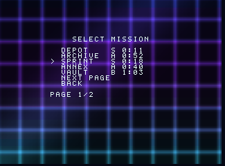
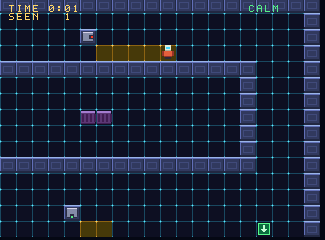

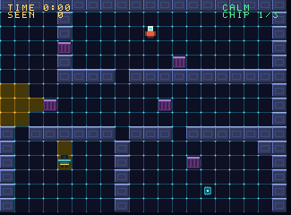
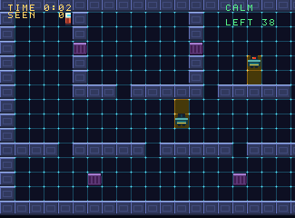
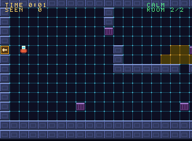

### How the whole game is put together

Nine files in [`demos/ghostgrid`](../../demos/ghostgrid) and a robot in [`demos/ghostgrid/robot`](../../demos/ghostgrid/robot):

| File | What is in it |
|---|---|
| `main.v` | the constants (speeds, tiles, the size of a room), `main`, which writes the `.jag` and the `.j64` |
| `maps.v` | the twelve rooms, as text |
| `missions.v` | the table: ten rows, each a few rooms, their guards and cameras, a limit and the scores for the ranks |
| `world.v` | what the build works out from the table: every room's routes, the fields of directions, the cones of every tile and of every camera position |
| `mission.v` | the game's variables and tables, the setup of a room, the update of a frame, the figure, the HUD |
| `guards.v` | the guards: `watch`, `chase`, `follow`, `around`, the lighting of a cone, the five states |
| `cameras.v` | the cameras: the sweep, the light, what a camera does to the guards |
| `scenes.v` | the title, the mission select, the briefing, the mission, the result, and the update that runs in every scene |
| `sound.v` | the effects and the two tracks |

A frame goes like this. The runtime counts the frame, moves the timers (`clock` and `limit`), and calls the game's own update (`gg_reset`: the four buttons together go back to the title), then the update of the current scene. In the mission scene that is: the pause menu if it is up (and nothing else); the first frame's start of the stopwatch and the countdown; the figure (walk, run, crouch, knock, take a chip, take a door, step on the exit); the guards, each one step of its state; one cone worked out (a guard's or a camera's, whichever is stale); the cameras; the clock; the sprites and the HUD; the camera of the picture; the music. Then the runtime moves the animations, draws the tiles that wait, steps the sound, and builds the display list. A scene change that goes through black (`go_fade`) freezes the update for sixteen frames and dims the colour table in between; the new scene's setup runs while the screen is black.

What is decided where:

- **What a mission is** is in `missions.v` and `maps.v`, and nowhere else.
- **What the game knows at run time about a room** is in tables made by `world.v`: for each room its guards (first waypoint, how many, the way each starts), its cameras (tile, first angle, positions), where its part of the pool of cones starts. `setup` reads them with the room number.
- **State that belongs to the mission** (the clock, the times seen, the chips) lives in variables that a door does not reset; **state that belongs to a room** (guards, cameras, lit tiles, the tiles chips were taken from) is made again each time the room is entered.

### A mission is a row of a table

<!-- guide:gg_missions -->
```v
return [
	MissionDef{
		title: 'DEPOT'
		kind:  .sneak
		brief: 'FOUR GUARDS WALK THE DEPOT. WAIT BEHIND COVER, CROUCH WITH B, AND REACH THE GREEN PAD UNSEEN.'
		rooms: [
			RoomDef{
				map:    map_depot
				guards: [GuardDef{
					route: '12'
				}, GuardDef{
					route: '46'
				}, GuardDef{
					route: '3'
					face:  jaggame.angle_up
				}, GuardDef{
					route: '5'
					face:  jaggame.angle_left
				}]
			},
		]
		ranks: [
			9,
			18,
			30,
		]
	},
```

The types behind it:

<!-- guide:gg_defs -->
```v
// GuardDef is a guard: the waypoints of its route (characters of the map, a
// guard goes to and fro along them in order) and, for a guard with one, the
// angle it stands facing.
struct GuardDef {
	route string
	face  int = jaggame.angle_down
}

// CameraDef is a camera's sweep: the angles it turns between.
struct CameraDef {
	from int
	to   int
}

// RoomDef is a map and what is in it.
struct RoomDef {
	map     string
	guards  []GuardDef
	cameras []CameraDef
}

// MissionDef is a mission.
struct MissionDef {
	title string // at most 8 characters
	kind  Kind
	brief string
	rooms []RoomDef
	limit int
	ranks []int
}

```

A `RoomDef` is a map and what is in it. The map says where things are (`@` the start, `1` to `9` waypoints, `A` to `C` cameras, `$` chips, `D` and `U` doors, `X` the exit) and the table says what they do: which waypoints each guard walks, the angles each camera sweeps between. A guard whose route is one waypoint stands there and looks the way `face` says; with two or more it walks to and fro along them.

<!-- guide:gg_map_vault -->
```v
const map_vault = '
############################
#..........................#
#.@..........A.............#
#..........................#
#...####################...#
#...#..................#...#
#...#..................#...#
#.1.#........cc........#.2.#
#...#..................#...#
#...#..................#...#
#...####################...#
#..........................#
#..........................#
#...........B..............#
#.......................X..#
#..........................#
############################
############################
############################
############################
'

```

A mission has one to three rooms, up to four guards and three cameras in a room, and a limit in seconds or none. Everything else follows from what its rooms hold, and `kind` is only the word the briefing prints:

| Kind | What it asks | Where that comes from |
|---|---|---|
| sneak | reach the exit unseen (it is not forbidden to be seen; it costs rank) | one room with no chips and no limit |
| collect | take every chip, then the exit | `$` on the map; the exit pad does nothing until `chips_left` is 0 |
| timed | the exit before the countdown ends | `limit` above 0 |
| rooms | the exit in the last of several rooms | `D` and `U` doors on the maps |

Ten missions, two or more of each kind: DEPOT, VAULT and FOUNDRY are sneak missions; ARCHIVE and STACKS collect; SPRINT, DASH and GAUNTLET are timed; ANNEX and CROSSING have two rooms. The first mission is the first mission of slice 4 on a smaller map. The difficulty rises with the number of guards, the cameras, and the tighter limits and ranks.

### Adding a mission

1. Draw a map in `maps.v`: a `const` string of 28 by 20 characters (exactly 20 rows; a room that needs fewer ends in rows of wall). Put `@` where the figure starts (`[` instead in a room that follows another), `X` in the last room, `1` to `9` where guards walk, `$` for chips, `A`, `B`, `C` where cameras stand, and `D` and `U` (with `[` and `]` beside them) for doors.
2. Add a `RoomDef` for it and a `MissionDef` row to the table in `missions.v`: a title of at most eight letters, a kind, a briefing of at most five lines of twenty characters (it is broken at build time), the limit, and the scores for S, A and B.
3. If the table now has more than ten missions, raise `mission_count` and give the mission select another page (`picker_rows`, the `PAGE 1/2` text, `draw_page` loops over the table, so only the page count is by hand). The record has one word for each mission: `m0` to `m9` in `mission.v`'s `game.save` call grows by one, and the version number goes up, so that an old chip is ignored.
4. Run `v -prod test demos/ghostgrid/missions_test.v`: it checks that the map is the right size, that everything on it can be reached from where the figure comes in, that every waypoint and camera the table names is on the map, and that the mission is what its kind says. Then add a row to the `expected` table of a `robots_N_test.v`: the robot finds the way and plays it, and the test says what it came to; run it once with a wrong number and it prints the right one.

Nothing in `mission.v`, `guards.v`, `cameras.v` or `scenes.v` mentions a mission by name or number except the briefing's and the picker's loops over the table.

A mission is limited by what the tables are laid out for, and each is a number at the top of a file: rooms of 28 by 20 tiles (the cone tables and the fields of directions are one size; `room_cols` and `room_rows`, and `keys_per_room`), four guards and three cameras, sixteen positions of a camera's sweep, a cone of at most forty cells, a waypoint number below 256 for all rooms together. The image is 450 KB, of which about 320 KB are the cones of the twelve rooms (a table of where each list starts, one of how long it is, and the cells), and it must end below `0x80000`, where the display lists are (496 KB); the cartridge's copy loop counts in 32 bits since this slice, for an image of more than 256 KB.

### Rooms and doors

A room is loaded when the scene begins (`load_room_number` with the mission's first room and `room_at`). A door is a tile with a flag the game chose (`flag_door`, one of the four `flag_user` bits) and one of two pictures, onward or back:

<!-- guide:gg_door -->
```v
c.if_(under.and(flag_door).ne(0).both(m.phase.eq(0)))
tile := game.tile_at(m.pcx(), m.pcy())

c.if_(tile.eq(tile_door_next).either(tile.eq(tile_door_next_lit)))
c.inc(m.room_at)
c.set(m.entering, 1)
c.else_()
c.dec(m.room_at)
c.set(m.entering, 2)
c.end() // onward or back
game.play(mut c, 'door')
c.set(m.limit.running, false)
c.set(m.clock.running, false)
m.scenes.go_fade(mut c, 'play')
c.end() // on a door
```

The rule for what a room remembers is simple, and the tests hold it: **leaving a room forgets it.** When the figure comes back, the room is loaded again from its map and `setup` puts the guards on the first waypoints of their routes, in patrol, and the cameras at the start of their sweeps; the lit tiles are cleared and drawn again. What belongs to the mission is kept: the clock (it stops while the room loads and goes on after), the time left on a countdown, the times seen and the alerts. A chip that was taken comes back with its room, which is why a chip is only on a mission with one room (the test of the table says so); a guard that was chasing is back at his post.

The figure arrives on the tile beside the door it came through: `[` in a room reached by a door onward, `]` in one reached by a door back. A door is only taken once (`go_fade` ignores a second call while a fade is going), the fade out takes eight frames in which the mission stands still, and the new room needs about eighteen to load.

### Chips and the exit

A `$` is a marker with the item flag, so the number of chips in the loaded room is an expression (`marker_count('chip')`). Standing on one takes it: the count goes down, the tile becomes the floor again (the lit floor if a cone is on it), and the status line shows `CHIP 1/3`. The exit works when the count is 0.

<!-- guide:gg_chip -->
```v
c.if_(under.and(jaggame.flag_item).ne(0))
c.dec(m.chips_left)
game.play(mut c, 'chip')

c.if_(m.lit.at(m.pcell).and(0x7f).ne(0))
game.set_tile(mut c, m.pcx().shr(4), m.pcy().shr(4), tile_floor_lit)
c.else_()
game.set_tile(mut c, m.pcx().shr(4), m.pcy().shr(4), tile_floor)
c.end() // lit or not
c.end() // a chip
```

### The clock and the countdown

Two timers, both from chapter 2. `clock` is a stopwatch, started in the first frame of the first room and stopped while the game is paused, between rooms and when the mission ends; the whole seconds come from counting, not dividing (a division costs more than a frame's whole HUD). `limit` counts down from `seconds(limit)` and its `fired` flag is the end of the mission:

<!-- guide:gg_limit -->
```v
c.if_(m.scenes.time().eq(0))

c.if_(m.entering.eq(0))
m.clock.stopwatch(mut c)
c.set(m.secs_at, game.fps.as_(.u16))
c.else_()
c.set(m.clock.running, true)
c.end() // the start, or another room

c.if_(m.ms_limit.at(m.mission).gt(0))

c.if_(m.entering.eq(0))
m.limit.start(mut c, game.seconds(m.ms_limit.at(m.mission)))
c.set(m.left_secs, m.ms_limit.at(m.mission))
c.set(m.left_edge, game.seconds(m.ms_limit.at(m.mission)).sub(game.fps.as_(.u16)))
c.else_()
c.set(m.limit.running, true)
c.end() // the start, or another room
c.end() // a countdown
c.end() // the first frame
```

Seconds are real seconds on both standards: the same frames take twenty percent more of them on PAL, so a limit that an NTSC run meets with room to spare has less on PAL. The robot's runs show it: the same pad, frame for frame, is 6 seconds on NTSC and 8 on PAL for a mission of 400 frames.

Running is a trade in a timed mission: it is twice as fast and a guard within five tiles hears it (chapter 4's noise). Nothing in the table says so; the briefing of SPRINT does.

### Cameras

A camera is an actor on a pillar of the map. It sweeps a cone between two angles in positions 11 degrees apart, one every 24 frames. The cones of every position were worked out when the game was built (`world.v` calls `view_cells` for 16 angles, where a guard has four facings), so a camera's step is the same look-up and the same `light` as a guard's, with a source number of 4 to 6 in the `lit` words. **What is lit is what sees** holds for a camera as it does for a guard: the camera looks at `lit`.

The rules, in `cameras.v`:

- a camera holds still while the figure is in its light and sweeps on when it is out of it;
- cover does not help against a camera: it looks from above;
- a frame in the light adds one to the camera's exposure, and a frame out of it takes one off every second frame;
- at 12 the camera has seen the figure: one time seen, and every guard within twelve tiles of the camera (across plus down) that is on patrol or on his way back becomes suspicious about the figure's spot, and the camera's lens turns red;
- at 60 the guards within that reach that are not chasing already are alert and chase it (each is an alert for the rank);
- when the exposure is back to 0 the camera can see the figure for the first time again.

<!-- guide:gg_sweep -->
```v
c.if_(exposure.eq(0).both(n.gt(1)))
c.set(m.cf(i, 'wait'), m.cf(i, 'wait').add(1))

c.if_(m.cf(i, 'wait').ge(cam_period))
c.set(m.cf(i, 'wait'), 0)

c.if_(m.cf(i, 'dir').invert())

c.if_(step.add(1).ge(n))
c.set(m.cf(i, 'dir'), true)
c.dec(step)
c.else_()
c.inc(step)
c.end() // the far end, or on
c.else_()

c.if_(step.eq(0))
c.set(m.cf(i, 'dir'), false)
c.inc(step)
c.else_()
c.dec(step)
c.end() // the near end, or back
c.end() // which way
c.set(m.cf(i, 'stale'), true)
c.set(redraw, true)
c.end() // time to turn
c.end() // sweeping
```

<!-- guide:gg_look -->
```v
seeing := m.lit.at(m.pcell).and(jaggame.lit(1).as_(.u16).shl(i.add(max_guards))).ne(0)

c.if_(seeing)

c.if_(exposure.lt(255))
c.inc(exposure)
c.end() // not at the top
c.else_if(game.frame.and(1).eq(0).both(exposure.gt(0)))
c.dec(exposure)
c.end() // seen or not

c.if_(exposure.eq(0).both(alarm.ne(0)))
c.set(alarm, 0)
c.set(redraw, true)
c.end() // out of the light

c.if_(exposure.ge(cam_notice).both(alarm.eq(0)))
c.set(alarm, 1)
c.set(redraw, true)
c.inc(m.seen)
game.play(mut c, 'spotted')
c.call(m.call_guards, i, 1)
c.end() // it has seen the figure

c.if_(exposure.ge(cam_alarm).both(alarm.lt(2)))
c.set(alarm, 2)
c.call(m.call_guards, i, 2)
c.end() // the alarm
```

<!-- guide:gg_call -->
```v
m.guards.each(mut c, g)
state := m.ai.state_of(g)

c.if_(m.gcx(g).sub(camx).abs().add(m.gcy(g).sub(camy).abs()).le(cam_reach))
m.spot_figure(mut c, g)

c.if_(mode.eq(1))

c.if_(state.eq(0).either(state.eq(4)))
m.ai.start(mut c, g, 'suspicious')
c.end() // on patrol or on the way back
c.else_()

c.if_(state.ne(2))
m.ai.start(mut c, g, 'alert')
c.end() // not chasing already
c.end() // which call
c.end() // near the camera
c.end() // each guard
```

The camera's picture is the right-looking frame flipped when it looks left (the sprite's `flip`), and redrawn only when the position or the alarm changes:

<!-- guide:gg_cam_sprite -->
```v
c.if_(redraw)
c.set(face, m.cf(i, 'a0').add(step.mul(cam_turn)).add(32).shr(6).and(3))
c.set(sprite.flip, face.eq(2))
c.set(sprite.frame, jaggame.lit(0).as_(.u8))

c.if_(face.eq(1))
c.set(sprite.frame, 1)
c.else_if(face.eq(3))
c.set(sprite.frame, 2)
c.end() // down or up

c.if_(alarm.ne(0))
c.set(sprite.frame, sprite.frame.add(3))
c.end() // alarmed
c.end() // something changed
```

`rt_sight_test.v` has the test that a cone at any of 32 angles lights exactly what `can_see` says yes to (8,554 tiles asked in random rooms, no disagreement), and `cameras_test.v` plays the vault: the sweep goes out and back with every position lasting 24 frames, the light on the machine is the list that was worked out for that position, the camera sees after 12 frames, the guard near is called at once and chases after 60, cover does not hide the figure, a guard far away is not called, and the interpreter agrees.

### Ranks and the result

A mission done is given a score: **the seconds, plus 5 for every time seen, plus 15 for every alert; lower is better**. Each mission has the scores that earn S, A and B in its row, and anything above the last is C. The result screen shows the time, the times seen, the alerts, the score, the rank as a letter and a medal (a 24 by 24 picture in 16-bit colour, shown at twice its size), and the best of the mission so far:

<!-- guide:gg_result -->
```v
mut c := scenes.on_enter('result')
changed := c.local_bool('changed')
packed := c.local_u16('packed')
old_rank := c.local_u16('old_rank')
old_time := c.local_u16('old_time')
time := c.local_u16('time')
c.set(m.new_best, false)
c.set(m.has_next, false)
game.music_stop(mut c)

c.if_(m.phase.eq(1))
game.play(mut c, 'complete')
// the score: seconds, and 5 for each time seen, 15 for each alert
c.set(m.score, m.secs.add(m.seen.mul(5)).add(m.alerts.mul(15)))
c.set(m.rank,
	m.score.le(m.ms_rank_b.at(m.mission)).as_(.u8).add(m.score.le(m.ms_rank_a.at(m.mission)).as_(.u8)).add(m.score.le(m.ms_rank_s.at(m.mission)).as_(.u8)).add(1))
c.set(packed, m.bests.at(m.mission))
c.set(old_rank, packed.shr(12))
c.set(old_time, packed.and(0xfff))
c.set(time, m.secs.min(4095))

c.if_(old_rank.eq(0).either(time.lt(old_time)))
c.set(m.new_best, true)
c.set(old_time, time)
c.end() // a faster time
c.set(changed, m.new_best.either(m.rank.as_(.u16).gt(old_rank)))
c.set(m.bests.at(m.mission), old_rank.max(m.rank.as_(.u16)).shl(12).or_(old_time))

// The next mission opens.
c.if_(m.unlocked.lt(m.mission.as_(.u16).add(2)).both(m.mission.add(1).lt(mission_count)))
c.set(m.unlocked, m.mission.as_(.u16).add(2))
c.set(changed, true)
c.end() // something new is open
c.set(m.has_next, m.mission.add(1).lt(mission_count))

c.if_(changed)
m.store_record(mut c)
c.end() // something to keep
c.else_if(m.phase.eq(2))
game.play(mut c, 'caught')
c.else_()
game.play(mut c, 'timeup')
c.end() // done, caught or out of time
```

The medal is `png_cry` art and a sprite that is `fixed` to the screen and scaled; the panel behind the text is an `art_cry` picture of 28 by 16 pixels of one colour, scaled up to 210 by 120 and put above every sprite of the room. A mission that is not done (caught, or out of time) has a result of two lines and a menu of two items, and writes nothing.

### The record

The saved record is a header word (a mark and the version), eleven fields, and a checksum: thirteen of the chip's 64 words.

| Word | Holds |
|---|---|
| 0 | `0x4702`: the mark and version 2 |
| 1 to 10 | one word for each mission: the best rank (4 S, 3 A, 2 B, 1 C, 0 none) in the top four bits and the best time in seconds in the low twelve |
| 11 | how many missions are open (at least 1) |
| 12 | the checksum: `0x5a5a` plus the header and the fields, modulo 65,536 |

The best time and the best rank are kept separately: a faster run with more times seen keeps the better of each. Version 1 (slice 5's record of two fields) is not this layout: it is a record of another version, `load` gives "none", and the fields are not touched, which `records_test.v` checks with a version-1 record that is otherwise valid. The next mission opens when a mission is done. One word a frame is moved in either direction, so the up to ten milliseconds a real chip takes for a word never keeps a frame from being ready.

<!-- guide:gg_record -->
```v
for k in 0 .. mission_count {
	c.set(m.bests.at(k), m.save.field('m${k}'))
}
c.set(m.unlocked, m.save.field('open').max(1))
```

### The mission select, the briefing and the fade

The mission select has five missions on a page and the items NEXT PAGE and BACK: a menu of seven items, the first five blank and written over by `draw_page` with the title, the best rank and time, or LOCKED:

<!-- guide:gg_page -->
```v
for k, def in m.world.defs {
	row := 3 + k % picker_rows

	c.if_(m.page.eq(k / picker_rows))
	m.print_padded(mut c, 3, row, def.title)

	c.if_(m.unlocked.gt(k))
	rank := m.bests.at(k).shr(12)
	secs := m.bests.at(k).and(0xfff)
	m.msg.print(mut c, 12, row, '  ')
	m.letter(mut c, 12, row, rank)

	c.if_(rank.ne(0))
	m.clock_at(mut c, 14, row, secs)
	c.else_()
	m.msg.print(mut c, 14, row, '    ')
	c.end() // a record, or none
	c.else_()
	m.msg.print(mut c, 12, row, 'LOCKED')
	c.end() // open, or locked
	c.end() // this page
}
m.msg.number(mut c, 6, 11, m.page.add(1), 1)
```

The briefing breaks the mission's text into lines when the game is built (`print_wrapped`; a word wider than the line is a build error, and so is a briefing of more than five lines) and prints the scores for the ranks. Both are set up behind the black of the fade, a step a frame, which is also what keeps the frame that enters them under the frame budget.

Scenes are changed with `go_fade`: the picture dims to black in eight frames, the scenes change, the setup runs, and it comes back in eight. It is a brightness variable (`game.fade`, 0 to 16) that the machine applies to the colour table, so it dims whatever is drawn with the palette (tiles, 8-bit sprites, text) and leaves the 16-bit backdrop and the medal alone; a game may set the variable itself, which GHOSTGRID does for the pause menu (half brightness behind the menu).

### Testing the missions

| File | What it plays |
|---|---|
| `missions_test.v` | the table and the maps as data (no emulator): sizes, reachability, markers, kinds, the image fits |
| `guards_test.v` | the depot's guards: seen, chased, caught; heard; knocked; hidden behind cover; never in a wall, never stuck; the interpreter alongside through a chase |
| `cameras_test.v` | the vault's cameras, above |
| `records_test.v` | ranks against the thresholds, the record's words, a restart that shows the best, an old or damaged record, the next mission opening, the countdown and the pause, chips, doors |
| `flow_test.v` | the title, the mission select (both pages, a locked mission refused), the briefing, the pause menu, the fade, the music, the backdrop, the picture against the map; the guide's screenshots |
| `robots_1_test.v` to `robots_3_test.v` | the robot plays each mission, then all of a file's missions in one session |
| `agree_test.v` | the interpreter and the machine, frame by frame, on a whole mission of each kind (sneak, collect, timed, two rooms on PAL) and one with cameras |
| `cost_test.v` | the cost of the worst frame of every room |

The robot (in `demos/ghostgrid/robot`, a module of its own so that the game's build does not link the emulator, and so that every test file can use it) works as chapter 4 described, and extends it to what the missions have: the game is run in the interpreter with the figure parked in a wall, the lit words of every frame are written down (a camera's bit makes a tile unsafe for a crouching figure too, since cover does not help), and the search finds the way through every goal of a room (the chips, nearest first, then the exit or the door) from tile to tile, in time. A room that follows is planned with the game played in the interpreter through the rooms before it, because each room's guards start when it is entered. The plan is for NTSC and played on both: the guards move by frames, so the same pad is right on PAL.

| Mission | Kind | Guards, cameras | Robot, NTSC | Robot, PAL | Frames | Worst frame, NTSC | Worst frame, PAL | Missed |
|---|---|---|---|---|---|---|---|---|
| DEPOT | sneak | 4, 0 | 7 s, S | 8 s, S | 446 | 131,100 (59%) | 131,200 (49%) | 0 |
| ARCHIVE | collect | 2, 0 | 16 s, S | 19 s, A | 966 | 90,000 (40%) | 87,700 (33%) | 0 |
| SPRINT | timed | 2, 0 | 7 s, S | 8 s, A | 426 | 102,900 (46%) | 100,000 (37%) | 0 |
| ANNEX | rooms | 1, 0 | 14 s, S | 17 s, A | 925 | 87,500 (39%) | 87,600 (33%) | 0 |
| VAULT | sneak | 1, 2 | 6 s, S | 8 s, S | 402 | 94,100 (42%) | 94,100 (35%) | 0 |
| STACKS | collect | 1, 1 | 13 s, S | 15 s, A | 786 | 98,100 (44%) | 98,100 (37%) | 0 |
| DASH | timed | 2, 1 | 6 s, A | 8 s, A | 403 | 106,900 (48%) | 107,000 (40%) | 0 |
| CROSSING | rooms | 1, 1 | 14 s, S | 17 s, A | 925 | 89,800 (40%) | 88,100 (33%) | 0 |
| FOUNDRY | sneak | 3, 2 | 7 s, S | 9 s, A | 458 | 118,100 (53%) | 118,200 (44%) | 0 |
| GAUNTLET | timed | 2, 1 | 6 s, A | 7 s, A | 367 | 113,000 (51%) | 113,000 (42%) | 0 |

The robot's runs: the time the clock shows and the rank (S is the best), the frames of the mission, never seen. The worst frame is the dearest frame of the worst room of the mission in the worst case described below (limit: 60% of an NTSC frame, 132,600 of 221,000 cycles; a PAL frame is 265,000); missed is the frames missed in that run on both standards. The frames are the same on both standards; a PAL second is 50 of them.

The robot only walks (it never runs, never knocks); what a running or knocking figure does to the guards is tested in `guards_test.v`.

### What it costs

The target: the dearest frame of every mission, played in its worst case with music, at most 60% of an NTSC frame (132,600 of 221,000 cycles), and no frame missed. The worst case of a room is all of its guards chasing the figure, which runs, in the open middle of the room, the cameras sweeping, the cones moving, the alert music playing. `cost_test.v` plays it on the machine for 500 frames and reports:

| Frame | NTSC | PAL |
|---|---|---|
| the worst frame of any room, worst case | 131,100 (59%) | 131,200 (49%) |
| a frame that changes scene | up to 170,500 | up to 170,700 |
| a room loading (about 18 frames) | up to 159,900 | up to 159,900 |
| a fade (the setup behind it included) | up to 170,600 | up to 170,800 |
| the first frame after power on | 230,700 | 230,800 |
| any other frame, from the title to the mission | up to 86,600 | up to 86,900 |
| frames missed, in all of these | 0 | 0 |

The table of every room is in the table above (the worst frame of the mission's worst room); `cost_test.v` prints one line for each of the twelve rooms on both standards.

Missed frames are 0 in all of them, and across every run of the robots and the menus (a room loads in about 18 frames of up to 160,000 cycles; the frames that change a scene run up to 170,000; the first frame after power on is 235,000, which the machine absorbs, since it is before the picture). What got the cost down from the first version of the missions: a cone's cells are looked up in one table and stored once, a camera redraws its picture only when it changes, the seconds are counted and not divided, the tile queue draws at most 7 a frame (4 when fewer wait), and FOUNDRY has three guards where the first design had four.

A cone is the expensive thing: working out one (the three loops of `light`) is 30,000 cycles in the language. It could be machine code with a twin like the tile queries are; the missions fit without, and the room to do it is in `design.md`.

### Playing it in Virtual Jaguar

The robot's pad for missions 1 and 2, played one after the other from the title (1,585 frames), is a file of `button@frame+frames` that both emulators take: `vjag_test run --press` and the second emulator's `front --holds-file` (chapter 5's limit of sixteen holds is gone). The result is in `design.md`: the pictures at five points of the run agree to 0.2 to 0.6 % of the pixels, by up to 6 in a colour channel; the record the game wrote is word for word the same in both chips; a second start with that chip shows the best times.

### V traps in this slice

| Trap | Workaround |
|---|---|
| `assert` in a function that is not in a `_test.v` file is not checked | `panic` with a message, as the robot module and `world.v` do |
| a constant computed from another module's constant (`const flag_door = jaggame.flag_user1`) cannot be passed where a `Val` is wanted | write the number and let a test check it |
| `int_max` and `int_min` are V's own: a test file that defines them does not compile | use them |
| a `$` in a V string starts an interpolation | `u8(`$`)` for the chip's character |
| V builds one `_test.v` at a time, each in about forty seconds | split the tests into files so they run in parallel |
