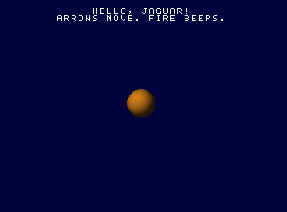

# Writing Jaguar programs in V with jagkit

`jagkit` is a V module that turns a V program into an Atari Jaguar image. There is no assembler, linker or C toolchain: you write V, run it, and a `.jag` file comes out that the emulator loads.

This guide walks through [`demos/hello`](../demos/hello/main.v), the smallest complete program, then covers what the larger demos add.

Everything here has run in this emulator only. Real hardware has not seen any of it.

## Contents

- [Run the example](#run-the-example)
- [How a jagkit program is built](#how-a-jagkit-program-is-built)
- [The 68000 assembler](#the-68000-assembler)
- [Start-up](#start-up)
- [The frame interrupt](#the-frame-interrupt)
- [Pictures and the display list](#pictures-and-the-display-list)
- [Colour](#colour)
- [The pad](#the-pad)
- [Sound](#sound)
- [Text](#text)
- [The GPU and the DSP](#the-gpu-and-the-dsp)
- [Testing in the emulator](#testing-in-the-emulator)
- [V traps](#v-traps)
- [Where to look next](#where-to-look-next)

## Run the example

You need V 0.5.2 and the repository built (`just release`).

```sh
v run demos/hello            # writes demos/hello.jag (about 3 KB)
just run demos/hello.jag     # play it
just demo hello              # both steps
v -prod test demos/hello/    # boot it in the emulator and check it works
```

Two lines of text and a ball on a dark blue screen. The arrow keys move the ball; Z, X or C beep.



## How a jagkit program is built

A jagkit program is an ordinary V `main` module. Running it does three things:

1. Calls assembler methods, which append machine code and data to a buffer.
2. Resolves the labels with `assemble()`.
3. Wraps the bytes in a `.jag` header with `jagkit.jag_image` and writes the file.

```v
mut m := jagkit.new_m68k(load_address)   // code will run at this address
m.label('entry')
m.move(.w, imm(0), abs(jagkit.bg))       // one 68000 instruction
// ...
payload := m.assemble()!
image := jagkit.jag_image(load_address, m.address_of('entry'), payload)
```

Two things follow from this design.

- **V is the macro language.** A V function that calls assembler methods is a macro; a V `for` loop unrolls code; a V constant is an assembly-time constant. `slide` in the example is called four times and leaves four copies of its code in the image.
- **V computes the data.** The ball is drawn by a V function at build time (`ball()`), and so are sine tables, palettes and whole songs in the larger demos. Nothing is loaded from asset files.

Keep `build()` separate from `main()`, returning the image and the symbol table. The test calls `build()` directly.

## The 68000 assembler

`jagkit.new_m68k(origin)` returns the assembler. An instruction is a method; operands are `Ea` values made with these helpers:

| Helper | Assembly | Meaning |
|---|---|---|
| `d0`..`d7`, `a0`..`a6`, `sp` | `d0`, `a0` | a register |
| `imm(5)` | `#5` | a constant |
| `abs(0xf00058)` | `$f00058` | the memory at a fixed address |
| `lbl('frame')` | `frame` | the memory at a label; the label itself for jumps |
| `ptr('ball')` | `#ball` | the address of a label, as a value |
| `ind(a0)`, `inc(a0)`, `dec(a0)` | `(a0)`, `(a0)+`, `-(a0)` | through an address register |
| `at(6, a1)` | `6(a1)` | with an offset |
| `idx(8, a0, d0)` | `8(a0,d0.l)` | with an offset and an index register |
| `rel('table')` | `table(pc)` | relative to the program counter |

The registers are constants of the module. V does not allow importing constants by name, so alias the ones you use:

```v
import jagkit { abs, at, imm, inc, lbl, ptr }

const d0 = jagkit.d0
const a0 = jagkit.a0
```

Instructions that have a size take it first: `.b`, `.w` or `.l`. Source comes before destination, as in Motorola syntax.

```v
m.move(.w, lbl('ball_x'), d0)
m.add(.w, imm(2), d0)
m.cmp(.w, imm(288), d0)      // flags of d0 - 288
m.b(.hi, 'skip')             // branch if d0 > 288, unsigned
m.move(.w, d0, lbl('ball_x'))
m.label('skip')
```

| Group | Methods |
|---|---|
| Moves | `move` `moveq` `lea` `push` `pop` `swap` `ext` `clr` `move_to_sr` |
| Arithmetic | `add` `sub` `neg` `cmp` `tst` `mulu` `muls` `divu` |
| Logic and bits | `and` `orr` `eor` `not` `btst` `bset` `bclr` |
| Shifts | `asl` `asr` `lsl` `lsr` `rol` `ror` `roxl` |
| Flow | `bra` `bsr` `b(cc, …)` `dbra` `jmp` `jsr` `rts` `rte` `stop` `nop` |
| Data | `byte` `word` `long` `long_label` `bytes` `text` `align` |
| Labels | `label` `unique` `address_of` `symbols` |

`or` is spelled `orr` because `or` is a V keyword. Branch conditions are `hi ls cc cs ne eq vc vs pl mi ge lt gt le`.

**Labels** are strings. A label may be used before it is defined. `m.unique('skip')` returns a fresh name, which a macro needs so that two calls do not define the same label. `m.address_of(name)` returns the address of a label that is already defined; use it to hand addresses to other builders, such as the display list.

**Errors** are collected, not thrown one at a time. `assemble()` returns one error listing every problem: unknown labels, labels defined twice, values out of range, operands an instruction does not accept. A handful of misuses that have no sensible recovery (passing a data register where an address register is required) panic at the call.

**Data** goes in the same buffer as code. A variable is a label followed by `m.word(initial)`. Keep data out of the path of execution: the example puts it after the last `rts`.

## Start-up

The loader puts the payload in RAM at the load address and jumps to the entry label. The example then does five things, in `start_up`:

1. **Mask interrupts and set the stack.** `move_to_sr(imm(0x2700))`, then point `sp` just below the program.
2. **Set the display window.** `jagkit.ntsc` and `jagkit.pal` hold the values for `hdb1`, `hdb2`, `hde`, `vdb` and `vde`. Write `vde | 1` to `vi` so the interrupt arrives after the last visible line.
3. **Start the DSP** (see [Sound](#sound)).
4. **Install the display list and turn video on.** Copy the list into place, write its address to `olp` with the two words swapped, write `vmode`.
5. **Enable the interrupt and sleep.** Store the handler's address at `jagkit.interrupt_vector`, enable the video interrupt in `int1`, lower the interrupt mask, then loop on `stop`.

```v
m.lea(lbl('profile_ntsc'), a0)
m.move(.w, abs(jagkit.joybuts), d0)
m.btst(4, d0)
m.b(.ne, 'standard_known')
m.lea(lbl('profile_pal'), a0)
m.label('standard_known')
```

```v
m.move(.l, imm((list_address << 16) | (list_address >> 16)), abs(jagkit.olp))
m.move(.w, imm(jagkit.vmode_cry16), abs(jagkit.vmode))
m.move(.l, ptr('frame_interrupt'), abs(jagkit.interrupt_vector))
m.move(.w, imm(jagkit.int1_video), abs(jagkit.int1))
m.move_to_sr(imm(0x2000))
m.label('sleep')
m.stop(0x2000)
m.bra('sleep')
```

**Both television standards.** Bit 4 of `joybuts` is set on an NTSC machine. The example builds a *profile* for each standard (the display window values, where the middle of the picture starts, the address of a display list built for that standard) and copies the right one into its variables at start-up. Everything after that reads the variables.

**Memory.** The Jaguar has 2 MB of RAM from address 0. The demos load at `0x4000`, let the stack grow down from there, and place buffers at round addresses above the image (`0x80000` and up). Nothing on the Jaguar stops a program from drawing over its own code, so check the layout at build time with `jagkit.check_regions`. It reports regions that overlap or run past the end of memory:

```v
payload := m.assemble()!
jagkit.check_regions([
	jagkit.Region{'image', load_address, payload.len},
	jagkit.Region{'display list', list_address, list_bytes},
])!
```

## The frame interrupt

All three demos do their work in the vertical interrupt, once a frame (60 times a second on NTSC, 50 on PAL). The handler must:

1. Save the registers it uses (`m.push([...])`) and restore them before `rte` (`m.pop([...])`).
2. Acknowledge the interrupt: write `int1_video | int1_video_ack` to `int1`, then `0` to `int2`. Without both writes no further interrupt arrives.
3. Copy a fresh display list into place (next section).

```v
m.label('frame_interrupt')
m.push(registers)
m.move(.w, imm(jagkit.int1_video | jagkit.int1_video_ack), abs(jagkit.int1))
m.move(.w, imm(0), abs(jagkit.int2))
// ... the frame's work ...
m.pop(registers)
m.rte()
```

The 68000 runs about 221,000 cycles in an NTSC frame. If the handler takes longer, a frame is missed. The demos keep a `frame` counter and their tests assert that it advances by exactly one per emulated frame.

Anything counted in frames runs a sixth slower on PAL. Music is where that is heard, so the demos with a tune correct it:

- **MAW** plays a step of its tune every six frames on NTSC and every five on PAL: the same ten steps a second.
- **Jaguar Hero** counts song time in sixtieths of a second, so on PAL every fifth frame advances the song twice (`demos/hero/pal.v`).

Movement is not corrected: MAW's tunnel and WIREWING's plane are a sixth slower on PAL.

## Pictures and the display list

The Jaguar has no frame buffer of its own. Each frame, the object processor walks a **display list**: a linked list of objects in RAM, each saying "show this bitmap at this position". `jagkit.object_list` builds one.

```v
list := jagkit.object_list(list_address, video, [
	jagkit.Bitmap{
		x:           100
		y:           video.vdb + 2 * 50
		width:       32
		height:      32
		data:        m.address_of('ball')
		depth:       .bpp16
		transparent: true
	},
])!
m.label('list')
m.bytes(list.bytes)
```

Rules the builder checks and reports:

| Rule | Why |
|---|---|
| The list address is a multiple of 32 | scaled objects need it; the builder gives every object a 32-byte slot |
| Pixel data starts on a multiple of 8 | the object processor reads 64-bit phrases; use `m.align(8)` |
| `width × bits per pixel` is a multiple of 64 | a line must fill whole phrases |
| `palette` is even, `height` is 1..1023 | field sizes |
| Scales are 1/32..7.97 | 3.5 fixed point |

Things the builder cannot check:

- **`y` is in half-lines from the top of the frame.** Line `n` of the visible picture is `video.vdb + 2 * n`.
- **`x` is in pixels from the left of the display window**, which is `video.width` wide (352 on NTSC, 345 on PAL). Televisions, and this emulator, show roughly the middle 320, so the demos centre their picture: `left := (video.width - 320) / 2`.
- **Later objects are drawn over earlier ones.**
- **The list is used up as it is drawn.** The object processor rewrites the objects while it works. Keep a master copy in the image and copy it to the list address every frame, in the interrupt. Skip this and the picture is gone after one frame.

**Moving an object.** Either build one list per situation and choose which to copy (WIREWING has a list for every combination of state and buffer), or patch the copy after copying it. The example patches: the bitmap is the first object, 32 bytes in; its `y` is in bits 3..13 of the first phrase and its `x` in bits 0..11 of the second.

```v
m.lea(abs(list_address + 32), a1)
m.move(.w, lbl('ball_y'), d0)
m.add(.w, d0, d0)                              // half-lines
m.add(.w, lbl('top'), d0)                      // first line of the picture, from the profile
m.lsl(.w, imm(3), d0)
m.and(.w, imm(0xc007), at(6, a1))              // clear the old y
m.orr(.w, d0, at(6, a1))
```

`list.offsets[i]` is the byte offset of bitmap `i`, for lists with more than one object.

**Depths.** `.bpp16` pixels are colours. `.bpp1`, `.bpp2`, `.bpp4` and `.bpp8` pixels are numbers looked up in the 256-entry colour table at `jagkit.clut` (one word each); for depths below 8 bits, `palette` is added to the pixel value. A 1-bit object with `palette: 16` draws its set pixels in colour 17. With `transparent: true`, pixel value 0 is not drawn.

**Scaling.** `hscale` and `vscale` magnify an object. Jaguar Hero's notes and WIREWING's title are scaled bitmaps.

## Colour

The demos use the Jaguar's CRY mode (`vmode_cry16`): a 16-bit pixel is a hue in the high byte and a brightness in the low byte. `jagkit.cry(r, g, b)` returns the nearest CRY value to an RGB colour, at build time.

```v
m.move(.w, imm(jagkit.cry(0, 0, 60)), abs(jagkit.bg))             // background
m.move(.w, imm(jagkit.cry(255, 230, 140)), abs(jagkit.clut + 2 * 17))  // colour 17
```

Because brightness is its own byte, scaling the low byte fades a colour without changing its hue. Writing new values to the colour table every frame animates everything drawn with those colours at no drawing cost; MAW's tunnel and Jaguar Hero's highway move this way.

`jagkit.big_endian16` and `big_endian32` turn `[]u16` and `[]u32` into the bytes the Jaguar reads, for `m.bytes`.

## The pad

The controller is a matrix. Write a row select to `joystick`, read the columns back from `joystick` and the fire button from `joybuts`. Lines are low while pressed.

| Row select (low nibble) | `joystick` bits 8..11 | `joybuts` bit 1 |
|---|---|---|
| `0xe` | up, down, left, right | A |
| `0xd` | keypad column | B |
| `0xb` | keypad column | C |

Always include `jagkit.joystick_enable` in the value written: it drives the row outputs and unmutes the sound.

`m.pad_reader()` emits a complete reader as the subroutine `read_pad`, with two word variables it keeps up to date: `pad`, the buttons that are held, and `pressed`, the ones that went down since the last call. Call it once a frame; it changes `d0` and `d1`.

```v
m.pad_reader()                          // once, anywhere outside the path of execution
// in the frame interrupt:
m.bsr('read_pad')
m.move(.w, lbl('pressed'), d0)
m.btst(jagkit.pad_fire, d0)
m.b(.eq, 'no_beep')
```

| Bit | Button |
|---|---|
| `pad_fire` | A, B or C |
| `pad_a`, `pad_b`, `pad_c` | each fire button on its own |
| `pad_up`, `pad_down`, `pad_left`, `pad_right` | the directions |

It does not read the keypad, Option or Pause. Jaguar Hero's reader in [`demos/hero/game.v`](../demos/hero/game.v) does.

In the emulator the arrow keys are the directions and Z, X, C are the fire buttons.

## Sound

Sound is made by a program running on the DSP, which writes samples to the two DACs from an interrupt. `jagkit.synth()` is a ready-made DSP program with three voices: a square wave, a sawtooth and noise.

Build it, put its code in the image, copy it to DSP RAM at start-up and start it:

```v
mut dsp := jagkit.synth()
mut dsp_code := dsp.assemble()!          // pad to a multiple of four bytes
// in start_up: copy dsp_code to jagkit.dsp_ram, then
m.move(.l, imm(dsp.address_of('start')), abs(jagkit.d_pc))
m.move(.l, imm(jagkit.risc_go), abs(jagkit.d_ctrl))
```

The synthesizer only makes waves. The 68000 plays it by writing longs at offsets from the synth's `voices` label:

| Offset constant | Meaning |
|---|---|
| `voice_bass_step`, `voice_bass_volume` | square wave pitch and volume |
| `voice_lead_step`, `voice_lead_volume` | sawtooth pitch and volume |
| `voice_noise_volume` | noise volume |

A pitch is a phase step: `jagkit.note_step(midi_note)` or `jagkit.hertz_step(hertz)`. A volume is an amplitude; a few thousand is comfortable, and the three voices are added, so keep the sum under 32,767.

```v
lead_step := abs(dsp.address_of('voices') + u32(jagkit.voice_lead_step))
lead_volume := abs(dsp.address_of('voices') + u32(jagkit.voice_lead_volume))
m.move(.l, imm(jagkit.note_step(81)), lead_step)
m.move(.l, imm(9000), lead_volume)
```

A note that is never turned down never stops. The example fades the volume by an eighth every frame, which turns a note into a beep. A tune is a table of steps and a frame counter: [`demos/maw/sound.v`](../demos/maw/sound.v) holds the tables of a 150 BPM tune, and the sequencer that plays them is in `demos/maw/game.v`.

For more than three voices, envelopes or echo, write your own DSP program. [`demos/hero/sound.v`](../demos/hero/sound.v) is a ten-voice one.

## Text

A `jagkit.TextScreen` is a one-bit picture made of 8×8 character cells: 40 columns by 25 rows unless you say otherwise. `m.text_routines(screen)` emits the font and three subroutines for it.

| Subroutine | Does |
|---|---|
| `print` | draws the zero-terminated string at `a0` at column `d0`, row `d1` |
| `number` | turns `d0` (0..65535) into `screen.digits` digits and leaves `a0` pointing at them, ready for `print` |
| `clear_text` | blanks the screen |

They change `d0`..`d3` and `a0`..`a3`.

```v
const text = jagkit.TextScreen{
	address: 0x81000
	rows:    2
}

m.text_routines(text)                           // once
// show it: one more bitmap in the display list
text.bitmap(left, top, text_colour)             // text_colour is an odd colour number
// at start-up
m.move(.w, imm(jagkit.cry(255, 255, 255)), abs(jagkit.clut + 2 * text_colour))
m.bsr('clear_text')
m.print_at(13, 0, 'HELLO, JAGUAR!')             // a string constant, stored in line
```

To print a variable:

```v
m.move(.w, lbl('score'), d0)
m.bsr('number')
m.moveq(30, d0)        // column
m.moveq(0, d1)         // row
m.bsr('print')
```

Notes:

- **The font has capitals, digits and punctuation only** (ASCII 32..95). `print_at` reports a string with any other character; `print` at run time does not check.
- **Printing does not erase.** A cell is overwritten whole, so print spaces over text that should go.
- **A drop shadow** is a second bitmap of the same screen, one pixel down and right, in a dark colour, placed before the first in the list. WIREWING does this in [`demos/wirewing/main.v`](../demos/wirewing/main.v).
- **For a fixed word or logo**, draw it at build time instead: `banner` in the same file, using `jagkit.font_8x8()`. `jagkit.glyph(c)` returns one character's rows.

## The GPU and the DSP

The GPU and the DSP are two RISC processors with nearly the same instruction set. `jagkit.new_risc(origin)` assembles for both. The GPU's program lives in 4 KB at `jagkit.gpu_ram`, the DSP's in 8 KB at `jagkit.dsp_ram`. They are many times faster than the 68000 at arithmetic, so the demos use the GPU to draw and the 68000 to run the rules.

Registers are `jagkit.Reg.r0`..`r31`. Give them names; it is the main thing that keeps RISC code readable.

```v
mut g := jagkit.new_risc(jagkit.gpu_ram)
target := jagkit.Reg.r0
left := jagkit.Reg.r1
zero := jagkit.Reg.r2
g.label('clear')
g.store(zero, target)        // write a long
g.subq(1, left)
g.jr(.ne, 'clear')
g.addqt(4, target)           // delay slot: runs before the jump takes effect
```

The destination is always the second operand.

### Rules of the RISC processors

| Rule | Consequence |
|---|---|
| Every jump has a **delay slot** | the instruction after `jr` or `jump` always executes, taken or not; put a useful instruction or `nop` there. The assembler reports a `movei` or a jump in a delay slot |
| `jr` reaches 16 words back, 15 ahead | the assembler reports a `jr` that is too far; for longer jumps load the address with `movei_label` and use `jump` |
| `movei` is three words | it cannot go in a delay slot |
| Quick values are small | `addq`/`subq`/shifts take 1..32, `moveq` 0..31, `cmpq` −16..15; the assembler reports others |
| `cmp a, b` computes `b − a` | afterwards `cs` means b < a unsigned, `mi` means b < a signed |
| `addqt`/`subqt` leave the flags alone | use them in a delay slot after a flag-setting instruction |
| `mult`/`imult` use the low 16 bits of both operands | 16×16→32 |
| `load`/`store` need an address that is a multiple of 4 | the GPU ignores the two low bits of the address and reads the long before it. Put `m.align(4)` before any table the GPU or DSP reads as longs. MAW had this wrong, and it showed only when run in a second emulator |
| `load_r14`/`store_r14` take offsets 4..128 in steps of 4 | point `r14` at a block of variables and reach 32 of them in one word each |

There is no call instruction. A subroutine is a `jump` to a register holding its address, with the return address loaded into another register beforehand; WIREWING's `project`, `ray` and `line` work this way.

### Loading and starting

Assemble the program, pad it to a multiple of four bytes, put the bytes in the 68000 image, and at start-up copy them into the processor's RAM, set the program counter and write `risc_go`:

```v
m.lea(lbl('gpu_program'), a0)
m.lea(abs(jagkit.gpu_ram), a1)
m.move(.w, imm(gpu_longs - 1), d0)
m.bsr('copy')                                        // d0 + 1 longs from a0 to a1
m.move(.l, imm(jagkit.gpu_ram), abs(jagkit.g_pc))
m.move(.l, imm(jagkit.risc_go), abs(jagkit.g_ctrl))
```

`assemble()` reports a program that runs past the end of the GPU's or the DSP's RAM.

### Sharing values with the 68000

Reserve a block of longs at a label inside the RISC program (WIREWING calls it `shared`). The RISC side points `r14` at it and uses `load_r14`/`store_r14`; the 68000 side gets its address at build time with `gpu.address_of('shared')` and writes to `abs(address + offset)`. Define the offsets once as V constants and use them on both sides.

### Drawing without tearing

The GPU does not finish a picture in step with the display. The demos use two buffers and a handshake:

1. The GPU draws into the hidden buffer.
2. When done it stores that buffer's address in a `finished` slot of the shared block, then waits until the slot is zero again.
3. In the frame interrupt, the 68000 looks at the slot. If it is not zero, it copies the display list that shows that buffer, hands the GPU fresh values for the next picture, and clears the slot.
4. The GPU swaps buffers and starts over.

The 68000 only ever shows complete pictures, and the GPU never draws into the one being shown. `frame_interrupt` in `demos/wirewing/flight.v` is the 68000 half; search `shared_finished` in `demos/wirewing/wire.v` for the GPU half.

### DSP interrupts

The DSP's sample interrupt enters at `jagkit.dsp_i2s_vector`. Two traps:

- **On entry, `r30` holds the vector's address**, whatever it held before. A handler that keeps the flags register's address in `r30` must reload it first. Getting this wrong produces silence, not a crash.
- **To leave**, clear the interrupt mask bit and set the acknowledge bit in the flags, pop the return address from the stack in `r31`, add 2 and jump to it, with the flags written in the delay slot.

`jagkit.synth()` in [`jagkit/synth.v`](../jagkit/synth.v) is a complete, commented handler to start from.

## Testing in the emulator

Because the game is built by a V function and the emulator is a V module, a test can build the image, boot it, press buttons and read the game's memory, all in one process. Every demo is tested this way.

```v
fn boot() Player {
	built := build() or { panic(err) }
	plan := loader.plan(built.image, loader.Options{}) or { panic(err) }
	mut m := machine.new(machine.Config{})
	m.load_direct(plan)
	return Player{ symbols: built.symbols, m: m }
}

fn (p &Player) word(name string) int {
	return int(p.m.peek32(p.symbols[name]) >> 16)
}
```

| Call | Use |
|---|---|
| `m.run_frame()` | run one frame |
| `m.set_button(0, .right, true)` | hold or release a pad button |
| `m.peek8(address)`, `m.peek32(address)` | read memory |
| `m.frame()` | the picture as `[]u32` RGB and its size; index with `y * info.pitch + x` |
| `m.drain_audio(mut samples)` | take the sound made so far |

`built.symbols` comes from `m.symbols()`, so a test names a game variable by its label.

What the demo tests assert, as a pattern to copy:

- **It runs:** the frame counter advances once per frame, over a long run, so no frame took too long.
- **It shows something:** a plausible number of lit pixels, where the variables say they should be.
- **It can be played:** a robot reads the game's variables and steers. MAW's survives 1,500 frames, WIREWING's collects beacons, Jaguar Hero's plays the hardest song perfectly.
- **It can be lost:** doing nothing, or the wrong thing, ends the game the intended way.
- **It makes sound:** the drained samples are not silent.

Notes:

- Each `_test.v` file is compiled on its own with the module's other files, so helpers must live in the test file that uses them.
- A frame can end in the middle of the interrupt handler. Run a frame or two more before asserting on something the handler does last.
- The emulator's picture is the middle of the display window, a few pixels in from the edges, like a television. Compare positions by difference, not absolutely.
- Use `v -prod test`; the emulator is several times slower without it.

For looking at a picture, `./bin/vjag_test run game.jag --frames 120 --screenshot out.png` runs headless and saves the last frame; `--wav` saves the sound and `--press b@30+5` holds a button.

## V traps

Found with V 0.5.2 while writing the kit and the demos.

| Trap | Workaround |
|---|---|
| `shared`, `go`, `dump` are keywords | pick another name for a variable or label constant |
| A single capital letter is not a valid type or enum name | use longer names |
| Constants cannot be imported by name (`import jagkit { d0 }` fails) | `const d0 = jagkit.d0` |
| `mut x := other.array` aliases the array | add `.clone()` |
| A `match` or `if` expression that returns a tuple can miscompile | return a single value, or assign in each branch |
| Helpers in one `_test.v` are invisible to another | keep them in the same test file |
| `v fmt` rewraps long lines | run it before committing, and expect diffs to move |
| Shifting a signed `int` left draws a notice | harmless for small values; use `u32` to silence it |

## Where to look next

| To learn | Read |
|---|---|
| The whole flow in one file | [`demos/hello/main.v`](../demos/hello/main.v) |
| Text, PAL and NTSC, a GPU renderer, the buffer handshake | [`demos/wirewing`](../demos/wirewing) |
| Lookup-table rendering, palette animation, a sequencer | [`demos/maw`](../demos/maw) |
| Many scaled sprites, a display list rebuilt every frame, a full DSP synthesizer | [`demos/hero`](../demos/hero) |
| Every function, with its comment | `v doc jagkit`, or the files in [`jagkit/`](../jagkit) |
| How each instruction is encoded, checked against the emulator's disassemblers | [`jagkit/asm_test.v`](../jagkit/asm_test.v) |
