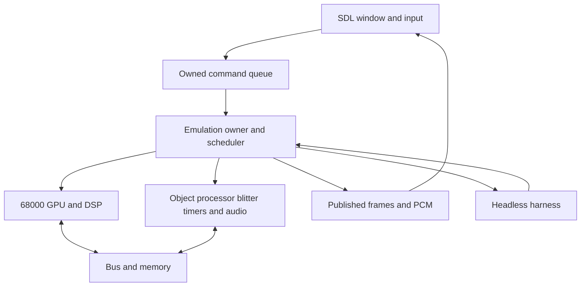

# Atari Jaguar Emulator in V Research and Implementation Specification

Research date: 12 November 2026. Target: an original Atari Jaguar cartridge emulator whose machine implementation is written in V, with a compact desktop frontend and a deterministic headless test runner. Initial development targets macOS on Apple Silicon, with Linux CI and a portable host boundary for Windows.

**Recommended architecture:** a pure V machine core, interpreted Motorola 68000 and Jaguar GPU/DSP processors, a software object processor and blitter, one emulation owner thread, an explicit guest timeline, and SDL3 for host presentation, sound, and input. Qualify the V compiler and host bindings before implementing substantial hardware.

**Validation finding:** useful Jaguar test software exists, including 152 assembly tests in the inspected Virtual Jaguar revision. It is not a comprehensive hardware-certified standard. Some tests exercise emulator-specific behavior, some only collect measurements, and one deliberately fails unconditionally. Build a curated validation system rather than using a single aggregate pass percentage.

This is an implementation specification and source audit. No emulator was implemented or benchmarked, and no ROMs were executed on an emulator or physical Jaguar during this research. Statements under implementation requirements are proposed project contracts; cited hardware facts describe the source material.

## 1 Scope and decisions

### First useful release

- Retail Jaguar cartridge hardware with a genuine MC68000 instruction model, TOM GPU, JERRY DSP, object processor, blitter, main memory, video, audio, timers, interrupts, controller matrix, and cartridge EEPROM.
- NTSC and PAL machine profiles; programmable video behavior rather than a fixed frame-rate simulation.
- Explicit direct-load development boot and actual boot-ROM execution as distinct modes.
- Raw cartridge images, selected header-bearing homebrew executables, and explicitly described raw binaries.
- Keyboard and gamepad input, all twelve keypad buttons, two standard controllers, compact status/debug controls.
- Headless execution, structured test results, execution tracing, save states, deterministic input playback, and persistent cartridge saves.

Defer Jaguar CD, Memory Track, GameDrive banking/extensions, Team Tap, rotary controllers, UART networking, shaders, netplay, achievements, dynamic recompilation, and a large graphical debugger. Preserve extension points for those devices. CD is a separate hardware milestone involving a controller, boot process, DMA, disc layout, and CD audio; accepting another filename extension would not implement it.

### Project decisions

| Decision | Choice | Reason |
| --- | --- | --- |
| Machine language | V | The requested language; all guest semantics remain in V. |
| Production compiler path | Pinned V C backend plus Clang | Keeps the first build on an established native code-generation and C-library path. |
| CPU execution | Interpreters first | Observable state and instruction boundaries simplify debugging and validation. |
| Host media | SDL3 | One host abstraction for window, texture, audio, keyboard, and gamepad support. |
| Guest concurrency | One deterministic scheduler on one emulation thread | Shared memory ordering must depend on guest time. |
| Rendering | CPU implementation of Jaguar graphics, followed by texture upload | Preserves guest-visible memory/register behavior. |
| Primary test interface | Headless executable | Enables CI before the GUI or retail BIOS is complete. |
| Accuracy claim | State the implemented timing profile | Functional compatibility is different from measured cycle accuracy. |

An existing C 68000 core may be used as a separate development comparator. Shipping it as the machine CPU would change the goal from a V implementation to a V frontend around another emulator, and is not this plan.

## 2 V language and host technology

### Compiler baseline

The official release page identifies V 0.5.2, dated 12 July 2026, with commit prefix `7647ce1`. Current online documentation is newer: it describes a new default compiler and automatic fallback to the 0.5.2 compiler. Those are different toolchain states. Do not combine a release binary with assumptions taken indiscriminately from current documentation. [V1](https://github.com/vlang/v/releases) [V2](https://docs.vlang.io/the-default-compiler.html)

At milestone M0, record a complete immutable V commit, compiler frontend/backend, C compiler version, target, flags, SDL version, and binding commit. Start qualification with the tagged C-backend release; adopt a newer commit only after rerunning the same qualification. If using the newer compiler, make fallback explicit and visible; do not let two CI jobs silently use different compiler implementations.

### Relevant language capabilities

V provides fixed-width integers, fixed arrays, structs, enums, sum types, pattern matching, result/error returns, unsafe pointers, and C interoperability. The 0.5.2 documentation describes `int` as 32-bit; current documentation makes it platform-width. The emulator should use explicit widths regardless of compiler version. Use `u8/u16/u32/u64` for guest storage and explicit signed equivalents only where signed interpretation is required. [V3](https://docs.vlang.io/v-types.html) [V6](https://docs.vlang.io/v-and-c.html)

Define small helpers for sign extension, arithmetic shift, rotate, addition/subtraction flags, and truncation. Test their output under the exact debug and optimized compilers. Never infer a guest exception from a V division panic, and never use a host shift by an unchecked guest-supplied count.

Use widened unsigned intermediates for carry and borrow. Treat the DSP accumulator as a masked 40-bit quantity with explicit sign interpretation, rather than hoping a host signed overflow reproduces it. Use a 64-bit master tick and checked arithmetic when parsing file offsets, lengths, and address ranges.

### Memory policy

V documents a default tracing collector, manual management via `-gc none`, experimental autofree, and preallocation options. Autofree is not the baseline for this project, and a short-lived-program preallocation mode is not a long-running emulator memory strategy. [V4](https://docs.vlang.io/memory-management.html)

Allocate machine memory, ROM storage, decode tables, frame buffers, audio staging buffers, and bounded trace storage during setup. The instruction loop, bus operations, device events, scanline construction, and sample generation must not allocate. Keep formatting, JSON, disk operations, and growing collections outside them.

Begin qualification with a documented ownership policy and measure process-wide behavior. Allocation-free core code alone does not prove a collector cannot pause the process. If manual management is selected, include loader errors, repeated content changes, debugger snapshots, and state replacement in the ownership audit. Allocate the large machine on the heap and pass references; do not accidentally copy megabytes of state as a value.

### GUI and audio alternatives

| Option | Verified capability | Project use |
| --- | --- | --- |
| SDL3 through `vlang/sdl` or a small `.c.v` binding | Official V binding repository has separate SDL2/SDL3 branches; SDL supplies the media/input APIs. | Recommended complete frontend. Pin the SDL3 branch revision rather than taking the default branch on trust. |
| Bundled `gg` plus `sokol.audio` | `gg` supports streaming CPU pixel buffers; its macOS backend uses Metal. Sokol audio supports a push model. | Good minimal keyboard-first prototype. Gamepad coverage needs its own verification. |
| `vlang/ui` | Repository labels V UI 0.0.4 pre-alpha and warns of changing APIs. | Avoid as a foundational dependency for the first release. |

Sources: [V7](https://github.com/vlang/sdl) [V8](https://modules.vlang.io/gg.html) [V9](https://modules.vlang.io/sokol.audio.html) [V10](https://github.com/vlang/ui). The SDL2 binding README documents GC-related failures on some setups; this is a binding qualification concern, not evidence that SDL3 or V is inherently unusable.

V C interop requires V declarations for the C functions/types used; `#include` does not import declarations into V. Keep the host binding small and isolated. [V6](https://docs.vlang.io/v-and-c.html)

Qualify C ABI widths separately from guest arithmetic. Match the actual C header types, pointer types, callback calling conventions, struct sizes, alignment, and field offsets. In particular, do not pass a platform-width V integer array as a C `int*`. Verify the pinned compiler's representation of C `int`, `size_t`, and opaque pointers with small C/V probes rather than assuming similarly named types match.

Use SDL3 streaming textures and pushed audio. `SDL_OpenAudioDeviceStream` accepts a null callback; the application can submit PCM with `SDL_PutAudioStreamData`, which copies the supplied bytes. Explicitly resume the initially paused stream. This avoids entering V code from the native audio callback. [S1](https://wiki.libsdl.org/SDL3/SDL_OpenAudioDeviceStream) [S2](https://wiki.libsdl.org/SDL3/SDL_PutAudioStreamData)

The main thread owns window/event/render operations. A single worker owns the emulated machine. UI commands carry owned data and sequence numbers. Frame publication uses bounded buffers with explicit ownership; the UI never reads a buffer the worker is modifying. SDL file-dialog callbacks, if used, only post an owned result to the appropriate thread. [S3](https://wiki.libsdl.org/SDL3/SDL_PollEvent) [S4](https://wiki.libsdl.org/SDL3/SDL_ShowOpenFileDialog)

Ownership transitions require validated synchronization, not ordinary shared mutable flags. Use bounded channels outside hot execution or a qualified atomic shim. Stop and join the worker before destroying its queues and buffers. An asynchronous dialog retains its callback context until completion or safely resolved cancellation. If entering V on that foreign thread is unsupported by the selected runtime, use a small C trampoline to queue/copy the result; test this in M0.

### Qualification gate

Before implementing the console:

1. Build a V headless program and SDL3 window on macOS ARM64; build the headless program in Linux CI.
2. Verify fixed-width arithmetic, endian composition, truncation, signed shifts, boundary shift counts, and explicit division fault paths.
3. Stream a generated image, resize/fullscreen it, and handle focus changes.
4. Push deterministic stereo PCM for ten minutes; record queue behavior, underruns, and memory growth.
5. Attach/remove a gamepad and exercise keyboard/keypad bindings.
6. Run an instruction-dispatch plus mixed-memory-access microbenchmark. Record throughput rather than claiming C-like speed from the compiler architecture.
7. Repeatedly create, unload, and replace content and buffers.
8. Compare debug and optimized observable output with a harness that retains its checks.

Current V documentation says `-prod` removes `assert` statements. Required runtime checks must use explicit errors, and optimized binary validation must not rely on assertions that disappeared. [V5](https://docs.vlang.io/testing.html)

## 3 Jaguar hardware model

### Processing blocks

| Component | Essential model |
| --- | --- |
| Motorola 68000 | 16-bit external data bus; general CPU and system coordination. |
| TOM GPU | 32-bit RISC processor; two banks of 32 registers; 4 KiB local RAM. |
| TOM object processor | Display-list execution and scanline composition. |
| TOM blitter | Programmable address generation and pixel/phrase operations. |
| JERRY DSP | Related RISC processor, 8 KiB local RAM, 40-bit accumulate behavior. |
| Main RAM | 2 MiB behind the system memory interface. |
| JERRY peripherals | Audio serial interface, timers, interrupt and input hardware. |

The nominal NTSC master clock is 26.590906 MHz; PAL is 26.593900 MHz, with the 68000 at half the master rate. The restored technical manual's PAL CPU number conflicts with its stated half-rate rule; derive it from the master value instead of copying that table cell. Video counters and programmable timing determine output timing. [H1](https://asterick.github.io/jag-docs/sources/TechRef_V10.pdf) [H3](https://www.hillsoftware.com/files/atari/jaguar/jag_v8.pdf)

The host GPU presents finished images. The emulated Jaguar GPU executes its own instruction set. Those are separate components.

### Address map for initial implementation

| Address range or base | Device |
| --- | --- |
| `0x000000–0x1FFFFF` | Installed main RAM |
| `0x800000–0xDFFFFF` | Standard cartridge address window |
| `0xE00000–0xE1FFFF` | Boot ROM storage window in the normal console map |
| `0xF00000` | TOM register space |
| `0xF02100` | GPU control registers |
| `0xF02200` | Blitter registers |
| `0xF03000–0xF03FFF` | GPU local RAM |
| `0xF10000` | JERRY register space |
| `0xF14000`, `0xF14002` | Controller interface |
| `0xF1A100` | DSP control registers |
| `0xF1B000–0xF1CFFF` | DSP local RAM |
| `0xF1D000–0xF1DFFF` | Wavetable address window |

This is a map of useful normal locations, not a complete decoder. Reset-time ROM mapping, aliases, byte lanes, wait states, and unimplemented holes need explicit behavior. The wavetable's address window is 4 KiB; its meaningful sample storage is 2 KiB exposed through wider entries. [H1](https://asterick.github.io/jag-docs/sources/TechRef_V10.pdf) [H2](https://asterick.github.io/jag-docs/sources/SoftRef_V10.pdf) [H5](https://github.com/mamedev/mame/blob/master/src/mame/atari/jaguar.cpp)

Document TOM's special `+0x8000` graphics windows for 32-bit writes, including GPU RAM at `0xF0B000–0xF0BFFF`. They are not ordinary read/write mirrors; semantics depend on the initiating master. [H2](https://asterick.github.io/jag-docs/sources/SoftRef_V10.pdf)

Create a checked-in register catalog with address, widths, masks, access direction, reset state or unknown-state designation, side effect, interrupt routing, and source/page. Generate constants and debugger names from it. Keep behavior in code; do not turn every hot MMIO access into a generic dictionary interpreter.

### Essential correctness traps

Record these as separate requirements and regression tests, with the manual/errata reference beside each implementation:

- RISC MOVEI occupies six bytes; its immediate stores the low 16-bit word before the high word. GPU and DSP share much of their design but need variant-specific decoding.
- Delayed control flow and interrupt boundaries need explicit state.
- 68000 access to 32-bit GPU/DSP storage has paired-transfer latch behavior; preserve instruction-specific bus ordering.
- The object-list pointer is word-swapped and needs a dedicated accessor.
- Object processing writes back height, source pointer, and scaling remainder to guest memory. Rendering is not a read-only inspection of a framebuffer.
- Jaguar RGB16 uses red in bits 15–11, blue in 10–6, and green in 5–0. Do not feed those values straight to a conventional RGB565 conversion. CRY and mixed modes need their own conversion.

These points come from the software reference and original hardware warnings. [H2](https://asterick.github.io/jag-docs/sources/SoftRef_V10.pdf) [H4](https://asterick.github.io/jag-docs/sources/Other%20Documents/Original%20version%20of%20updated%20documents/HWBugs%20%28Atari%20Original%29.pdf) Build focused tests before folding their behavior into a fast path.

## 4 Module boundaries and data ownership

Use `vjag` as a temporary executable name; branding is outside this specification.

| Module | Responsibility |
| --- | --- |
| `cmd/vjag` | Desktop application and CLI dispatch |
| `cmd/vjag_test` | Headless runner, corpus adapters, result reporting |
| `hwtypes` | Leaf definitions for transactions, events, media plans, IDs, and shared value types |
| `machine` | Aggregate state, reset, stepping, ownership |
| `bus` | Address decoding, byte lanes, arbitration, side effects |
| `m68k` | MC68000 decoding, execution, exceptions, bus phases |
| `risc` | Shared GPU/DSP primitives and separate variant tables |
| `tom` | Video timing, object processor, blitter, TOM interrupts |
| `jerry` | DSP integration, serial audio, timers, input, interrupts |
| `cart` | Cartridge mapping, board profile, EEPROM |
| `loader` | Image detection and validated load plans |
| `state` | Versioned serialization and replay metadata |
| `debug` | Disassembly, breakpoints, peeks, bounded trace |
| `host/sdl` | Window, texture, audio queue, input devices |
| `tests` | Host vectors, source ROMs, manifests, corpus adapters |

The machine/core modules must not import SDL, query wall-clock time, read files, access network services, or poll host input. A headless build must link without SDL.

Keep the V import graph acyclic. CPU/device modules depend on leaf types, not `machine`; `machine` composes them and dispatches transactions. The bus decoder can return a device/offset dispatch target or operate through a leaf interface rather than importing the aggregate machine back. `state` and `debug` may depend on `machine`, while `machine` must not import them. The table names component boundaries; closely coupled internal components may share one V module if that keeps ownership simpler.



### Serialized state inventory

| State | Required contents |
| --- | --- |
| Machine | Tick, region/revision profile, boot mode, deterministic RAM seed, stop reason |
| Main memory | All 2 MiB of current main RAM, plus any implemented guest-visible auxiliary memory |
| 68000 | D/A registers, PC, SR, USP/SSP, prefetch state, execution phase, pending exception/IRQ, outstanding bus transfer |
| Each RISC | Both register banks and bank selection, PC/fetch state, flags, control, G/D_END, matrix registers, division control and in-flight result/countdown, GPU HIDATA, DSP modulo, pending branch, execution phase, accumulator/remainder, local RAM, pending IRQs, bus latches and implemented scoreboard state |
| Bus | Mapping configuration, active transactions, latches, arbitration/refresh state, next availability |
| TOM | Video counters/registers, CLUT, line buffers, OP traversal/writeback state, blitter registers and active work |
| JERRY | Timers/prescalers, serial audio phase/latches, interrupt state, controller matrix |
| Cartridge | Mapping identity, EEPROM contents and serial protocol state |
| Scheduler | Pending events, generation tokens, phase and tie-break state |
| Replay | Applied input sequence, current levels, pending timestamped inputs or immutable stream identity and next-event cursor, initial EEPROM snapshot/hash, content/configuration identity |

Host pointers, file descriptors, texture handles, native audio queues, mutexes, and thread objects never appear in serialized guest state.

### Public core contract

The following are interface intentions, not compiled V declarations:

```text
create_machine(config, media, boot_assets) -> Machine or structured error
power_on(machine, reset_profile)
advance_until(machine, tick_deadline, observer) -> stop reason
apply_input(machine, tick, logical_controller_state)
peek(machine, address, width) -> value and mapping metadata
capture_state(machine) -> versioned state bytes
restore_state(machine, validated_state)
take_completed_frame(machine) -> owned/leased frame descriptor
drain_pcm(machine, output_buffer) -> sample frames written
```

Ordinary guest reads go through bus semantics. Debugger `peek` neither advances time nor acknowledges/clears hardware. Commands are processed at defined safe points. A debugger request never races a running CPU by directly editing its struct.

## 5 Scheduling and memory visibility

### Guest timeline

Use `u64` master ticks. Derive device clocks from the machine profile and registers; use rational accumulators where a conversion cannot be represented by a fixed integer period. Keep fractional remainder across calls and save states.

The scheduler tracks the next relevant event for each device in bounded storage. It selects the earliest event/processor frontier, advances eligible work, resolves bus activity, and processes events in a documented deterministic order. Equal-timestamp ordering must be explicit and tested. A stable sequence number is a reproducibility mechanism; it is not evidence of hardware bus priority.

A CPU that waits for memory yields a pending transaction. The arbiter determines service/completion and resumes it. A CPU waiting in STOP does not halt video, timers, DSP, or DMA. When every processor is waiting, advance to the next event rather than spinning the host.

Never run a whole video frame of the 68000 followed by a frame of GPU and DSP execution. Shared mailboxes and device polling require much smaller ordered interactions.

### Bus transaction contract

Each transaction contains master, address, width, read/write direction, data, access class, request tick, completion tick, and phase. Distinguish instruction fetch, data access, and interrupt acknowledge where the CPU model needs it.

The bus decoder applies the 24-bit address rules, access width, lanes, endian/phrase transformations, master-specific behavior, mapping state, and register side effects. A 68000 long operation expands into the bus sequence appropriate to that instruction; it is not universally an atomic 32-bit host store.

In `timed_v1` and later, commit observable memory/MMIO effects at the modeled transfer point. A CPU cannot execute ahead, update shared memory, and only afterward report that its instruction consumed time: that makes future writes visible to other processors too early.

Unmapped access policy is specified per region and master from evidence. Do not globally return zero, mask every address by RAM size, or turn every unknown access into a host crash. Guest exceptions are guest behavior. An unimplemented emulator path produces a distinct diagnostic stop in development builds.

### Staged timing implementation

| Profile | Permitted implementation | Claim |
| --- | --- | --- |
| `functional_v1` | Instruction-level execution, deterministic side effects, provisional cycle accounting | Instruction/device semantics under the stated test conditions |
| `timed_v1` | Resumable bus phases, observable asynchronous engines, timer/video scheduling, documented waits/arbitration | Timing-aware compatibility for measured cases |
| Future measured profile | Refined pipeline, refresh, contention and errata supported by hardware observations | Only the timing properties actually validated |

Keep pending operations in the data model from the start, even while the functional interpreter is coarse. Every result file records the profile. A fast development mode cannot silently supply results to a timing conformance gate.

For `functional_v1`, define a deterministic instruction-atomic ordering and explicitly permit approximated visibility within an instruction. This is the development-stage simplification. It does not satisfy the modeled-transfer visibility contract of `timed_v1`, and its results cannot establish intra-instruction bus timing.

BigPEmu is useful precedent for a deterministic interpreter running all guest processors on one host core. Its author also states that default bus timing is heuristic and is not lockstepped at every bus access. Agreement with it is a valuable functional comparison, not exact timing proof. [H6](https://www.richwhitehouse.com/jaguar/index.php?content=faq) [H7](https://www.richwhitehouse.com/jaguar/)

## 6 Processor and device implementation contracts

### Motorola 68000

Implement a true MC68000 before compatibility extensions. Cover effective-address decoding, operand size, signedness, condition flags, supervisor/user state, exceptions, stack frames, interrupt acknowledgement, STOP/RTE, and instruction fetch behavior.

Implement families in this order: moves and addressing; integer/logical operations; branches and conditions; stack/control instructions; shifts/rotates/bit operations; multiply/divide; BCD and multi-register transfers; exceptional and privileged paths. The final gate is opcode/addressing coverage, not the ordering of this work list.

For each family, test register, memory, immediate, postincrement/predecrement, displacement/indexed, absolute, and PC-relative forms when legal. Test odd addresses and instruction-specific long-transfer ordering. Keep decode-time invalid encodings distinct from emulator implementation gaps.

Do not implement 68020 instructions as native 68000 instructions to satisfy an emulator-specific test. A program can provide its own guest exception handler; optional host compatibility services belong in an explicitly separate profile.

### GPU and DSP

Use a shared decoding representation with variant-specific opcode definitions and execution behavior. Each definition identifies operand encoding, flags affected, instruction length, functional operation, and timing model hooks. Unit tests operate directly on RISC state; integration tests also upload programs through the 68000-facing bus.

Acceptance must cover every implemented opcode's normal and boundary inputs, bank selection, delayed branches, interrupt entry/exit, local versus external memory, phrase operations, division, accumulate overflow, and load/store dependency sequences. Preserve undefined/reserved flags using the behavior supported by evidence rather than overwriting them for convenience.

A first functional implementation need not pretend to model every pipeline hazard. It must identify absent behavior, retain enough state for later timing, and refuse a timing-accuracy claim until measured.

### Object processor and video

Implement list fetch, object decoding, branch/stop behavior, bitmap and scaled bitmap processing, GPU handoff, clipping, palette lookup, line-buffer operations, and descriptor writeback. Keep visible color conversion after native line-buffer composition so intermediate native values remain inspectable.

The OP execution state must survive between scheduler events. An intentional object-list loop is guest activity, not a reason to hang the host inside an unbounded list walker. Bound each host dispatch by guest time. A test runner may time out; normal playback should not silently rewrite the list or skip its effects.

A frame descriptor carries width, height, pitch, crop/visible area, aspect information, interlace/field metadata, and sequence. Reallocate host textures on mode changes without resetting guest timing. Retain raw output and a display-oriented crop as separate concepts.

Headless execution and dropped display frames still run OP logic, memory writes, timing, and interrupts. They may omit the host upload. Debugger line-buffer viewers use peeks.

### Blitter

Represent `idle`, `setup`, `active`, `collision_stopped`, and completion/abort transitions. Track inner/outer counts, address-generator state, source/destination/Z data, partial phrases, and outstanding transfers.

Implement copy/fill first, then address increments/strides and pixel widths, logical operations, comparison/transparency, clipping, shading, and Z behavior. Use exact RAM-result tests and guard words around the destination. Include overlapping source/destination and partially written phrases.

Starting a blit must not permanently be an instantaneous memcpy. Busy/idle status and intermediate writes need an observable schedule. Route any interrupt behavior only through a documented source/condition; an internal scheduler completion event does not itself justify inventing a guest interrupt.

Define how writes while active are latched or observed from hardware evidence. Do not snapshot every register at launch or accept an arbitrary new command merely because either is easy to implement. [H2](https://asterick.github.io/jag-docs/sources/SoftRef_V10.pdf) [H4](https://asterick.github.io/jag-docs/sources/Other%20Documents/Original%20version%20of%20updated%20documents/HWBugs%20%28Atari%20Original%29.pdf)

### Audio and timers

Execute the DSP as a processor, including when output is muted. Generate audio from serial-interface register writes, clock/word-strobe behavior, and interrupt timing. The guest chooses the effective sample rate; resample the resulting stream to a host rate with preserved phase. Do not model an invented fixed set of sound channels. [H2](https://asterick.github.io/jag-docs/sources/SoftRef_V10.pdf)

Record pre-resampler sample values and their guest timestamps for tests. Host mixer/resampler output is a separate regression artifact. Host queue depth may regulate how quickly the app advances relative to wall time; it must not change the ratio between emulated processors and peripherals.

If exact host-PCM continuation after state restore is tested, serialize resampler history and fractional phase in the output-state section. Otherwise reset the host converter explicitly and exclude its transient from exact audio equivalence; guest timestamped PCM must still resume identically. Identify the JERRY wavetable contents and digest as a required asset. Do not replace ROM noise/chirp data with host randomness or assume generated sine values reproduce every ROM entry.

Use explicit pending, enabled, routed, and acknowledged interrupt states. Test enabling an already pending source, simultaneous sources, repeated acknowledgements, timer reprogramming at boundaries, and reset with an event scheduled. Generation tokens invalidate stale events after reconfiguration.

### Controllers and EEPROM

Represent logical button levels separately from matrix row selection and active-low register readback. Support simultaneous presses and both controllers. Handle focus loss and unplugging by releasing all affected host inputs and enqueueing a deterministic transition. [H1](https://asterick.github.io/jag-docs/sources/TechRef_V10.pdf)

Model EEPROM serial command/shift state, write-enable state, contents, and busy time. The ordinary cartridge profile starts with the documented 128-byte device; expansion sizes need an explicit board profile. Do not intercept an imagined high-level save call. [H1](https://asterick.github.io/jag-docs/sources/TechRef_V10.pdf)

Key saves by normalized content hash and board profile. Write using a temporary file and atomic replacement. On failure, retain dirty data in memory and report the failure; do not mark the save clean or overwrite a newer file with an empty buffer.

## 7 ROM and executable formats

### Format distinctions

| Format or convention | Loader behavior |
| --- | --- |
| Raw cartridge, commonly `.j64` | Map bytes at `0x800000`; preserve the boot/security area. |
| `.jag` | Could be a raw cartridge or a Jaguar Server executable. Inspect contents. |
| Alpine `.rom` payload | Traditionally load/run at `0x802000`; some modern `.rom` files are full cartridges. |
| DRI/Alcyon ABS | Recognize header and declared sizes/addresses; do not treat every `.abs` as header-bearing. |
| COFF `.cof` or ABS variant | Parse executable sections and entry metadata. |
| Raw `.bin` | Require explicit base, entry, and boot profile when identity is ambiguous. |
| `.prg` and less common wrappers | Add only with a documented variant and fixtures. |

The historical Virtual Jaguar format note documents these ambiguities, and the current loader contains additional variants and heuristics. This specification adopts deterministic parsing and explicit overrides, rather than reproducing every heuristic. [F1](https://icculus.org/virtualjaguar/extensions.html) [F2](https://github.com/libretro/virtualjaguar-libretro/blob/8543bbffaf021971726852bf39de52791db412f7/src/core/file.c)

### Concrete parser anchors

These are useful recognition anchors, not sufficient validation by themselves. [F2](https://github.com/libretro/virtualjaguar-libretro/blob/8543bbffaf021971726852bf39de52791db412f7/src/core/file.c) [F3](https://github.com/RetroHQ/JagGDCmd)

| Image | Verified conventional fields |
| --- | --- |
| Cartridge | Common universal marker at file offset `0x400`; conventional big-endian entry pointer at `0x404`; entry commonly `0x802000`. |
| DRI ABS beginning `0x601B` | Common 36-byte header; text/data sizes at `0x02/0x06`; load/start at `0x16`; payload at `0x24`. |
| Jaguar Server | Typically `0x601A` prefix and `JAGR` at `0x1C`; variant at `0x20`, load address at `0x22`, length at `0x26`. |
| JAGR type 2 | Payload at `0x2A`; entry equals load address. |
| JAGR type 3 | Entry at `0x2A`; payload at `0x2E`. |
| Jaguar COFF | Big-endian magic `0x0150`; optional-header and section-table layout govern loading. |

Do not generalize the legacy COFF loader's fixed `0xA8` payload offset to arbitrary COFF files. Either implement the complete supported section-table layout or accept a tightly validated named variant. Reject unresolved relocation/object input instead of running it as an executable. Zero BSS only according to validated format semantics; preserve section-specific addresses where applicable.

Type-2 JAGR is an especially valuable fixture: treating it as type 3 consumes the first four instruction bytes as an entry address. Unknown JAGR variants should receive a clear unsupported-variant result until independently specified.

### Load-plan pipeline

1. Read the bounded file and retain the original bytes/hash.
2. Detect strong structure before consulting extensions or size hints.
3. Produce a `LoadPlan`: image kind, segments, zero-fill regions, entry, board profile, boot profile, and any normalization.
4. Validate the complete plan before touching the current machine.
5. Load into a candidate machine/content object, then replace the active session at a safe point.

Initialization order is fixed: create/reset and seed the candidate, copy validated segments and zero-fill regions, then apply the direct-boot register/entry setup. Do not clear RAM with another reset after copying the executable into it.

Check every header minimum, integer sum, file range, destination range, overlap, and CPU entry alignment. Executable loading cannot write through MMIO as a side effect of a malformed destination. Bound the standard cartridge window to its supported 6 MiB address space; images needing a mapper are unsupported extensions rather than silently truncated files. Small homebrew images remain valid when their structure/profile is valid.

Do not enforce power-of-two ROM sizes or create arbitrary modulo mirroring. Cartridge board profiles define decode/mirroring behavior. Unknown wiring is explicit. Byte swapping and prepended-header removal are recognized normalization operations with an original hash, normalized hash, and recorded reason. Never mutate the user's file.

Ambiguous content reports the detected candidates and accepts CLI/UI overrides. Loading the same bytes with identical explicit options must produce the same plan regardless of extension.

### Boot modes

| Mode | Contract |
| --- | --- |
| `retail` | Requires the selected boot-ROM bytes and identity; follows reset mapping and actual boot execution. |
| `direct` | Loads a declared program and sets a documented synthetic initial state; for early tests and development. |
| Optional `vj_hle_compat` | Reproduces only the explicitly selected Virtual Jaguar boot assumptions needed by external tests. |

Do not silently fall back from retail boot to direct boot when authentication or CPU/GPU execution fails. The failure itself is diagnostic evidence. Preserve BIOS revision/hash in tests and states; some small GPU boot intros depend on a particular boot-ROM revision. [T15](https://github.com/42Bastian/JaguarDemos)

Direct boot is a defined test fixture, not a claim about physical reset values. Initialize every promised register/state and leave anything outside that promise marked as unspecified. Tests of retail reset must use retail boot.

## 8 Application states and recovery

| State | Allowed next steps | Required behavior |
| --- | --- | --- |
| Empty | Load, quit | UI remains responsive without machine content. |
| Loading | Ready/booting, previous session, error | Validate transactionally; failure preserves existing content. |
| Booting | Running, paused, fault | Use the selected boot path and bounded host dispatch. |
| Running | Pause, step request, reset, load, capture state, quit | Process commands at safe points. |
| Paused | Resume, instruction/event/frame step, reset, load, restore | Other processors advance as required by the selected stepping contract. |
| Faulted | Inspect, reset, load, restore, quit | Preserve trace and state; identify guest exception versus emulator fault. |
| Closing | Closed, recoverable save error | Drain ownership safely; flush intended persistent data. |

An architectural guest exception normally transfers control to the guest handler; it is not automatically `Faulted`. Unknown implementation paths, invalid state files, and unavailable boot assets have their own structured errors.

Define separate reset classes: power-on/external system reset, the 68000-issued peripheral reset, and direct-loader restart. The privileged MC68000 `RESET` instruction asserts the external reset output and continues with its next instruction; it does not reload its own SSP/PC or clear its CPU registers. Determine affected Jaguar peripherals from the board wiring. Their RAM, device, EEPROM, and event effects differ. Do not implement every reset as `memset(machine, 0)`. Architectural CPU halt/double-fault is also distinct from an emulator implementation fault. [H8](https://www.nxp.com/docs/en/reference-manual/MC68000UM.pdf)

Save/restore is transactional. Validate version, lengths, checksums, ROM/BIOS hashes, region, timing profile, and supported features before replacing state. Capture all guest-visible in-flight work. Clear host audio queued before restore and republish the restored video state without altering the guest timeline.

For EEPROM after restore, use a timeline-aware dirty baseline: merely loading an old state does not immediately overwrite the persistent save. Subsequent guest writes make that branch dirty; flushing it follows the normal persistence policy. Recording/replay test runs use disposable saves by default, initialized with the recording's captured EEPROM contents rather than blank NVM. Disposable means isolated writeback, not a different starting state.

Assign host input to an explicit guest tick and sequence when accepted by the emulation owner, and record that assignment. Replay consumes those guest timestamps rather than repeating wall-clock arrival times.

### Compact UI

The primary view is the game image, a small status line, and a collapsible inspector. Include open/drag-drop, pause, reset, fullscreen, scale/aspect, mute/volume, controller mapping, and an on-screen keypad. Show region, boot/timing profile, speed percentage, frame queue, and audio underruns in the diagnostic view.

Debugger panes expose all three CPUs, breakpoints, memory, interrupt state, current OP object, active blit, and recent bus/events. Read-only inspection is the initial scope; arbitrary live writes can follow with safe-point commands.

No game library service, accounts, cover-art fetching, or database is required. Config and test manifests are local text files; cartridge saves and states are binary artifacts.

## 9 Existing validation resources and their limits

### Current Virtual Jaguar inventory

At inspected commit `8543bbffaf021971726852bf39de52791db412f7` (10 November 2026), the acid source subtree contains 152 assembly test sources, and `BASELINE.txt` records 149 PASS entries and three FAIL entries. Those are upstream expected statuses; this research did not execute them. The README's older 140/143 headline is stale. [T1](https://github.com/libretro/virtualjaguar-libretro/blob/8543bbffaf021971726852bf39de52791db412f7/test/acid/BASELINE.txt) [T2](https://github.com/libretro/virtualjaguar-libretro/tree/8543bbffaf021971726852bf39de52791db412f7/test/acid/tests)

| Category | Source tests |
| --- | ---: |
| Blitter | 37 |
| Bus | 5 |
| DSP | 22 |
| GPU | 18 |
| HLE | 6 |
| IRQ | 7 |
| Memory | 10 |
| Object processor | 11 |
| Performance | 3 |
| Quirks | 11 |
| Stress | 3 |
| Timing | 19 |
| Total | 152 |

The tests are source-buildable; only one `.jag` binary was checked into that subtree. Build rules use `vasmm68k_mot`, flat binaries, and a synthetic cartridge header. The runner selects HLE boot, NTSC, and the accurate blitter; its additional DRAM/pipeline timing options are not enabled by default. These conditions must travel with the results. [T3](https://github.com/libretro/virtualjaguar-libretro/blob/8543bbffaf021971726852bf39de52791db412f7/test/acid/Makefile) [T4](https://github.com/libretro/virtualjaguar-libretro/blob/8543bbffaf021971726852bf39de52791db412f7/test/acid/run.c)

### What the audit changed

| Example | Actual meaning | Treatment |
| --- | --- | --- |
| `bus_refresh_steals.s` | Records a counter then unconditionally fails. | Placeholder/measurement; exclude from pass-rate conformance goals. |
| `gpu_alu_loop_rate.s` and siblings | Pass if the processor ran; expected hardware timing numbers are TBD. | Keep measurements; do not claim timing validation. |
| `perf/gpu_loop_stub.s` | A 68000 loop followed by PASS. | Harness/performance smoke only. |
| `divl_zero_traps.s` | Checks VJ handling of a 68020-style instruction. | Optional emulator compatibility, not MC68000 correctness. |
| HLE SSP/reset tests | Assert emulator-selected initialization. | Match only an explicit loader profile. |
| `blitter/copy_simple.s` | Reads results without waiting because its reference blitter is synchronous. | Adapt with bounded completion polling, preserving upstream provenance. |

Sources: [T5](https://github.com/libretro/virtualjaguar-libretro/blob/8543bbffaf021971726852bf39de52791db412f7/test/acid/tests/bus/bus_refresh_steals.s) [T6](https://github.com/libretro/virtualjaguar-libretro/blob/8543bbffaf021971726852bf39de52791db412f7/test/acid/tests/timing/gpu_alu_loop_rate.s) [T7](https://github.com/libretro/virtualjaguar-libretro/blob/8543bbffaf021971726852bf39de52791db412f7/test/acid/tests/perf/gpu_loop_stub.s) [T8](https://github.com/libretro/virtualjaguar-libretro/blob/8543bbffaf021971726852bf39de52791db412f7/test/acid/tests/quirks/divl_zero_traps.s) [T9](https://github.com/libretro/virtualjaguar-libretro/blob/8543bbffaf021971726852bf39de52791db412f7/test/acid/tests/blitter/copy_simple.s). The suite author's account also describes initial test-code errors and the absence of hardware during that work. That is a reason to audit expectations, not to discard useful source tests. [T10](https://joemattiello.dev/blog/acid-tests-for-virtual-jaguar/)

Candidate starter assertions include `memory/ram_endianness.s`, `gpu/gpu_op_add.s`, `dsp/dsp_op_mac40_overflow.s`, `blitter/zmode_gt.s`, and later `op/op_bitmap_render.s`. They exercise observable results; their initial status is manual-derived or emulator-differential until corroborated on hardware. [T2](https://github.com/libretro/virtualjaguar-libretro/tree/8543bbffaf021971726852bf39de52791db412f7/test/acid/tests)

Do not set acceptance to “all 152 unmodified tests pass.” A correct implementation must still fail an unconditional failure test, and a native MC68000 must not acquire 68020 semantics because a compatibility suite expects them.

### Other useful resources

| Resource | Useful for | Limit |
| --- | --- | --- |
| `SingleStepTests/m68000` | Instruction state, memory effects, bus transactions and address-error cases | MAME-derived oracle, not Jaguar-specific; adapt prefetch conventions and known TAS/TRAPV caveats. |
| Jaguar 240p Test Suite | Output geometry, color, scaling, display modes and navigation | Display-oriented suite; not comprehensive processor/timing certification. |
| BlueRetro Jaguar Padtest | Controller/matrix interoperability | Framework behavior and polling performance are not timing authority. |
| Atari System Test Cartridge | Historical system/joypad diagnostics | No complete source-buildable official conformance package was established here. |
| Public Jaguar demos | Integration coverage and reproducible regressions | A demo running is not a complete correctness proof. |

The `m68000` corpus uses packed `.json.bin` files and a decoder, with its own prefetch/bus-state conventions. Use its supplied format instead of assuming every Tom Harte-style collection is interchangeable. [T11](https://github.com/SingleStepTests/m68000/tree/64b253116a3de04aaac4346c43680960dc9b67e5)

The Jaguar 240p port exists and is work in progress. Its author warns that RAM-loaded COF builds can run out of memory for some tests; use the proper ROM build when testing the suite. [T12](https://github.com/BitJag/atari_jaguar_240p_test_suite) The official Atari diagnostic cartridge is documented in a distributor's catalog, but it is not a substitute for a transparent, reproducible emulator test harness. [T14](https://www.best-electronics-ca.com/addendum.htm)

RMAC/RLN are appropriate tools for original 68000/GPU/DSP tests; the existing acid suite targets vasm syntax and should keep its pinned toolchain until a separately validated port exists. JagStudio provides richer examples and integration software after isolated tests are working. [T16](https://rmac.is-slick.com/) [T17](https://www.reboot-games.com/jagstudio/)

### Source reuse

Record actual licenses with fixtures. The inspected VJ repository is GPL-3.0 and its acid directory has no separate permissive license. `SingleStepTests/m68000` is MIT; the Jaguar 240p port declares GPL-2.0-or-later; Padtest uses Apache-2.0. Running an external corpus and copying its implementation into the core are different dependency decisions. Keep original emulator code and imported test sources identifiable. [T18](https://github.com/libretro/virtualjaguar-libretro/blob/8543bbffaf021971726852bf39de52791db412f7/LICENSE) [T11](https://github.com/SingleStepTests/m68000/tree/64b253116a3de04aaac4346c43680960dc9b67e5) [T12](https://github.com/BitJag/atari_jaguar_240p_test_suite) [T13](https://github.com/darthcloud/AtariJaguarPadtest)

## 10 Validation design

### Every test has an evidence class

Use these exact classes: `hardware_measured`, `manual_derived`, `emulator_differential`, `emulator_specific`, `regression`, `measurement_only`, and `placeholder`.

Each manifest records immutable source revision/path, license, assembler/version/flags, source and binary hashes, format/load/entry, boot profile, BIOS hash, region, machine/timing profile, input stream, required features, expected results, guest-tick budget, host watchdog, and known exceptions. Hardware measurements additionally record machine/board/BIOS/loader identity, raw observations, repeat count, and uncertainty.

A new unclassified test is an inventory error. Missing fixtures, skipped tests, not-yet-supported features, timeouts, harness faults, and assertion failures are separate results. None count as PASS.

### RAM-signature adapter

Reuse the VJ observer protocol for external acid tests: [T19](https://github.com/libretro/virtualjaguar-libretro/blob/8543bbffaf021971726852bf39de52791db412f7/test/acid/include/acid_test.s)

| Address | Big-endian 32-bit value |
| --- | --- |
| `0x100000` | `0x12345678` pass; `0xDEADBEEF` fail; zero pending |
| `0x100004` | Detail/subtest |
| `0x100008` | Observed value |
| `0x10000C` | Expected value |

These are ordinary RAM addresses. The harness observes them; they do not become emulated hardware registers or CPU shortcuts. Snapshot all result words consistently after the guest publishes the terminal marker. For new tests, write diagnostics first and result last. Validate how imported macros order writes before permitting early termination.

Reject stale completion words from a previous run or restored machine. Each test profile must clear the signature during explicit setup or require a terminal publication attributable to the current run; merely finding an old PASS magic is insufficient.

Use both a guest-tick limit and a host watchdog. A broken video generator must not make a frame-count timeout infinite. If a test expects GPU/DSP completion, require a sentinel transition or completion mailbox so a test cannot pass when the target processor never ran.

### Validation ladder

1. **Host primitives and parsers:** endian/width/flag helpers; decoder coverage; malformed/truncated/ambiguous images; transactional loading.
2. **68000 corpus:** register/defined-flag/memory behavior first; bus sequences and timing as the core matures. Keep disputed vectors visible.
3. **Original tiny direct-load programs:** signature smoke, CPU exceptions, memory, GPU/DSP mailbox execution.
4. **Curated source ROMs:** explicit expected memory/register/video results for each peripheral, with corrected asynchronous assumptions documented.
5. **Retail boot:** valid bootable test images through selected real BIOS profiles; compare setup assumptions with direct boot.
6. **Output/input programs:** 240p, Padtest, selected public demos, scripted input and reproducible capture.
7. **Compatibility scenarios:** fixed content hashes and saved input movies; record boot/title/menu/gameplay/completion separately.
8. **Hardware timing experiments:** disputed arbitration, pipeline, latch, video and interrupt behavior.

### Required original regression cases

| Area | Cases and assertions |
| --- | --- |
| CPU bus | Normal/predecrement long transfers, partial writes, odd addresses, prefetch/exception ordering |
| RISC | MOVEI boundary, branch taken/untaken, interrupt adjacent to delay slot, register banks, local/external access |
| OP | Descriptor height/data/remainder writeback, branch/stop, GPU handoff, cycles in lists, clipping and palette cases |
| Blitter | All supported sizes/modes; guards; busy→idle ordering; overlapping traffic; collision stop/resume |
| Timers/IRQ | Boundary reload, enable/clear/pending combinations, concurrent sources, stale event cancellation |
| Audio | Sample count and serial phase over fixed ticks; register changes mid-stream; muted output equivalence |
| Inputs | Matrix rows, simultaneous buttons, disconnect/focus release, input replay |
| EEPROM | Command sequencing, write enable/disable, busy reads, power/reset behavior, restore during a command |
| Save state | Capture during branch delay, bus wait, active blit, OP handoff, timer period and partial sample |
| Presentation | Identical future guest-state hashes with GUI/headless, host frames dropped, audio muted, and different queue sizes |

### Differential tests

Use at least two independent references for disputed functional behavior when practical. Compare at meaningful boundaries, not merely equal host-frame indices. Normalize only explicitly irrelevant state; do not discard a mismatching flag because it makes the test green.

BigPEmu supplies an independent compatibility reference; Virtual Jaguar and MAME expose implementation details. If two implementations share code or generated constants, document that dependence. Matching implementations can share a mistake.

### Hardware measurements

For each uncertain behavior, build one small program with explicit initialization. Record the exact image, board/region/BIOS, boot path, raw result words, and relevant register settings. Repeat after cold boot. For reset-dependent or revision-dependent results, repeat on additional identified machines when available.

Use a development cartridge/transport that actually supports the required data transfer, or display result values for capture. Do not assume every Jaguar has a serial test interface. Authentic boot requires a suitable cartridge header or development loader; the acid suite's synthetic HLE header is not sufficient.

Measure absolute time independently when the claim is absolute. A counter measured against the emulator's own video counter may only establish a ratio. Preserve distributions or tolerances for genuinely variable results; never invent an expected cycle count from a convenient emulator baseline.

### CI gates

- Require the assembler; verify expected source count, built binary count, unique hashes where appropriate, and one result per selected test.
- Run mandatory lint directly. Do not inherit a build rule that treats a missing assembler or ignored lint error as success.
- Gate the curated assertion set, parser tests, and deterministic replay. Keep measurement/placeholder results outside conformance percentages.
- Compare debug and optimized output; compare ARM64 and x86_64 when available.
- Retain test configuration, trace tail, failure details, image/hash, and exact executable identity on failure.
- Mutation-check a small representative set: disabling GPU execution, suppressing a writeback, breaking a byte lane, or skipping an interrupt must make the corresponding test fail.
- Never regenerate expected data automatically as part of the same change that altered behavior.

VJ's own baseline gate intentionally tolerates its recorded failures; it is a regression gate. This project should report both regression status and evidence-backed conformance status. [T20](https://github.com/libretro/virtualjaguar-libretro/blob/8543bbffaf021971726852bf39de52791db412f7/test/acid/scripts/check-baseline.py)

## 11 Headless CLI and diagnostics

These commands define the intended interface; they are not currently implemented:

```sh
vjag inspect program.jag --json
vjag run program.j64 --region ntsc --boot retail --bios boot.rom
vjag run demo.bin --format raw --load-address 0x4000 --entry 0x4000 --boot direct
vjag test tests/manifests/smoke.json --report-json out/smoke.json
vjag test tests/manifests/gpu.json --trace-on-failure out/traces
vjag replay inputs/demo.json --headless --state-hash-interval 100000
vjag bench tests/manifests/perf.json --unthrottled --report-json out/perf.json
```

`inspect` reports detected format/variant, original/normalized hashes, segments, entry, boot requirement, region override, EEPROM profile, and ambiguity. `test` produces PASS/FAIL/TIMEOUT/SKIPPED/UNSUPPORTED/HARNESS_ERROR with an evidence class. Exit zero means all required selected tests passed and the inventory is complete.

Tracing is off by default. A bounded ring records tick, device, PC/opcode or event, address/width/data, and exception/IRQ transitions. Overflow increments a counter. Expensive formatting occurs when exporting the ring, not in the execution loop.

Use subsystem counters for instructions, bus waits, OP objects, blitter work, generated samples, frames, and interrupts. A total frame-rate number alone cannot explain a machine that is running one component too fast.

## 12 Implementation milestones and acceptance

| Milestone | Deliverable | Exit gate |
| --- | --- | --- |
| M0 Toolchain | Pinned V/Clang, small SDL3 shell, numeric/ownership probes | Qualification outputs match; audio and repeated lifecycle runs are stable. |
| M1 Headless machine | Loader plans, bus decoder, 68000 minimum, direct boot, signature runner | Original smoke/endian programs pass; invalid loads preserve prior state. |
| M2 Processor correctness | Complete MC68000 plus GPU/DSP functional interpreters | CPU corpus adapter and curated instruction assertions; unsupported encodings visible. |
| M3 Video path | Video counters, CLUT, OP, initial blitter | Original display-list tests and exact RAM/line-buffer assertions pass. |
| M4 Sound and input | Timers/interrupt routing, DSP serial audio, matrix, EEPROM | Sample/timer/matrix/save tests and deterministic input replay pass. |
| M5 Timing and boot | Resumable bus/device work, arbitration, real BIOS path | Async-aware tests and selected authentic boot programs pass under named profiles. |
| M6 Desktop integration | Compact UI, state files, controller mapping, recoverable errors | Headless/GUI equivalence and lifecycle scenarios pass. |
| M7 Compatibility | Curated demos and user-supplied games, performance work | Reproducible scenario matrix, scoped known issues, measured host performance. |

Milestones can overlap only across independent modules. Keep one owner for the bus/scheduler contract. Freeze instruction and device interfaces before parallel work; require each implementation change to supply a focused assertion or captured failing scenario.

The first end-to-end target is **a direct-loaded original program that runs on the 68000 and writes PASS, followed by a GPU mailbox program that executes a real ADD and publishes its result**. This makes subsequent hardware work measurable without waiting for the entire console.

### Performance acceptance

Treat full-speed operation on the user's M2 as a target to measure, not a research conclusion. Benchmark fixed input movies and manifest versions with host throttling disabled, then separately test real-time pacing/audio stability.

Record guest ticks per host second, frame-time percentiles, audio underruns, peak/steady memory, and subsystem cost. Do not improve the benchmark by skipping guest OP/DSP work, changing guest clocks, or disabling timing features without changing the reported profile.

Optimize only measured hot paths after semantic tests pass: inline validated memory access, improve decode tables, specialize blitter cases, cache pure conversions, and batch execution only until the next observable event. Retain a simple reference path for optimized operations. JIT work is a later project.

## 13 Open evidence questions

These are explicit research tasks to resolve during implementation, not permission requests or reasons to stop the project:

| Question | Required resolution |
| --- | --- |
| Which V/SDL3 commits work together best? | M0 build and ownership/audio qualification; record exact identities. |
| Exact undocumented bus/refresh/pipeline behavior | Small measured hardware programs with raw observations. |
| Reset state across BIOS/board revisions | Separate hardware reset from BIOS effects and direct-loader policy. |
| Which imported tests establish hardware properties? | Source-level audit and oracle classification before admission to the curated gate. |
| Nonstandard cartridge wiring and large images | Explicit board profiles and fixtures; no inferred universal mirroring. |
| COFF/DRI/JAGR variants outside the initial set | Producer documentation or emitted fixtures plus independent parser comparison. |
| CRY output/analog appearance | Separate native digital results from display conversion/capture calibration. |
| Commercial compatibility extent | Track actual tested scenarios and hashes; never infer completion from a title screen. |

The useful foundation is a deterministic machine with trustworthy small tests. It makes every uncertain hardware rule an isolated question and prevents a large body of superficially passing software from concealing the same mistake.

## Sources

Links to moving documentation describe what was inspected on the research date. Use immutable revisions when importing source or fixtures. Page numbers in restored manuals are their printed pages.

- [V1 — V releases](https://github.com/vlang/v/releases), including 0.5.2 dated 12 July 2026.
- [V2 — Current V compiler and fallback behavior](https://docs.vlang.io/the-default-compiler.html).
- [V3 — Current V types](https://docs.vlang.io/v-types.html) and [0.5.2 language documentation](https://github.com/vlang/v/blob/0.5.2/doc/docs.md).
- [V4 — V memory management](https://docs.vlang.io/memory-management.html).
- [V5 — V tests and production assertions](https://docs.vlang.io/testing.html).
- [V6 — V and C interoperability](https://docs.vlang.io/v-and-c.html).
- [V7 — Official V SDL bindings](https://github.com/vlang/sdl).
- [V8 — V gg graphics API](https://modules.vlang.io/gg.html).
- [V9 — V Sokol audio API](https://modules.vlang.io/sokol.audio.html).
- [V10 — V UI](https://github.com/vlang/ui).
- [S1 — SDL3 audio stream creation](https://wiki.libsdl.org/SDL3/SDL_OpenAudioDeviceStream).
- [S2 — SDL3 queued audio submission](https://wiki.libsdl.org/SDL3/SDL_PutAudioStreamData).
- [S3 — SDL3 event polling](https://wiki.libsdl.org/SDL3/SDL_PollEvent).
- [S4 — SDL3 file dialog](https://wiki.libsdl.org/SDL3/SDL_ShowOpenFileDialog).
- [H1 — Jaguar Technical Reference V10 restoration](https://asterick.github.io/jag-docs/sources/TechRef_V10.pdf), especially clocks, system map, input and cartridge hardware.
- [H2 — Jaguar Software Reference V10 restoration](https://asterick.github.io/jag-docs/sources/SoftRef_V10.pdf), especially OP, GPU, blitter, DSP and serial audio sections.
- [H3 — Jaguar Technical Reference revision 8](https://www.hillsoftware.com/files/atari/jaguar/jag_v8.pdf).
- [H4 — Original Atari Hardware Bugs and Warnings](https://asterick.github.io/jag-docs/sources/Other%20Documents/Original%20version%20of%20updated%20documents/HWBugs%20%28Atari%20Original%29.pdf).
- [H5 — MAME Jaguar implementation](https://github.com/mamedev/mame/blob/master/src/mame/atari/jaguar.cpp) and [RISC CPU implementation](https://github.com/mamedev/mame/blob/master/src/devices/cpu/jaguar/jaguar.cpp).
- [H6 — BigPEmu author FAQ](https://www.richwhitehouse.com/jaguar/index.php?content=faq).
- [H7 — BigPEmu architecture and features](https://www.richwhitehouse.com/jaguar/).
- [H8 — NXP MC68000 User Manual](https://www.nxp.com/docs/en/reference-manual/MC68000UM.pdf), reset operation; [M68000 Programmer Reference](https://www.nxp.com/docs/en/reference-manual/M68000PRM.pdf), RESET instruction.
- [F1 — Historical Virtual Jaguar file-format explanation](https://icculus.org/virtualjaguar/extensions.html).
- [F2 — Inspected Virtual Jaguar loader](https://github.com/libretro/virtualjaguar-libretro/blob/8543bbffaf021971726852bf39de52791db412f7/src/core/file.c).
- [F3 — Jaguar GameDrive command tool](https://github.com/RetroHQ/JagGDCmd) and [loader code](https://github.com/RetroHQ/JagGDCmd/blob/main/main.cpp).
- [T1 — Inspected acid baseline](https://github.com/libretro/virtualjaguar-libretro/blob/8543bbffaf021971726852bf39de52791db412f7/test/acid/BASELINE.txt).
- [T2 — Inspected acid source tree](https://github.com/libretro/virtualjaguar-libretro/tree/8543bbffaf021971726852bf39de52791db412f7/test/acid/tests).
- [T3 — Acid build rules](https://github.com/libretro/virtualjaguar-libretro/blob/8543bbffaf021971726852bf39de52791db412f7/test/acid/Makefile).
- [T4 — Acid runner](https://github.com/libretro/virtualjaguar-libretro/blob/8543bbffaf021971726852bf39de52791db412f7/test/acid/run.c).
- [T5 — Unconditional refresh failure placeholder](https://github.com/libretro/virtualjaguar-libretro/blob/8543bbffaf021971726852bf39de52791db412f7/test/acid/tests/bus/bus_refresh_steals.s).
- [T6 — GPU timing measurement example](https://github.com/libretro/virtualjaguar-libretro/blob/8543bbffaf021971726852bf39de52791db412f7/test/acid/tests/timing/gpu_alu_loop_rate.s).
- [T7 — GPU-named performance stub](https://github.com/libretro/virtualjaguar-libretro/blob/8543bbffaf021971726852bf39de52791db412f7/test/acid/tests/perf/gpu_loop_stub.s).
- [T8 — Emulator-specific DIVS.L test](https://github.com/libretro/virtualjaguar-libretro/blob/8543bbffaf021971726852bf39de52791db412f7/test/acid/tests/quirks/divl_zero_traps.s).
- [T9 — Blitter copy test with synchronous assumption](https://github.com/libretro/virtualjaguar-libretro/blob/8543bbffaf021971726852bf39de52791db412f7/test/acid/tests/blitter/copy_simple.s).
- [T10 — Acid-suite author's account and corrections](https://joemattiello.dev/blog/acid-tests-for-virtual-jaguar/).
- [T11 — SingleStepTests m68000](https://github.com/SingleStepTests/m68000/tree/64b253116a3de04aaac4346c43680960dc9b67e5).
- [T12 — Jaguar 240p suite](https://github.com/BitJag/atari_jaguar_240p_test_suite) and [author's build notes/downloads](https://jagcorner.com/240p-test-suite/).
- [T13 — BlueRetro Jaguar Padtest](https://github.com/darthcloud/AtariJaguarPadtest).
- [T14 — Atari diagnostic cartridge catalog](https://www.best-electronics-ca.com/addendum.htm); [Atari CD manufacturing test document](https://www.myatari.com/jagcdtest.pdf).
- [T15 — Jaguar demos and boot requirements](https://github.com/42Bastian/JaguarDemos).
- [T16 — RMAC and RLN](https://rmac.is-slick.com/).
- [T17 — JagStudio](https://www.reboot-games.com/jagstudio/).
- [T18 — Virtual Jaguar repository license](https://github.com/libretro/virtualjaguar-libretro/blob/8543bbffaf021971726852bf39de52791db412f7/LICENSE).
- [T19 — Acid result macros](https://github.com/libretro/virtualjaguar-libretro/blob/8543bbffaf021971726852bf39de52791db412f7/test/acid/include/acid_test.s).
- [T20 — Acid baseline gate](https://github.com/libretro/virtualjaguar-libretro/blob/8543bbffaf021971726852bf39de52791db412f7/test/acid/scripts/check-baseline.py) and [CI workflow](https://github.com/libretro/virtualjaguar-libretro/blob/8543bbffaf021971726852bf39de52791db412f7/.github/workflows/acid-test.yml).
